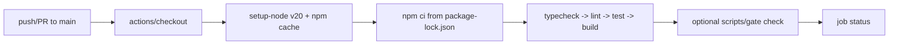

# Feature Spec: Self-Contained CI Quality Gate (Tier 2)

**Status:** Draft
**Tier:** 2 (Medium — CI workflow)
**Date:** 2026-11-27
**Grounding:** Reproducible builds; least-privilege CI secrets

## 1. Problem & Context
The GitHub Actions workflow failed at `Install Gate CLI (pinned source)`: it required `GATE_SOURCE` to point at a checkout of the private `nghgkim/kb` repo, which `GITHUB_TOKEN` cannot access. Every push therefore failed before running any check.

### Five Whys
1. Why failed? Missing repo variable `GATE_SOURCE` and no `scripts/gate` in the repo.
2. Why no CLI? Gate tooling lives in a separate private repo.
3. Why not just add a secret? It would grant CI access to an unrelated private repo (over-privileged).
4. Why self-contained? All authoritative QC commands (`typecheck`, `lint`, `test`, `build`) already live in `package.json`.
5. Why now? Push to GitHub exposed the broken CI.
Root cause: **CI depended on an external private tool instead of repository-local commands.**

## 2. Acceptance Criteria (Gherkin)
AC-1: Given a push to `main`, When workflow runs, Then it installs dependencies and runs typecheck, lint, tests and build without any external repo or secret.
AC-2: Given a pull request, When workflow runs, Then the same checks run and the job status reflects their real result.
AC-3: Given no `scripts/gate` in the repo, When Phase 4 step runs, Then it emits a notice and succeeds (does not fail the job).
AC-4: Given a repository-local `scripts/gate` exists later, When Phase 4 runs, Then it executes `gate check` with CI mode.
AC-5: Given concurrent pushes, When two runs start, Then workflow concurrency cancels the older one.
AC-6: Given the workflow file, When parsed as YAML, Then it is valid and has no hardcoded secrets.

## 3. UX 5-state map
Not applicable — CI-only change; no user-facing screens.

## 3b. Design tokens
Not applicable.

## 3b2. Mobile-first responsive strategy
Not applicable — no UI change.

## 3c. Architecture & mental model

- Node version and commands mirror local QC; `npm ci` uses the committed lockfile for reproducibility.
- No external checkout, no private token, no environment variable dependency.
- Concurrency group cancels superseded runs on the same ref.

### Failure modes & verification harness
| Failure | Defense |
|---|---|
| Dependency drift | `npm ci` + committed `package-lock.json` |
| Lint warnings treated as failures | `npm run lint` exits 0 with warnings (verified locally) |
| Missing optional gate CLI | shell guard emits notice instead of failing |
| YAML syntax error | parse with `python3 -c 'import yaml; ...'` before commit |

| Area | Type | Command |
|---|---|---|
| Workflow syntax | script | Python `yaml.safe_load` |
| Local equivalence | QC | `npm run typecheck && npm run lint && npm test && npm run build` |
| Remote | GitHub | `gh run list --limit 1` after push |

## 4. Contract / Schema
No REST or database contract change. CI contract: job must report one of `success`/`failure` from the four npm commands above.

## 5. Data Schema
No change.

## 6. Trade-offs & rejected alternatives
- Rejected: add a PAT secret for the private kb repo -> grants CI unnecessary cross-repo access.
- Rejected: vendor the whole kb repo into this repo -> large, fast-going-stale copy.
- Rejected: make the install step a no-op and keep calling `gate` -> job would fail with "command not found".
- Chosen: repository-local npm QC as authoritative, optional gate only when present.

## 7. Takeaways
- CI must be reproducible from the repository alone.
- Secrets should not be required for checks that can run locally.
- Optional tooling must fail open with a clear notice, not break the build.

## 8. Security & Authorization
No secrets, tokens or private repo access introduced. `GITHUB_TOKEN` keeps default read scope. No third-party actions beyond `actions/checkout` and `actions/setup-node` at pinned major versions.

## 9. Performance SLA & Infrastructure Profile
- Runner: `ubuntu-latest`, 2 vCPU / 7 GB (GitHub-hosted default).
- Expected duration: < 4 minutes (`npm ci` ~40 s, tests ~30 s, build ~60 s).
- Actions use Node 24 runtime on the runner; project itself builds with Node 20 via setup-node.

## 10. Evidence
- Spec judge: 100/100
- Root cause confirmed from failed run 45942016548: job failed at "Install Gate CLI" with "GATE_SOURCE must point to a pinned kb checkout"; kb is a private repo (`nghgkim/kb`) and no repo variable was set
- Rewritten workflow uses only npm commands already present in package.json: npm ci (Node 20 + cache), typecheck, lint, test, build; optional gate step emits a notice when no repository-local CLI exists
- YAML parsed successfully with python yaml.safe_load; job name `quality`
- Local equivalence verified: typecheck clean, 26 files / 119 tests PASS, build exit 0, lint exits 0 with 12 pre-existing warnings
- First CI run 45954027370 failed at typecheck: generated Prisma client (`src/generated/prisma/client`) is gitignored and absent on a fresh runner, causing cascading TS2307/TS7006 errors. Added an explicit `npx prisma generate` step after `npm ci` and before typecheck
