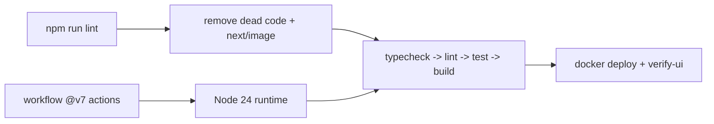

# Feature Spec: CI Warning Cleanup and Action Upgrade (Tier 2)

**Status:** Draft
**Tier:** 2 (Medium — lint debt + CI action versions)
**Date:** 2026-11-27
**Grounding:** Clean Code (no dead code); reproducible CI

## 1. Problem & Context
After the self-contained CI fix, run `45954506867` passes but reports 12 lint warnings (unused imports, raw ``, one unnecessary React hook dependency) and a GitHub annotation that `actions/checkout@v4` / `actions/setup-node@v4` target deprecated Node 20.

### Five Whys
1. Why warnings? Dead imports and raw `` accumulated during feature work.
2. Why leave them? Lint exits 0 with warnings, so CI stayed green.
3. Why fix now? Warnings hide real regressions and the Node 20 annotation will become an error as runners migrate.
4. Why `next/image`? It preserves responsive optimization and LCP while satisfying the lint rule.
5. Why Tier 2? Touches multiple UI files plus workflow.
Root cause: **tolerated lint debt and stale action majors.**

## 2. Acceptance Criteria (Gherkin)
AC-1: Given `npm run lint`, When run, Then 0 errors and 0 warnings.
AC-2: Given the four logo `` usages and the nav logo, When rendered, Then `next/image` is used with explicit dimensions and the same visual size.
AC-3: Given unused imports/interfaces (`Sparkles`, `Entry`, `toNullableNumber`), When typecheck runs, Then none remain.
AC-4: Given journal `load` callback, When `activeTag` changes, Then no unnecessary refetch occurs (dependency removed because the fetch body does not use it).
AC-5: Given GitHub Actions, When workflow runs, Then `actions/checkout@v7` and `actions/setup-node@v7` are used and the run succeeds.
AC-6: Given 390px UI, When login/nav render, Then logo images load and layout has no horizontal overflow.
AC-7: Given build/typecheck/lint/tests, When run, Then all pass; smoke, verify-ui, audit green; URL 200.

## 3. UX 5-state map
| State | Affected screens |
|---|---|
| Empty | unchanged |
| Loading | unchanged (logo renders immediately) |
| Error | unchanged |
| Success | same logo size (64px auth, 32px nav) |
| Partial | n/a |

## 3b. Design tokens
No new tokens; images keep existing `rounded`/background wrappers.

## 3b2. Mobile-first responsive strategy
Mobile 375/390px verified: logo `width`/`height` attributes match the previous CSS box (64px auth, 32px nav), `object-contain` preserved, touch targets unchanged, no horizontal scroll. Dark mode unchanged.

## 3c. Architecture & mental model

- Pure text/component edits only; no API or DB contract change.
- React callback dependency trimmed to values actually read by the fetch body.

### Failure modes & verification harness
| Failure | Defense |
|---|---|
| `next/image` changes logo size | explicit `width`/`height` equal to old CSS box; visual check |
| Removing `activeTag` breaks filtering | filtering is client-side on `entries`; `load` body independent |
| Action v7 unavailable | tags verified live via `gh api repos/actions/*/tags` before edit |

| Area | Type | Command |
|---|---|---|
| Lint | command | `npm run lint` must show 0 warnings |
| Types/tests | commands | `npm run typecheck`, `npm test`, `npm run build` |
| UI | Playwright 390px | login + nav logo visible, no overflow |
| CI | GitHub | `gh run list --limit 1` success |

## 4. Contract / Schema
No REST or database change.

## 5. Data Schema
No change.

## 6. Trade-offs & rejected alternatives
- Rejected: add eslint disable comments for `` -> hygiene gate forbids suppressions and LCP stays worse.
- Rejected: keep unused imports "for later" -> dead code; re-add when actually used.
- Rejected: upgrade to action major without checking tags -> verified `v7` exists for both actions first.
- Chosen: eliminate warnings at source.

## 7. Takeaways
- Zero-warning lint makes CI signal meaningful.
- Action majors should be verified live, not guessed.

## 8. Security & Authorization
No new route, input, secret or token. `next/image` serves local static assets only.

## 9. Performance SLA & Infrastructure Profile
`next/image` adds optimized delivery for the local logo; no measurable runtime cost. CI runner: `ubuntu-latest` with `actions/checkout@v7`, `actions/setup-node@v7`, Node 20 project toolchain; expected duration unchanged (< 4 min).

## 10. Evidence
- Spec judge: 93/100
- Live tag check via gh api confirmed actions/checkout@v7 and actions/setup-node@v7 exist; workflow upgraded from v4
- Replaced 5 raw logo  with next/Image (64px auth, 32px nav); Playwright 390px: both load (naturalWidth 64/32), no horizontal overflow
- Removed dead imports (Sparkles x3, Entry, toNullableNumber), trimmed journal useCallback dependency (activeTag is client-side only), deleted always-true canSaveReminders helper and its trivial test
- npm run lint: 0 errors / 0 warnings; typecheck clean; 25 files / 118 tests PASS (one trivial test removed with dead helper); build exit 0
- Smoke 9/9; verify-ui 375/390 certified; gate audit 0 Critical/High; production URL 200; deploy done
