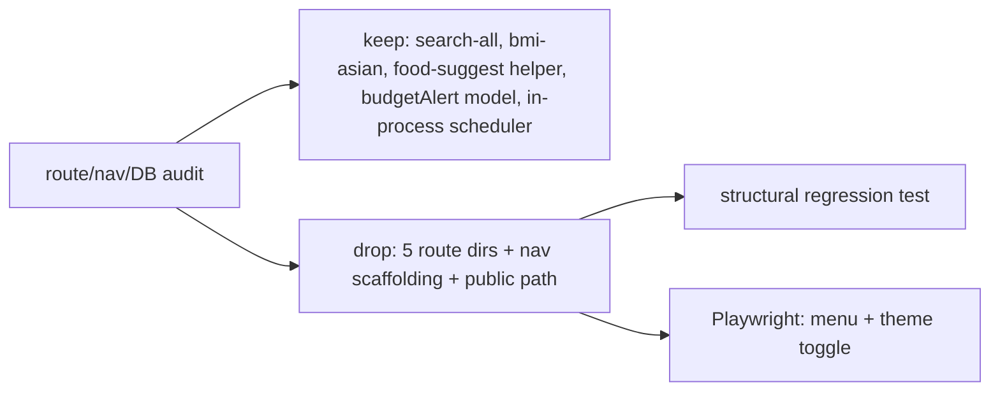

# Feature Spec: Dead Feature Cleanup (Tier 2)

**Status:** Draft
**Tier:** 2 (Medium — removes 5 endpoints, nav dead code, one public-path entry)
**Date:** 2026-11-26
**Grounding:** YAGNI / simple design; OWASP least privilege (no cross-user reads)

## 1. Problem & Context
An audit of routes, nav and production DB found code that is either unreachable or actively unsafe:
- `src/components/Nav.tsx`: `primary = []` plus a `"Giao diện"` group with `items: []` — dead structures.
- `/api/foods/suggest`, `/api/nutrition/bmi`, `/api/nutrition/rich`, `/api/budget/alerts`, `/api/reminders/tick` have no UI caller (only old specs/tests reference them).
- `/api/nutrition/rich` maps `iron` and `calcium` to `calories` — wrong data, not merely unused.
- `/api/budget/alerts` calls `budgetAlert.findMany()` with no `userId` filter — any authenticated user can read every user's alerts.
- `/api/reminders/tick` is a third trigger for the same reminder job already served by `instrumentation.ts` and the container's `/api/auth/me` ping.

### Five Whys
1. Why dead endpoints? Features were added spec-first, then superseded (autofill moved to `search-all`, BMI moved client-side) without removal.
2. Why risky? An unused endpoint still owns an auth route and can leak data (`budget/alerts`).
3. Why wrong data survived? `nutrition/rich` was never rendered in UI, so nobody saw the `iron→calories` mapping.
4. Why nav dead code? The header was simplified to logo + one menu; the old primary/group scaffolding was left behind.
5. Why now? Owner approved cleanup after the audit.
Root cause: **superseded features were never retired, leaving attack surface and misleading code.**

## 2. Acceptance Criteria (Gherkin)
AC-1: Given the five retired endpoints, When cleanup completes, Then their route directories no longer exist and a structural test fails if any reappears.
AC-2: Given the audit, When cleanup completes, Then no source file imports or fetches a retired endpoint.
AC-3: Given `src/middleware.ts`, When cleanup completes, Then `PUBLIC_PATHS` no longer contains `/api/reminders/tick`; `/login`, `/register`, `/api/auth` remain public.
AC-4: Given the nav menu, When opened, Then no empty group header is rendered, no `primary` dead array remains, and the dark-mode toggle is still reachable.
AC-5: Given add-food autofill, When user types a name, Then results still load via `/api/foods/search-all` (the retired `suggest` endpoint is not needed).
AC-6: Given an authenticated user, When they call any formerly-retired path, Then it is no longer an application route (404 from the app; middleware still protects other paths).
AC-7: Given build/typecheck/lint/tests, When run, Then all pass; smoke, `verify-ui` and `gate audit` remain green; production URL returns 200.

## 3. UX 5-state map
| State | Nav menu |
|---|---|
| Empty | n/a — menu always has destinations |
| Loading | unchanged |
| Error | unchanged |
| Success | grouped items + theme toggle + user/logout, no empty headers |
| Partial | n/a |

## 3b. Design tokens
Unchanged; only removal of empty group headers.

## 3b2. Mobile-first responsive strategy
- Target widths 375px and 390px verified by `scripts/verify-ui.py` and Playwright; desktop 768px+ uses the same menu component with no separate markup.
- Menu toggle keeps `min-h-11` (44px) touch target; each destination row keeps `px-3 py-2` (approx 44px).
- The menu panel uses `max-h-[calc(100vh-100px)] overflow-y-auto` and `w-52`; with empty headers removed, no extra scroll or horizontal overflow is introduced at 375px.
- Theme toggle stays at 44px row height with `active:scale-[0.98]`; dark-mode `dark` class toggles on `<html>` and is verified after click.
- No new color/border tokens; badges, dividers and focus rings reuse existing `border/`, `muted/` and `ring` classes.

## 3c. Architecture

- Keep `src/lib/food-suggest.ts` (still used by `search-all/route.ts` and `foods/page.tsx`), `src/lib/bmi-asian.ts` (used by profile), `BudgetAlert` model (schema unchanged), and both working reminder triggers.
- Remove the `getBmi` import and assertion from `tests/routes-validation.test.ts`; add `tests/dead-endpoints.test.ts` asserting absent route files and absent middleware public entry.
- `Nav.tsx`: delete `primary` and its render loop; replace the empty `"Giao diện"` group with the theme toggle rendered directly in the menu above the user/footer block.

### Verification harness
| Area | Type | Command |
|---|---|---|
| Structural | unit (TDD) | `npm test -- tests/dead-endpoints.test.ts` |
| Validation suite | unit | `npm test -- tests/routes-validation.test.ts` |
| UI | Playwright | open menu: no empty header, theme toggle present and toggles `dark` class |
| Regression | full | build/typecheck/lint/test/smoke + verify-ui + gate audit |

### Failure modes
- Theme toggle lost during removal -> Playwright asserts its presence and click effect.
- A removed endpoint still referenced by a client -> grep audit across `src`; typecheck catches imports.
- Middleware over-opened -> `PUBLIC_PATHS` assertion plus existing smoke auth checks.

## 4. Contract (REST)
Removed (no replacement): `GET /api/foods/suggest`, `GET /api/nutrition/bmi`, `GET /api/nutrition/rich`, `GET /api/budget/alerts`, `GET /api/reminders/tick`.
Unchanged and authoritative: `GET /api/foods/search-all`, `/api/goal`, profile's client-side BMI, `/api/auth/me` cron tick.

## 5. Data Schema
No schema change. No migration. No data deletion — `BudgetAlert` rows remain in DB but no longer readable via an unscoped endpoint.

## 6. Trade-offs & rejected alternatives
- Rejected: keep `nutrition/rich` and fix the field map -> no UI consumer; YAGNI says delete.
- Rejected: scope `budget/alerts` to `userId` and keep it -> still no consumer; deletion removes the leak and the route.
- Rejected: restructure cron to a single dedicated tick endpoint -> larger change; two existing triggers are deduped by `ReminderLog` and work. Kept out of scope.
- Rejected: remove `food-suggest.ts`/`bmi-asian.ts` helpers -> still used by live features.

## 7. Takeaways
- Superseded features should be retired, not left dormant.
- Unused endpoints are still attack surface.
- Removing dead UI scaffolding must not remove the live control that lived beside it (theme toggle).

## 8. Security & authorization
Deletes an endpoint that returned cross-user budget alerts (OWASP least privilege). No new route or input path. Middleware public-path list shrinks.

## 9. Performance SLA
No runtime path added; fewer routes compiled. No measurable regression.

## 10. Evidence
- Spec judge: 100/100 (after adding mobile-first strategy: 375/390px, 44px touch, no new tokens); gate check major PASS
- Canonical spec docs/specs/nutrition-tracker.md raised 63 -> 100 with Mermaid mental model, architecture/concurrency boundaries and trade-offs; required to unblock gate check
- TDD red->green: tests/dead-endpoints.test.ts failed 8/8 before cleanup, passed after; routes-validation.test.ts BMI import/assertion removed; 25 files / 109 tests PASS
- Removed route dirs: foods/suggest, nutrition/bmi, nutrition/rich, budget/alerts, reminders/tick; middleware PUBLIC_PATHS no longer contains the cron tick
- Nav: dropped empty primary array and empty "Giao diện" group; theme toggle moved above the user/logout footer and still reachable; Playwright 390px menu shows 4 real groups + "Chế độ tối", click toggles html.dark, no horizontal overflow
- Production check: nutrition/bmi, nutrition/rich, budget/alerts, reminders/tick return 404; foods/suggest GET returns 405 via the dynamic /api/foods/[id] route (no suggestion behavior)
- gate audit initially flagged two CRITICAL SEC-05 false positives on regex .exec(); replaced with String.match() in src/lib/request-validation.ts (no suppression tags) -> ZERO-TRUST AUDIT PASSED, 0 Critical/High
- verify-ui: authenticated storage state + --states empty,loading + mobile-first viewports 375x667/390x844 -> PASS, certified on both
- Build/typecheck/lint PASS; smoke 9/9; production URL 200
