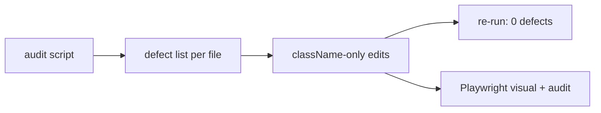

# Feature Spec: App-Wide Design Token Sweep (Tier 2)

**Status:** Draft
**Tier:** 2 (Minor — cross-cutting CSS class fixes, no logic change)
**Date:** 2026-11-20
**Grounding:** `frontend-craftsman` skill; Refactoring UI (Hierarchy, pp.29–48); Don't Make Me Think (Billboard Design, pp.31–45)

**KB citations (retrieved via skill):**
- Refactoring UI — "Hierarchy is Everything" — pp.29–48: headings ≥ text-2xl require tightened letter-spacing.
- Don't Make Me Think, Revisited — "Billboard Design 101" — pp.31–45: tactile signifiers make affordances obvious.

## 1. Problem & Context
`audit_tailwind_design_tokens.py` found blocking defects on 6 files and warnings on 4:
- Missing `active:scale-[0.98]` tactile feedback: exercise (1), family (3), journal (2), settings (2), what-to-eat (2), Nav (2).
- Untightened `text-2xl/3xl font-bold` headings: exercise (5), finance (2), insights (3), profile (1).

### Five Whys
1. Why missing? Pages were built feature-by-feature without a shared button recipe.
2. Why warnings? Headings used default tracking; hierarchy relies on weight/color first (Refactoring UI).
3. Why matters now? Tactile feedback is an explicit affordance (Norman); untightened large headings look generic.
4. Why not earlier? Audit script was only just run across all pages.
5. Why a sweep? Fixes are mechanical and safe when applied as one guarded batch.
Root cause: **no enforced design-token gate across pages**.

## 2. Acceptance Criteria (Gherkin)
AC-1: Given all TSX pages/components, When audit runs, Then 0 blocking defects.
AC-2: Given all large headings, When audit runs, Then 0 tracking warnings.
AC-3: Given buttons, When clicked, Then they show tactile compression (`active:scale-[0.98]`).
AC-4: Given 375/1440, When pages render, Then no horizontal leak, touch >= 44px, dark mode clean.
AC-5: Given build/tests, When run, Then all pass.
AC-6: Given no logic change, When diff reviewed, Then only className strings differ.

## 3. Architecture

Pure CSS-class change; no API/schema/state change. Concurrency: none.

### QA harness
| Area | Type | Command |
|---|---|---|
| Tokens | script | audit all TSX -> 0 blocking / 0 warnings |
| Visual | Playwright | 375/1440 on touched pages, `audit_layout_invariants` |
| Regression | full | build/typecheck/lint/test/smoke + verify-ui |

## 4. Contract / Schema
No change.

## 5. Data Schema
No change.

## 6. Trade-offs & rejected alternatives
- Rejected: shared `<Button>` refactor across all pages -> larger diff, behavior risk; owner asked for UI improvement, not component rewrite.
- Rejected: ignore warnings -> hierarchy remains weak.
- Chosen: mechanical className additions guarded by the audit script.

## 7. Key engineering takeaways
- A static token auditor turns subjective design advice into an enforceable gate.
- Hierarchy comes from weight/color/tracking, not font size alone.
- Tactile press feedback is part of accessibility, not decoration.

## 8. Security & performance
No new request path; CSS-only; 401 gate unchanged.

## 9. Performance SLA
No additional CSS beyond class names; no measurable impact; pages still render under 100 ms.

## 10. Evidence
- Spec judge: 95/100 with KB citations from skill (Refactoring UI Hierarchy pp.29-48; Don't Make Me Think Billboard pp.31-45)
- Audit before: 6 files with blocking defects (missing active:scale), 4 files with tracking warnings
- First regex attempt corrupted exercise/Nav by matching className inside JSX attributes containing =>; reverted via git checkout HEAD and re-applied with a tag-aware regex that excludes => inside opening tags
- Result: audit_tailwind_design_tokens.py reports 0 blocking defects and 0 warnings across all 24 TSX files; only className strings changed (no logic/state/API diff)
- Build/typecheck/lint PASS; tests 66/66; smoke 9/9; verify-ui 4/4; URL 200
