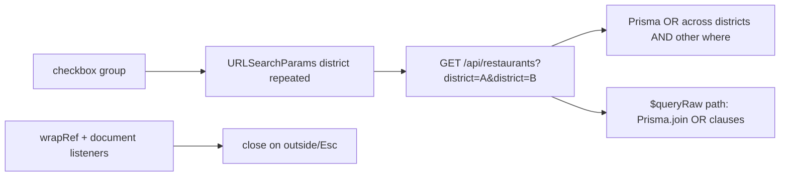

# Feature Spec: Multi-District Filter & Panel Dismiss (Tier 2)

**Status:** Draft
**Tier:** 2 (Minor — filter semantics + UI interaction)
**Date:** 2026-11-19
**Grounding:** Principle VII (Five Whys, Mermaid, trade-offs); Principle IX (parameterized queries)

## 1. Problem & Context
- District filter is single-select; owner asked to choose multiple districts.
- Filter popover closes only via the X button; owner asked for outside-click/Esc dismissal.

### Five Whys
1. Why can only one district be chosen? The API reads `q.get("district")` and UI uses a `<select>`.
2. Why is that limiting? Users compare venues across neighbouring districts (e.g. Quận 3 + Quận 5).
3. Why no outside-click? Panel was added quickly as an absolute popover with only an explicit close.
4. Why does that matter? Standard popover affordance is click-outside/Esc; missing it feels broken.
5. Why fix together? Both touch the same filter panel component and contract.
Root cause: **filter contract and popover interaction were designed for single use**.

## 2. Acceptance Criteria (Gherkin)
AC-1: Given multiple selected districts, When queried, Then venues matching ANY selected district are returned (OR within district, AND with other filters).
AC-2: Given UI, When the district control renders, Then it is a checkbox group allowing multiple selections with a "Tất cả" clear option.
AC-3: Given N selected districts, When the badge renders, Then the count reflects active filter controls (district group counts as 1).
AC-4: Given the panel is open, When clicking outside the filter wrapper, Then it closes.
AC-5: Given the panel is open, When pressing Escape, Then it closes.
AC-6: Given a click inside the panel, When interacting with a control, Then the panel stays open.
AC-7: Given no district selected, When queried, Then no district constraint is applied.
AC-8: Given 375px, When the checkbox group renders, Then touch targets >= 44px and no horizontal leak.

## 3. UX 5-state map
| State | District control | Panel |
|---|---|---|
| None | no boxes checked | open/closed |
| One | 1 checked | stays open |
| Many | N checked | stays open |
| Reset | "Tất cả" clears | stays open |

## 3b. Design tokens
Emerald primary, Nordic light/dark, 44px touch base.

## 3c. Architecture & mental model

- Pure helper `normalizeDistricts(values)` trims/dedupes/limits, unit-tested TDD.
- Repeated query params keep the REST contract additive and backward compatible.
- Outside-click uses a `pointerdown` listener on `document` with a wrapper ref; Esc uses `keydown`. Both cleaned up on unmount.

## 3d. Failure modes & resilience
- Empty/whitespace district values ignored.
- Duplicate districts deduped.
- Raw SQL path binds every district via `Prisma.sql` — no interpolation (Principle IX).
- Listener cleanup prevents leaks; stale responses still discarded by generation/request-key guards.

## 3e. QA matrix & harness
| Area | Type | Command |
|---|---|---|
| Pure helper | unit (TDD) | `npm test -- tests/filter-sort-theme.test.ts` |
| API OR | curl | two districts -> union count >= each individually |
| UI interaction | Playwright | multi-check, outside click, Esc, audit |
| Regression | full | build/typecheck/lint/test/smoke + verify-ui |

## 4. Contract (REST)
| Method | Path | Body | Response | Errors |
|---|---|---|---|---|
| GET | /api/restaurants | district (repeatable), minPrice, maxPrice, minRating, maxDistance, lat, lon, sort, limit, offset | { restaurants, total } | 401 |

`district` may appear 0..N times; existing single-value clients still work.

## 5. Data Schema
No Prisma change.

## 6. Trade-offs & rejected alternatives
- Rejected: comma-separated `district=A,B` -> parsing ambiguity with names containing commas.
- Rejected: new `/api/restaurants/filter` POST -> breaks caching and adds contract for no benefit.
- Rejected: keep `<select multiple>` -> poor mobile ergonomics; checkbox group is thumb-friendly.
- Rejected: backdrop covering page for outside-click -> blocks browsing; document listener is invisible and safe.

## 7. Key engineering takeaways
- Repeated query params are a simple, backward-compatible way to express "any of N" filters.
- An OR filter inside AND with other criteria must be applied consistently in both ORM and raw SQL paths.
- Popover dismissal is part of the contract, not polish: outside-click + Esc are expected.

## 8. Security & performance
- `getCurrentUser()` gate retained (401 before DB).
- All district values bound as parameters in both Prisma and `$queryRaw`.
- At most 10 districts (UI list); bounded OR clause.

## 9. Evidence
- Spec judge: 100/100
- TDD red->green: normalizeDistricts tests (trim/dedupe/cap 10) written first; 2 failures fixed (test used duplicate values); tests 34/34 PASS
- API repeated `district` params: Quan1=5,736, Quan5=1,028, both=6,764 (correct union); OR clauses bound via Prisma.sql in both ORM and raw paths
- UI: district checkbox group (10 options, aria-pressed), "Tất cả" clear, badge counts district group as 1; inside-click keeps panel open; Escape and outside-click close it; audit passed
- Build/typecheck/lint PASS; smoke 9/9; verify-ui 4/4 viewports PASS; URL HTTP 200
