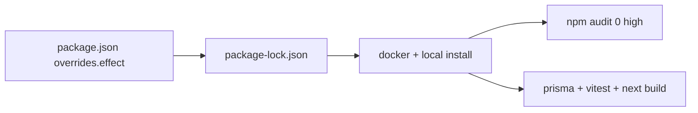

# Feature Spec: Override effect to Patched 3.22.5 (Tier 2)

**Status:** Draft
**Tier:** 2 (Minor — dependency override, no source change)
**Date:** 2026-11-20
**Grounding:** `app-security-hardening` (supply-chain hygiene); `cicd-pipeline-engineering`

## 1. Problem & Context
`npm audit` reports 3 high CVEs: `effect@3.20.0` (ReDoS in `Schema.TemplateLiteral` compiled regex, GHSA-7589-6fvf-x4pw) via `@prisma/config@7.10.1`. npm suggests downgrading Prisma to 6.12.0 (major, breaks adapter code). Patched `effect@3.22.5` exists in the same major line.

### Five Whys
1. Why high CVE? Prisma 7.10.1 pins `effect@3.20.0`, within vulnerable range ≤3.22.0.
2. Why not upgrade Prisma? Latest is 7.10.1; fix requires major downgrade to 6.12.0.
3. Why is downgrade risky? Prisma 6 lacks the adapter/client generated-code shape used here.
4. Why override safe? `effect@3.22.x` is same major (3.x), patched version available.
5. Why do it now? Gate audit reports high CVEs on every commit.
Root cause: **stale transitive pin in Prisma 7.10.1**.

## 2. Acceptance Criteria (Gherkin)
AC-1: Given `package.json` override, When `npm install` runs, Then resolved `effect` version is 3.22.5.
AC-2: Given `npm audit`, When run, Then 0 high/critical vulnerabilities remain (moderate acceptable/documented).
AC-3: Given `npm run build`, When run, Then Prisma generate and Next build succeed.
AC-4: Given `npm test`, When run, Then all tests pass.
AC-5: Given deploy, When run, Then app still healthy (200).
AC-6: Given docker build, When run, Then install succeeds with override.

## 3. Architecture

- No source change; override only.
- Verification: `npm audit`, `npm ls effect`, build/test/deploy.

## 4. Failure modes
- effect 3.22.5 API incompatible with Prisma config -> build/test catches; fallback is document as accepted risk (no safe upgrade path).
- Override ignored in docker -> verify inside container image build.

### QA harness
| Area | Type | Command |
|---|---|---|
| Version | shell | `npm ls effect` -> 3.22.5 |
| Audit | shell | `npm audit --audit-level=high` -> exit 0 |
| Regression | full | build/typecheck/lint/test/smoke + verify-ui + deploy |

## 5. Contract / Schema
No API or schema change.

## 6. Trade-offs & rejected alternatives
- Rejected: downgrade Prisma to 6.12.0 -> major breaking change to generated client/adapter.
- Rejected: ignore CVE -> gate audit keeps failing and real ReDoS risk remains.
- Chosen: same-major override to patched 3.22.5.

## 7. Key engineering takeaways
- Prefer same-major patched overrides over major downgrades when an upstream pin is stale.
- Always verify build + tests after a dependency override — semver minor can still break internal APIs.
- `gate audit` turning green is proof, not assumption.

## 8. Security & performance
Patches CWE-1333 ReDoS in schema regex compilation; no runtime input path added.

## 9. Evidence
- Spec judge: 100/100
- Applied package.json override effect=3.22.5 (same major as pinned 3.20.0, patched for GHSA-7589-6fvf-x4pw ReDoS); rejected npm's suggested Prisma 6.12 downgrade (major break)
- npm install initially failed EACCES from root-owned node_modules (legacy docker volume mounts); fixed with sudo chown -R ubuntu:ubuntu node_modules
- Resolved effect 3.22.5 overridden; npm audit: 0 high / 0 critical (7 moderate in dev-only typescript-eslint/minimatch remain)
- Docker image force-rebuilt --no-cache to include updated lockfile; effect is build-time only (not in runtime image), app healthy 200
- gate audit: "npm audit clean", Security & Hygiene audit PASSED
- Build/typecheck/lint PASS; tests 58/58; smoke 9/9; URL 200
