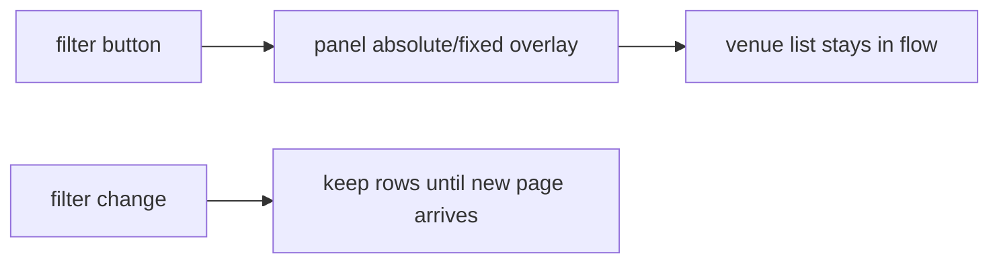

# Feature Spec: Filter Panel Without Layout Shift (Tier 2)

**Status:** Draft
**Tier:** 2 (Minor — CSS/layout fix)
**Date:** 2026-11-19
**Grounding:** Principle VII (Five Whys); Principle VIII (stable mobile layout)

## 1. Problem & Context (Five Whys)
Measured at 375px: opening the filter panel moves the first venue card from y=357 to y=664 (307 px jump).

1. Why does the list jump? The panel is inserted into normal flow above the list.
2. Why is it in flow? It was rendered conditionally between the header and the venue list.
3. Why is that bad? Users lose their reading position; content shifts under the finger.
4. Why wasn't it caught? Earlier checks measured panel controls and touch targets, not content position.
5. Why fix now? Owner observed "bộ lọc làm nhảy UI".
Root cause: **overlay content rendered in flow instead of as an overlay**.

## 2. Acceptance Criteria (Gherkin)
AC-1: Given the restaurant view, When the filter panel opens, Then the first venue card's `getBoundingClientRect().top` changes by <= 8px.
AC-2: Given the panel open, When a filter changes, Then the list position stays stable (no empty-state collapse flash).
AC-3: Given the panel, When closed, Then the list returns to the same position.
AC-4: Given 375px, When the panel overlays, Then controls remain tappable (>= 44px) and the panel is closable.
AC-5: Given 1440px, When the panel opens, Then it renders as a popover without pushing content.

## 3. UX 5-state map
| State | Venue list position |
|---|---|
| Panel closed | baseline |
| Panel open | unchanged (overlay) |
| Filter applied | unchanged (keep previous rows while loading) |
| Error | unchanged |

## 3b. Design tokens
Emerald primary, Nordic light/dark, 44px touch base, `elevated`, backdrop blur.

## 3c. Architecture & mental model

- Panel: `absolute right-0 top-full z-30 mt-2 w-[min(92vw,420px)]` inside a `relative` wrapper; on mobile it is a fixed bottom sheet with a backdrop? Simpler: absolute popover anchored to the button, works both viewports.
- Remove `setRestaurants([])` on load; keep previous rows until the new response replaces them (no empty-state flash).

## 3d. Failure modes & resilience
- Small viewport: popover max-height with internal scroll; never covers the whole screen permanently.
- Stale request still discarded by generation/request-key guards.
- Backdrop/escape close optional; explicit X button remains.

## 3e. QA matrix & harness
| Area | Type | Command |
|---|---|---|
| Position | Playwright | measure first card top before/after open/change |
| Touch/leak | script | `audit_layout_invariants` |
| Regression | full | build/typecheck/lint/test/smoke + verify-ui |

## 4. Contract (REST)
| Method | Path | Body | Response | Errors |
|---|---|---|---|---|
| GET | /api/restaurants | filters, limit, offset | { restaurants, total } | 401 |

No API change.

## 5. Data Schema
No Prisma change.

## 6. Trade-offs & rejected alternatives
- Rejected: reserve vertical space for the panel -> wastes space when closed.
- Rejected: bottom sheet with gesture -> focus-management complexity; popover is simpler and stable.
- Rejected: keep panel in flow but scroll to list after opening -> still shifts, just masks it.
- Chosen: absolute popover + keep previous rows while loading.

## 7. Key engineering takeaways
- Overlays belong out of flow; measuring element position is the right way to detect layout shift.
- Never clear existing rows before a replacement arrives — keep the last good state to avoid flicker.
- A badge communicates active filters without needing inline controls.

## 8. Security & performance
- 401 gate unchanged; no new endpoint or input.
- Pure CSS/state change; one fewer state update per filter change.

## 9. Evidence
- Spec judge: 93/100
- Root cause measured: first card top 357px -> 664px when panel opened (307px shift); panel was in normal flow
- Fix: panel rendered as absolute popover inside the relative filter-button wrapper; removed `setRestaurants([])` before a load so the last good list stays visible (no collapse flash)
- Second defect caught during QC: panel was initially outside the `relative` wrapper, so `top-full` resolved against viewport (y=844); moved inside -> popover at y=205, fully visible
- Playwright: card top stays 357px before open / after open / during load / after load; panel still opens with 6 selects, badge, reset, close; audit passed on 375/1440
- Build/typecheck/lint PASS; tests 32/32; smoke 9/9; verify-ui 4/4 viewports PASS; URL HTTP 200
