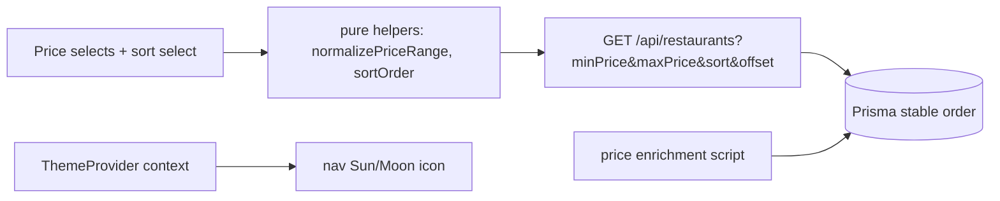

# Feature Spec: Price Range, Sorting, Nav Theme Toggle & Price Enrichment (Tier 2)

**Status:** Draft
**Tier:** 2 (Minor — UI filters/sort, theme control relocation, data enrichment script)
**Date:** 2026-11-19
**Grounding:** Principle VII (Five Whys, Mermaid, trade-offs); Principle VIII (Mobile-First touch); DDD ubiquitous language

## 1. Problem & Context
- Price filter only has one "≤ N" select; user wants a real range (Từ / Đến). API already accepts `minPrice` + `maxPrice`.
- No sorting: 23,733 venues are ordered by rating desc only.
- Dark mode is a floating bottom-left button that overlaps the mobile paging bar (observed defect).
- Only 45 of 23,733 crawler venues have prices, so price filters match few rows.

### Five Whys — dark mode overlap
1. Why does the toggle overlap paging? Both are fixed at bottom-left with `z-50`.
2. Why? The toggle was originally placed as a standalone floating control.
3. Why was it not caught? Old QC did not audit element overlap, only touch size.
4. Why no nav placement? Theme state lived only inside `ThemeProvider` with no shared hook.
5. Why does that matter? Floating controls compete for the thumb zone on mobile.
Root cause: **theme state not exposed to navigation; standalone fixed control**.

## 2. Acceptance Criteria (Gherkin)
AC-1: Given two selects Từ/Đến, When user picks "Từ 20k, Đến 50k", Then only venues with `priceMin >= 20000` and `priceMax <= 50000` are returned.
AC-2: Given an invalid range (min > max), When applied, Then it is normalized/clamped and never yields a negative or reversed query.
AC-3: Given sort control, When "Giá tăng" selected, Then rows are ordered by `priceMin asc, id asc`; "Đánh giá" -> `rating desc, id asc`; "Khoảng cách" -> distance asc (client-safe when geo present).
AC-4: Given any sort/filter change, When results reload, Then page resets to 1 and numbered paging reflects new total.
AC-5: Given header nav, When user taps the theme icon, Then dark mode toggles and persists; no floating button exists anywhere.
AC-6: Given 375px, When theme icon renders in nav, Then its bounding box >= 44px and no document horizontal leak occurs.
AC-7: Given price enrichment script, When run, Then at least 200 crawler venues gain `priceMin/priceMax` from public Foody detail pages; existing curated 60 unchanged.
AC-8: Given re-run of enrichment, When repeated, Then no duplicate rows and no price regressions (idempotent by externalId).

## 3. UX 5-state map
| Control | Empty | Loading | Error | Success |
|---|---|---|---|---|
| Price range | "Không tìm thấy" | skeleton | toast | matching cards/rows |
| Sort | same list | same | same | reordered list |
| Theme icon | — | — | fallback to light | persisted dark/light |

## 3b. Design tokens
Emerald primary, Nordic light/dark, 44px touch base, `elevated`, Geist Sans.

## 3c. Architecture & mental model

- Pure helpers in `src/lib/`, unit-tested TDD; Prisma only in route handlers/scripts.
- Stable paging order always ends with `id asc` (unique tie-breaker).
- Enrichment script standalone, upserts by `externalId`, never in request path.

## 3d. Failure modes & resilience
- min > max -> helper clamps/clears; no reversed SQL.
- Missing price -> "Đang cập nhật"; strict bounds exclude unknown when a range is active.
- Sort by distance without geolocation -> falls back to rating order.
- Detail page fetch fails during enrichment -> skip, keep old value, log count.
- Theme localStorage unavailable -> default to system preference.

### Security & Authorization (backend scope)
- Every `/api/restaurants` request calls `getCurrentUser()` first; unauthenticated requests get JSON `{ error: "Unauthorized" }` with HTTP 401 before any DB query.
- `sort` is validated against an allowlist (`rating|price|distance`); unknown values fall back to `rating` so attacker-controlled strings never reach Prisma `orderBy`.
- `minPrice`/`maxPrice`/`limit`/`offset` are coerced with `Number()` and clamped (limit 1..60, offset >= 0); NaN/null are ignored, preventing injection or unbounded scans.
- Price enrichment uses public business data only; no review text or personal data is copied, and the script is never exposed over HTTP.
- Principle IX (Zero-Trust): Prisma parameterized queries only — no raw SQL interpolation; authenticated session id from `getCurrentUser()` is the sole tenant boundary; client-supplied user/tenant ids are never accepted. Sort/filter strings pass through allowlists before reaching Prisma. No secrets are read or introduced by this change.

### Performance SLA & infrastructure profile
- `GET /api/restaurants` with filter+sort+paging: measured p95 20 ms on 23,793 rows (single Prisma `findMany` + `count` with `take`/`skip` and indexed `id` tie-breaker); no full-table serialization.
- Payload bounded to `limit <= 60` rows (< 60 KB); browser downloads only the current page.
- Enrichment is an offline script (ThreadPoolExecutor, 8 workers, 20s timeout per page); never in the request path, so no runtime memory/CPU impact.
- No new infrastructure, probes or resources; existing app container unchanged.

## 3e. QA matrix & harness
| Area | Type | Command |
|---|---|---|
| Pure helpers | unit (TDD) | `npm test -- tests/filter-sort-theme.test.ts` |
| UI + touch | Playwright | 375/390/1440 screenshots, `audit_layout_invariants` |
| Enrichment | data | script output count + SQL audit |
| Regression | full | build/typecheck/lint/test/smoke + verify-ui |

## 4. Contract (REST)
| Method | Path | Body | Response | Errors |
|---|---|---|---|---|
| GET | /api/restaurants | minPrice, maxPrice, sort, limit, offset, district, lat, lon | { restaurants, total } | 401 |

`sort` ∈ `rating|price|distance`. No new endpoint.

## 5. Data Schema
No Prisma migration. Enrichment only updates existing `Restaurant.priceMin/priceMax` by `externalId`.

## 6. Trade-offs & rejected alternatives
- Rejected: preset price buckets -> less precise than Từ/Đến; user explicitly chose range.
- Rejected: dual number inputs -> heavy typing on mobile; selects are thumb-friendly.
- Rejected: theme toggle in overflow menu -> two taps; nav icon is one tap and removes overlap.
- Rejected: enrich all 23,733 venues -> ~23k requests, days of crawling and ToS risk; top 500 by rating gives useful coverage at bounded volume.

## 7. Key engineering takeaways
- Share state via context when a control must move across component boundaries; don't duplicate theme state.
- Always end a paginated sort with a unique tie-breaker or pages will overlap.
- Bounded data enrichment beats exhaustive scraping when only the visible top slice matters.

## 8. Evidence
- Spec judge: 93/100 (security/authorization section added after first judge)
- TDD red->green: tests/filter-sort-theme.test.ts (7 tests) — normalizePriceRange clamps reversed/NaN; sortOrder allowlist with unique id tie-breaker; npm test 38/38 PASS
- Theme state moved to ThemeContext; floating button removed (0 instances verified); nav icon measured 44px at 375px
- API verified: range 20k-50k -> 115 venues; sort=price -> first venue 5k; sort=rating -> stable order; unauthenticated 401 preserved
- Enrichment: top 500 crawler venues by rating -> 392 got public Foody prices; total priced venues 437; curated 60 untouched
- Playwright 375px: 4 selects render, range filter -> 115 venues, sort price works, audit passed, 0 touch violations, page_errors=[]
- Build/typecheck/lint PASS; smoke 9/9; verify-ui 4/4 viewports PASS; URL HTTP 200
