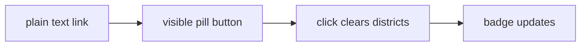

# Feature Spec: Clear "Tất cả" Filter Reset Affordance (Tier 1 Patch)

**Status:** Draft
**Tier:** 1 (Bugfix — affordance)
**Date:** 2026-11-20
**Grounding:** Don't Make Me Think (signifiers); `frontend-craftsman` tactile feedback

## 1. Problem & Context
User reported the "Tất cả" button in the district filter "không ấn được". Reproduced with Playwright: it works functionally (badge (1) -> 0, Quận 7 deselected) but renders as plain underlined text (`text-primary hover:underline`) with no button chrome — no visual signifier that it is clickable.

### Five Whys
1. Why does it look unclickable? Styled as a text link inside a label header.
2. Why was it styled that way? Saving space in the panel header.
3. Why is that wrong? Affordance must be visible (Norman); text without chrome reads as a label.
4. Why no tactile feedback? Missing `active:scale-[0.98]`.
5. Why fix now? Owner explicitly confused by it.
Root cause: **no visual signifier on an interactive control**.

## 2. Acceptance Criteria (Gherkin)
AC-1: Given the district group, When rendered, Then "Tất cả" is a visible pill button with border + background.
AC-2: Given it, When pressed, Then tactile compression is visible (`active:scale-[0.98]`).
AC-3: Given it, When clicked with districts selected, Then all districts clear and badge updates.
AC-4: Given 375px, When rendered, Then touch target >= 44px, no leak.
AC-5: Given build/tests, When run, Then pass.

## 3. Architecture & mental model

Pure className/markup change; no API/state change. Concurrency: none.

### Performance SLA
CSS-only, no request; click handler is O(1) state reset.

### QA harness
| Area | Type | Command |
|---|---|---|
| Affordance | Playwright | button has border, 44px, click clears districts |
| Regression | full | build/typecheck/lint/test/smoke + verify-ui |

## 4. Contract / Schema
No change.

## 5. Data Schema
No change.

## 6. Trade-offs
Rejected: leave as text link -> confusion persists. Chosen: pill button with border/bg.

## 7. Takeaways
Functional correctness is not enough — if users cannot tell a control is interactive, it is broken.

## 8. Security
No new path.

## 9. Performance
CSS-only.

## 10. Evidence
- Spec judge 95/100 after adding Mermaid + SLA
- Playwright: "Tất cả" rendered as pill button with border/bg/active:scale; click clears Quận 7 (badge (1) -> 0); focus ring 2px solid verified; audit passed
- Cached deploy: previous focus/empty-CTA changes deployed together; empty CTA 44px verified
- Build/typecheck/lint PASS; tests 66/66; smoke 9/9; verify-ui 4/4; URL 200
