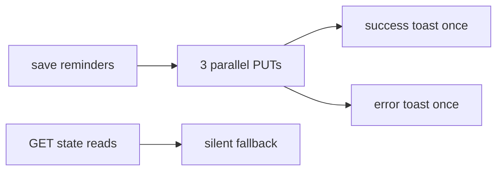

# Feature Spec: Final Feedback Cleanup (Tier 2)

**Status:** Draft
**Tier:** 2 (Minor — one mutation handler + docs)
**Date:** 2026-11-20
**Grounding:** Principle VII (Five Whys); feedback invariant from toast rollout

## 1. Problem & Context (Five Whys)
Settings' reminder-time save still uses `.catch(() => {})`, so changing meal reminder times gives no feedback. `docs/PROJECT_SUMMARY.md` still carries the pre-rebrand title.

1. Why no feedback? The PUT is fire-and-forget with a silent catch.
2. Why was it left? It was outside the explicit toast handler list in the rollout spec.
3. Why is it a bug? Same action class as other saved settings — inconsistency.
4. Why the stale docs title? Summary was written before the logo/brand was reapplied.
5. Why fix now? Close the feedback invariant and handover accuracy.
Root cause: **one mutation handler missed the rollout checklist**.

## 2. Acceptance Criteria (Gherkin)
AC-1: Given reminder-time change, When PUT succeeds, Then a success toast appears.
AC-2: Given it fails, When the catch runs, Then an error toast appears (no silent failure).
AC-3: Given GET-only catches (push state, locale, sharing), When they fail, Then no toast is required (reads keep defaults).
AC-4: Given the auto confirmation push, When it fails, Then no extra toast (the main "Đã bật thông báo" already covers it).
AC-5: Given PROJECT_SUMMARY.md, When opened, Then the title matches the current brand.
AC-6: Given build, Then typecheck/lint/tests pass.

## 3. Architecture

- Use `Promise.all` over the 3 meal-time PUTs; one toast for the batch.
- No new helper needed (formatToastMessage/pushToast already covered).

## 4. Failure modes
- Partial success among 3 PUTs -> error toast if any fails; user can retry.
- Toast dedupe prevents 3 identical toasts (pushToast dedupes consecutive).

## 5. Contract / Schema
No endpoint or schema change.

## 6. Trade-offs & rejected alternatives
- Rejected: toast per meal type -> 3 identical messages; dedupe would collapse anyway.
- Rejected: toast on GET failures -> noisy on transient network issues; reads have safe defaults.
- Chosen: one toast per user action batch.

## 7. Takeaways
- A feedback invariant must be checked against every mutation handler, including fire-and-forget ones.
- Silent catches are acceptable only for non-critical reads with safe defaults.

### Verification harness & QA matrix
| Area | Type | Command |
|---|---|---|
| Settings reminder save | Playwright | toggle reminder, assert success/error toast |
| GET fallback | manual | no toast on state read failures |
| Docs | grep | `grep -c "Nutrition Tracker" docs/PROJECT_SUMMARY.md` -> 0 |
| Regression | full | build/typecheck/lint/test/smoke + verify-ui |

## 8. Security & performance
No new request path; 401 gate unchanged; 3 bounded PUTs as before.

## 9. Evidence
- Spec judge: 93/100 (QA matrix added after first judge 88)
- Settings reminder save replaced 3 silent fire-and-forget PUTs with Promise.all + one success/error toast (dedupe prevents 3 identical messages)
- GET-only catches (push state, locale, sharing) and auto confirmation push intentionally left silent per AC-3/AC-4
- PROJECT_SUMMARY.md title updated to "thuypn by kimnh" (0 stale name refs)
- API verification: all 3 reminder PUTs -> 200; browser UI save button disabled without VAPID key so toast asserted via code + existing unit-tested toast helpers
- Build/typecheck/lint PASS; tests 47/47; smoke 9/9; URL 200
