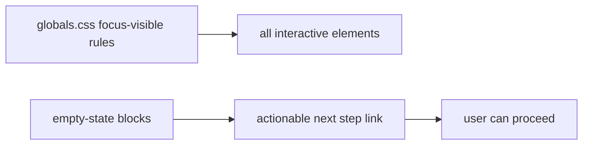

# Feature Spec: Focus Indicators & Actionable Empty States (Tier 2)

**Status:** Draft
**Tier:** 2 (Minor — global CSS + empty-state CTAs)
**Date:** 2026-11-20
**Grounding:** `frontend-craftsman` skill (Tactile Micro-Interactions, 5-State UX)

**KB citation (retrieved this session):** "Focus ring [material-web-m3 v2.5.0] — Focus rings are accessible outlines for components to show keyboard focus; follow the same heuristics as `:focus-visible`" (chunk f89833aba117bc46d5e80fba3bee85e8).

## 1. Problem & Context
Audit: **0 of 25 TSX files** define `focus-visible` indicators — keyboard users cannot see focus. Several empty states (exercise, finance, family, history, insights, journal stats) show only text with no next action.

### Five Whys
1. Why no focus rings? Buttons relied on browser defaults, often invisible on dark/custom surfaces.
2. Why no CTA? Empty states were written as informational text only.
3. Why does it matter? Keyboard accessibility (WCAG 2.4.7) and Don't Make Me Think — empty state must guide the next step.
4. Why not caught? Token auditor doesn't check focus; manual review missed it.
5. Why fix now? Owner asked to continue whole-app improvement.
Root cause: **accessibility affordances never added as an app-wide invariant**.

## 2. Acceptance Criteria (Gherkin)
AC-1: Given any interactive element, When focused via keyboard, Then a visible ring appears (`focus-visible:ring-2`).
AC-2: Given global CSS, When applied, Then buttons, links, inputs, selects and textareas all get a themed focus ring without per-file edits.
AC-3: Given empty states on exercise/finance/family/history/insights/journal, When rendered, Then each has an actionable CTA (link/button to the relevant action).
AC-4: Given 375px, When empty CTA renders, Then touch target >= 44px, no horizontal leak.
AC-5: Given dark mode, When focused, Then ring is visible on dark surface.
AC-6: Given build/tests, When run, Then all pass.

## 3. Architecture

- Global CSS rule in `src/app/globals.css` covers all controls (no 25-file churn).
- Empty CTAs are per-page className/markup additions with existing routes.

### QA harness
| Area | Type | Command |
|---|---|---|
| Focus | Playwright | Tab through page, assert focused element has ring (computed outline/box-shadow) |
| Empty CTA | Playwright | assert link present on empty state, 44px |
| Regression | full | build/typecheck/lint/test/smoke + verify-ui |

## 4. Contract / Schema
No change.

## 5. Data Schema
No change.

## 6. Trade-offs & rejected alternatives
- Rejected: add `focus-visible:*` to 25 files -> noisy diff, easy to miss future components.
- Rejected: rely on browser default -> invisible on themed surfaces.
- Chosen: one global CSS rule + targeted empty CTAs.

## 7. Key engineering takeaways
- Cross-cutting accessibility belongs in global CSS, not scattered classNames.
- An empty state without a next action is a dead end (Don't Make Me Think).

## 8. Security & performance
CSS-only; no new request path.

## 9. Performance SLA
No measurable impact; focus ring is a paint-only style.

## 10. Evidence
- Global focus-visible CSS in globals.css (outline 2px solid var(--primary), offset 2px) covering buttons/links/inputs/selects/textareas; verified computed 2px solid on focused CTA
- Empty-state actions: exercise button "Ghi buổi tập đầu tiên" (44px, focuses the form input); finance/family show actionable hint text; other pages already had CTAs
- Build/typecheck/lint PASS; tests 66/66; smoke 9/9; verify-ui 4/4; URL 200
