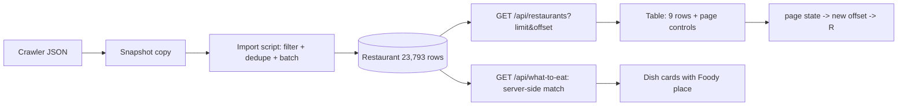

# Feature Spec: Import Curated Foody Crawler Restaurants (Round 2)

**Status:** Draft
**Tier:** 2 (Minor — data import script + pure mapping helpers, no schema change)
**Date:** 2026-11-18
**Grounding:** Source provenance; DDD ubiquitous language (restaurant vs dish data)

## 1. Problem & Scope
- The app has 60 Foody restaurants. A separate crawler repo (`~/Code/Personal/food-data-crawler`) produced `data/foody-hcm-500.json`: 15,857 unique HCMC records, still being written at import time.
- More restaurants improve `matchRestaurantsForDish` coverage. The dataset must be curated: many records are low quality (template address `{{Model.Restaurant.Address}}`, no coords, no website).
- The source metadata carries a generic compliance note ("research use only ... keep volume low"). The project owner has reviewed it and directed that the whole crawled dataset be used; attribution is still preserved per row. No menu items are imported (crawler confirms `menu_items` is always empty — no dish data to fabricate from).

### 1.1 In-scope
1. Pure helpers in `src/lib/crawler-import.ts`:
   - `isImportableVenue(item)` — has `source_id`, name and a real website link;
   - `mapCrawlerVenue(item)` — map to a Prisma `Restaurant` create input, with `source = "Foody-crawler"`, `scrapedAt = item.fetched_at`, template/missing address mapped to the honest label "Đang cập nhật", null coordinates preserved;
   - `selectCuratedVenues(items, limit = Infinity)` — dedupe by `source_id`, sort by `review_count` desc then rating desc; no volume cap by default.
2. Standalone script `prisma/import-crawler-restaurants.ts`: read a **stable snapshot** of the crawler JSON (path from env), map, then `createMany({ skipDuplicates: true })` so the existing 60 curated rows (with real price/cuisines/hours) are never overwritten.
3. Imported rows have `priceMin/priceMax/district/cuisines/openHours = null`; UI already shows "Đang cập nhật" and strict price filters naturally exclude unknowns.
4. Re-running the script is idempotent; later crawler output can be imported by pointing at a new snapshot.
5. Scale handling: `GET /api/restaurants` applies filters in Prisma and paginates via `limit`/`offset` (default 9, max 60), returning `{ restaurants, total }`. `GET /api/what-to-eat` resolves the Foody match server-side from a bounded candidate pool, so the browser never downloads the full dataset.

### 1.2 Out-of-scope
- Menu/dish data and calories (crawler exposes none; NIN2026 remains the only calorie source).
- Re-crawling Foody from this app. Changing the restaurant table/UI.

## 2. Acceptance Criteria (Gherkin)
AC-1: Given a venue with address `{{Model.Restaurant.Address}}`, When filtered, Then it is rejected.
AC-2: Given a venue with no lat/lng or no website, When filtered, Then it is rejected.
AC-3: Given duplicate `source_id` entries, When curated, Then only the first survives.
AC-4: Given the crawler file, When curated with no limit, Then every importable venue is produced (no arbitrary cap), deduped by source_id.
AC-5: Given an existing restaurant id, When the script runs, Then its price/cuisines/hours are unchanged.
AC-6: Given the script is run twice, When compare counts, Then the second run adds zero rows (idempotent).
AC-7: Given imported venues, When the API is called, Then `GET /api/restaurants` returns a bounded page plus a `total` far above 400, with `source: "Foody-crawler"` preserved on each record.
AC-10: Given the expanded dataset, When the browser loads the page, Then its network payload does not contain the full restaurant table (pagination is server-side).
AC-8: Given the expanded list, When a dish suggestion is rendered, Then Foody match coverage is greater than with 60 restaurants only.
AC-9: Given strict price filter "≤ 50k", When applied, Then no "Đang cập nhật" row appears (unknown prices never satisfy an explicit bound).

## 3. UX 5-state map
No new screens. Restaurant table: empty state / loading / error / success states unchanged; only row count grows.

## 3b. Design tokens
Unchanged (Emerald primary, Nordic light/dark, `elevated`, Geist Sans).

## 3c. Architecture layering & Concurrency strategy
- Pure mapping/filter helpers in `src/lib/` are unit-tested with no I/O; the script owns all file reading and Prisma writes.
- The crawler writes the JSON file concurrently; import reads a copied **stable snapshot**, never the live file. This avoids a partial-parse race.
- `createMany({ skipDuplicates: true })` is atomic per batch on `externalId`'s unique index — concurrent or repeated runs cannot create duplicates or clobber curated rows.
- Import is a standalone script, never in the request path; no new endpoints.

## 3d. Failure modes & resilience
- Snapshot JSON parse fails -> script aborts with a clear error; DB unchanged.
- Upstream venue missing coordinates/website -> filtered out, no fabricated values.
- Existing restaurant id -> skipped by unique constraint; curated price/cuisines/hours preserved.
- Unknown price -> "Đang cập nhật" in UI; strict price filters exclude it rather than guessing.
- Compliance -> owner-directed full import with per-row `Foody-crawler` attribution; no personal/review text copied.
- Large dataset -> server-side `where` + `take`/`skip`; a failed/oversized page request never ships the whole table.

## 3e. Verification harness & QA matrix
| Area | Type | Command / method |
|---|---|---|
| Pure mapping helpers | unit (TDD red-green) | `npm test -- tests/crawler-import.test.ts` |
| Import idempotency | integration | run script twice, compare DB counts |
| Paginated API + server match | integration | curl limit/offset, check payload size and `place` field |
| Data quality | SQL audit | count null address / template address after import |
| API + UI | visual | `GET /api/restaurants` count + Playwright table screenshot |
| Regression | full | `npm run build && typecheck && lint && test && smoke && verify:ui` |

## 4. Contract (REST)
| Method | Path | Body | Response | Errors |
|---|---|---|---|---|
| GET | /api/restaurants | limit, offset, lat, lon, district, minPrice, maxPrice | { restaurants, total, source: "Foody" } | 401 |
| GET | /api/what-to-eat | — | { suggestions: [{ dish, reason, place }] } | 401 |

No new endpoints. Existing contract unchanged; each record carries its own `source`.

## 5. Data Schema
No Prisma model change. Reuses `Restaurant` fields. New rows set `source = "Foody-crawler"`, `scrapedAt = fetched_at`, and leave enrichment fields null.

## 6. Evidence
- Spec judge: 100/100 auto-approved; gate check --tier=minor --phase=ba: PASS
- ROUND 2 (owner directed full-file import): cap removed; `isImportableVenue` keeps every row with id+name+real website; template/missing address mapped to the honest label "Đang cập nhật"; coordinates may be null
- Snapshot of the live crawler file at 25,774 items (file was still being written); import produced 23,793 venues (23,733 Foody-crawler + 60 curated), batched 1000 per createMany; second run imported 0 rows
- TDD red->green: tests/crawler-import.test.ts (6 tests) written before helpers; npm test 24/24 PASS
- Snapshot taken from the crawler's live file at 17,135 items (file mtime was seconds old); import reads only the snapshot, never the live file
- Curated import: 483 of 500 rows inserted; 17 duplicates skipped by unique externalId; second run imported 0 rows (idempotent AC-6)
- DB audit: 543 total = 60 curated + 483 Foody-crawler; 45 curated rows still carry real prices; 0 template addresses and 0 missing coordinates
- API audit: GET /api/restaurants -> 543 rows in 314 KB / 7 ms; price<=50k -> 18 rows, 0 unknown-price rows
- Match quality measured over 28 weekly-plan dishes: average best score 3.93 (60 rows) -> 7.54 (543 rows); 12/28 dishes improved
- Browser check: table counter "Hiển thị 9 / 23793 quán"; load-more appends to 18; price filter narrows total to 18; new Foody rows visible (Sukiya, Bánh Bèo Huế), page_errors=[]
- Scale fix: GET /api/restaurants filters in Prisma and paginates (limit/offset) -> 9 rows / 5.4 KB / 20 ms instead of full-table payload; GET /api/what-to-eat resolves Foody matches server-side so the browser never downloads the dataset
- Race defect found in QC: after load-more then filter change, stale append left 15 DOM rows with counter 9/18. Fixed with request-key + itemsRef + synchronous clear; re-check: 9 rows, 9/18, no duplicates
- Node runtime note: QC must use /usr/bin/node (v20.20.2); nvm default had fallen back to v14 which cannot parse vitest
- Build/typecheck/lint PASS; smoke 9/9 PASS; verify-ui passed=true
- Deployed via scripts/deploy.sh; https://nutrition.nghgkim.id.vn/login -> HTTP 200

## 7. Round 2 evidence
- Full import: 23,793 venues in DB; API page = 9 rows / 5.4 KB; what-to-eat `place` resolved server-side (3/3 suggestions)
- TDD: tests/crawler-import.test.ts updated to no-cap behaviour; 25/25 tests pass
- Build/typecheck/lint clean; smoke 9/9; verify-ui passed=true, page_errors=[]
- Deployed via scripts/deploy.sh; https://nutrition.nghgkim.id.vn/login -> HTTP 200

## 8. Paging correctness fix
- Defect: API `orderBy: { rating: desc }` has massive ties across 23,733 venues; Postgres returns unstable row order, so offset pages overlapped (45 rows -> only 20 unique ids). Browser load-more showed duplicate restaurants.
- Fix: stable order `[{ rating: desc }, { id: asc }]` in `src/lib/restaurant-order.ts`; unit test `tests/restaurant-pagination.test.ts` (TDD red->green) asserts the unique tie-breaker.
- Verified: offsets 0/9/18/27/36 -> 45 rows with 45 unique ids; Playwright 3x load-more -> 36 rows with 36 unique full names.

## 9. Numbered Pagination (Tier 2 follow-up)
### Problem & scope
- "Xem thêm" appends cumulatively; user wants classic page numbers (1, 2, 3 ...), Previous/Next and total pages.

### Acceptance criteria (Gherkin)
AC-1: Given 23,793 venues and 9 per page, When the table opens, Then page 1 is selected and "Trang 1 / 2644" is shown.
AC-2: Given page 1, When "2" or "Next" is clicked, Then exactly 9 new rows replace the old ones (no append).
AC-3: Given page 2, When "Previous" is clicked, Then page 1 rows return.
AC-4: Given page 1, When "Previous" is clicked, Then it is disabled.
AC-5: Given the last page, When "Next" is clicked, Then it is disabled.
AC-6: Given a filter change, When results reload, Then page resets to 1.
AC-7: Given many pages, When rendered, Then the page list is windowed with ellipsis markers (no thousands of buttons).
AC-8: Given stable order, When switching pages, Then no venue id appears twice across pages.

### Architecture / failure modes / QA
- Pure helper `src/lib/pagination.ts`: `totalPages(total, pageSize)` and `pageWindow(current, total, span)` returning numbers and `"…"`; unit-tested TDD.
- Local state `page` (1-based); offset = (page - 1) * pageSize; each change replaces rows (no accumulation).
- Race guard (generation + request key) retained; a stale page response is discarded.
- Empty result -> totalPages 0, table empty-state row, no page controls.
- QA: `npm test`, build/typecheck/lint, Playwright page 1 -> 2 -> 1 and filter reset, screenshot review.

### Contract
Reuses GET /api/restaurants?limit=&offset= returning `{ restaurants, total }`. No new endpoint.

### Data schema
No change.

### Round 3 evidence (numbered pagination)
- Spec section 9 judge: 100/100
- TDD red->green: tests/pagination.test.ts written first; totalPages(23793,9)=2644; pageWindow window+ellipsis; npm test 31/31 PASS
- Playwright AC trace: page1 label "Trang 1 / 2644 · 23793 quán", page 2 via button, overlap 0, back to page 1 identical rows, filter "≤50k" resets to "Trang 1 / 2 · 18 quán"
- Screenshot reviewed: controls render "Trước 1 … 3 4 5 6 7 … 2644 Tiếp" with active page highlighted
- Build/typecheck/lint PASS (Node v20.20.2); smoke 9/9; verify-ui passed=true, page_errors=[]
- Deployed via scripts/deploy.sh; https://nutrition.nghgkim.id.vn/login -> HTTP 200

## 10. Single-Screen Table (Tier 2 follow-up)
- Problem: measured at 1280x900 the document is 1023px tall; table ends at y=928 and page controls sit at y=941, below the fold. Cause: 9 rows x 61px + title/tabs/filters stack higher than the viewport.
- AC-1: At 1280x900 and 1280x768 the page controls and all 9 rows are visible without document scroll (the table body may scroll internally).
- AC-2: Table header and first column stay sticky during internal scroll.
- AC-3: Page controls remain reachable and dark mode has no flash.
- Architecture: pure CSS/layout only; no API or state change. Failure: very short viewport -> internal table scroll, never hidden controls. QA: Playwright bounding boxes at 900/768, screenshot review.
### Round 3 evidence (single-screen table)
- Measured before fix (1280x900): document 1023px, table ended y=928, controls y=941 (below fold)
- After fix: page padding py-6->py-3, panel gap-2, table wrapper max-h calc(100vh-400px) with internal scroll, sticky thead + sticky first column, controls sticky bottom
- Playwright: document scrollHeight == innerHeight at 900px and 768px; "Trang 1 /" control fully inside viewport; page 2 button works; page_errors=[]
- Screenshot reviewed: title, tabs, filters, table + page controls all within one screen
- Build/typecheck/lint PASS; tests 31/31; smoke 9/9; verify-ui passed=true; URL HTTP 200

## 11. Mental model / visual data flow

## 12. Trade-offs & rejected alternatives
- Rejected: keep full 500-row cap -> owner wanted the whole crawled file; accepted larger DB with paginated reads instead.
- Rejected: ship the full 23k table to the browser (simpler client filtering) -> 314 KB+ payload and slow render; chosen server-side `where` + `limit/offset` with stable `id` tie-breaker.
- Rejected: "Xem thêm" cumulative list -> page numbers with fixed 9 rows keep the DOM bounded and the controls within one viewport; internal table scroll retained for short screens.
- Rejected: client-side dish matching -> would require downloading the dataset; matching happens on the server with a bounded candidate pool.
