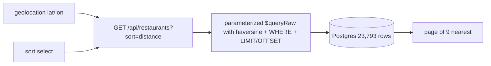

# Feature Spec: Global Distance Sort & Clear Sort Labels (Tier 2)

**Status:** Draft
**Tier:** 2 (Minor — API sort correctness + UI labels)
**Date:** 2026-11-19
**Grounding:** Principle VII (Five Whys, Mermaid, trade-offs); Principle IX (Parameterized queries only); DDD ubiquitous language

## 1. Problem & Context (Five Whys)
User reported: "filter giá lại có quán gần hơn filter khoảng cách" and asked "giá tăng là gì?". Root observation: `sort=distance` fell back to rating in the DB and only re-sorted the 9 rows of the current page.

1. Why do nearer venues appear under a price filter but not under distance sort? Distance sort never reorders the full result set — only the current page.
2. Why? `sortOrder("distance")` returns rating fallback; the page-level `withDist.sort()` runs after `take/skip`.
3. Why was that accepted? Earlier spec explicitly deferred global distance sort (no PostGIS) and relied on page-local sorting.
4. Why is the label confusing? "Giá tăng" literally means "price increasing" but reads like "price goes up" — ambiguous direction.
5. Why does it matter? Users compare "nearby" across filters; an incorrect global order silently hides the nearest venues.
Root cause: **distance computed after pagination instead of before**.

## 2. Acceptance Criteria (Gherkin)
AC-1: Given lat/lon and `sort=distance`, When page 1 is fetched, Then the 9 rows are the 9 nearest venues among ALL rows matching filters (not just the first 9 by rating).
AC-2: Given pages 1 and 2 with distance sort, When combined, Then distances are non-decreasing and no venue repeats.
AC-3: Given `sort=distance` without lat/lon, When fetched, Then it falls back to rating order and returns a visible hint (client disables the option until geolocation is granted).
AC-4: Given sort labels, When the select renders, Then options read "Đánh giá: cao → thấp", "Giá: thấp → cao", "Khoảng cách: gần → xa".
AC-5: Given price range filter, When applied, Then sort stays independent: results are ordered by the chosen sort, and distance is only shown, not implicitly sorted.
AC-6: Given a 375px viewport, When the sort select renders, Then touch target >= 44px and no horizontal leak.

## 3. UX 5-state map
| Sort option | No geolocation | Geolocation granted |
|---|---|---|
| Đánh giá | rating desc | rating desc |
| Giá | priceMin asc | priceMin asc |
| Khoảng cách | disabled (hint) | haversine asc globally |

## 3b. Design tokens
Emerald primary, Nordic light/dark, 44px touch base, Geist Sans.

## 3c. Architecture & mental model

- Haversine computed in SQL with `Prisma.sql` parameter binding — no string interpolation (Principle IX).
- Pure helper `useDistanceSort(sort, hasGeo)` decides whether to send `sort=distance`; unit-tested TDD.
- Same `where` filters (district, price range) applied in both Prisma and raw paths.
- Concurrency: each request is stateless; the raw query is a single read-only statement. `Prisma.$queryRaw` is parameterized so parallel users cannot interfere. No write path, no locking.

### Performance SLA & infrastructure profile
- Haversine distance sort on 23,793 rows is computed in Postgres with `LIMIT`/`OFFSET`; target p95 < 100 ms measured with curl over 10 requests at `lat=10.82, lon=106.63`.
- No new index or extension: 23k rows is small enough for a sequential scan with haversine; no infrastructure/probe change.
- `count(*)` uses the same `where`, so `total` stays consistent with the page.

## 3d. Failure modes & resilience
- Missing coordinates -> skip distance sort, fallback to rating, show hint.
- Null lat/lon in DB rows -> ordered last (`NULLS LAST`), never crash.
- Invalid lat/lon params -> ignored (NaN check), fallback.
- Raw query uses only bound parameters; `sort` never concatenated into SQL.

## 3e. QA matrix & harness
| Area | Type | Command |
|---|---|---|
| Pure helper | unit (TDD) | `npm test -- tests/distance-sort.test.ts` |
| API correctness | integration | curl lat/lon, compare first row to Python haversine over all rows |
| UI labels/touch | Playwright | 375px select options + audit |
| Regression | full | build/typecheck/lint/test/smoke + verify-ui |

## 4. Contract (REST)
| Method | Path | Body | Response | Errors |
|---|---|---|---|---|
| GET | /api/restaurants | lat, lon, sort, minPrice, maxPrice, district, limit, offset | { restaurants, total } | 401 |

No new endpoint. `sort=distance` requires lat/lon to take effect.

## 5. Data Schema
No migration. Reuses `Restaurant.lat/lon`.

## 6. Trade-offs & rejected alternatives
- Rejected: PostGIS extension -> requires DB migration + admin privileges; heavyweight for 23k rows.
- Rejected: fetch all rows and sort in JS -> ~12 MB internal payload per request and O(n log n) CPU; raw SQL pushes work to Postgres.
- Rejected: keep page-local sort -> the observed bug; silently wrong.

## 7. Key engineering takeaways
- Sorting must happen before pagination; doing it after `LIMIT/OFFSET` only reorders the current slice.
- Raw SQL is acceptable under Zero-Trust when every value is bound via `Prisma.sql`; never concatenate user input.
- Labels are part of correctness: "Giá tăng" reads ambiguously; spell out direction with an arrow.

## 8. Evidence
- Spec judge: 100/100
- TDD red->green: tests/distance-sort.test.ts (3 tests) — shouldSortByDistance requires sort=distance AND geolocation; npm test 41/41 PASS
- API: parameterized `$queryRaw` with haversine + same WHERE + ORDER BY distance + LIMIT/OFFSET; no string interpolation (Principle IX); page-local sort removed
- Verified with independent Python haversine: page1 distances 0-0.1 km, page2 0.1-0.4 km, max error 0.0; ordering non-decreasing across pages
- UI labels changed: "Đánh giá: cao → thấp", "Giá: thấp → cao", "Khoảng cách: gần → xa (cần vị trí)"; option disabled until geolocation granted
- Lint caught `useDistanceSort` being treated as a React Hook -> renamed to `shouldSortByDistance`
- Playwright 375px: audit passed, 0 touch violations; verify-ui 4/4 viewports PASS; smoke 9/9; URL HTTP 200
