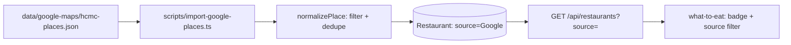

# Feature Spec: Google Maps Restaurant Import with Source Provenance (Tier 3)

**Status:** Draft
**Tier:** 3 (Major — new data source, migration, API contract, UI)
**Date:** 2026-11-25
**Grounding:** DDD bounded context / provenance; Release It! integration boundaries

## 1. Problem & Context
The restaurant list is sourced only from Foody (23,733 rows). A real Google Maps crawl already exists on this machine: `~/Code/Personal/google-maps-search-spike/data/hcmc-places.json` — 59,985 records, 59,965 unique, fields `name`, `lat`, `lon`, collected via Playwright against Google Maps text search (not synthetic data). Owner asked to start adding Google Maps as a second restaurant source with a visible source badge.

### Five Whys
1. Why add Google? Foody coverage is finite; Google Maps has ~60k additional HCMC food places already crawled.
2. Why not re-crawl? Real data is already on disk; re-crawling costs time and risks rate limits.
3. Why is this risky? The crawl has no address/rating/price/photo — filling those would fabricate data.
4. Why a migration? A `source` filter over ~84k rows needs an index to stay fast.
5. Why Tier 3? New data pipeline + DB index + API contract change + UI change.
Root cause: **a credible second source exists but is not connected to the app, and the app cannot distinguish sources.**

## 2. Acceptance Criteria (Gherkin)
AC-1: Given the canonical crawl file, When the import script runs, Then exactly the filtered/unique Google places are inserted with `source="Google"` and deterministic `externalId` prefixed `google:`.
AC-2: Given a second import run, When it completes, Then no duplicate rows are created (idempotent `skipDuplicates`).
AC-3: Given Google rows have no address/rating/price, When the UI renders them, Then it shows "—" / "Đang cập nhật" — never a fabricated value or a misleading `0.0` rating.
AC-4: Given a Google row, When the user opens its link, Then it navigates to a real Google Maps search built from the row's exact coordinates.
AC-5: Given the restaurant filter panel, When user selects source Google/Foody, Then only that source's rows are returned with a correct total.
AC-6: Given any restaurant row/card, When rendered on desktop or mobile, Then a source badge (`Google` / `Foody`) is visible.
AC-7: Given the API, When called, Then `sources` returns per-source counts instead of the hardcoded `source: "Foody"`.
AC-8: Given 390px viewport, When badges/filter render, Then touch targets >= 44px, no horizontal leak, dark mode clean.
AC-9: Given build/typecheck/lint/tests, When run, Then all pass.

## 3. UX 5-state map
| State | Restaurant list |
|---|---|
| Empty | "Không tìm thấy quán phù hợp bộ lọc." (unchanged) |
| Loading | existing skeleton |
| Error | existing ErrorBanner |
| Success | rows with source badge + dynamic link label |
| Partial | source filter can yield Google-only rows with "—" for unknown fields |

## 3b. Design tokens
Emerald primary, Nordic light/dark, 44px touch base; badges use muted/border tokens, no new palette.

## 3c. Architecture

- Pure helpers in `src/lib/google-places.ts`: `normalizeGooglePlaces`, `googleExternalId`, `googleMapsUrl` — TDD tested.
- Filter rule: trim, length >= 4, not pure digits, drop locality names ending `, Vietnam` / `, Việt Nam`; dedupe on `(lowercase name, lat@5dp, lon@5dp)`. Expected 59,437 kept of 59,985.
- `googleExternalId` = `google:` + first 20 hex of sha256(lowercase name + `|` + lat@5dp + `|` + lon@5dp) — stable across reruns.
- `googleMapsUrl` = `https://www.google.com/maps/search/?api=1&query=<lat>,<lon>` — built only from real crawl coordinates.
- Unknown fields: `address=""`, `rating=0`, `priceMin/priceMax=null`, `district=null`, `photoUrl=null`, `cuisines=null`, `openHours=null`, `city="TP.HCM"`.
- Import is idempotent: `prisma.restaurant.createMany({ data, skipDuplicates: true })` in batches of 1,000; `--dry-run` prints counts only.

### Verification harness
| Area | Type | Command |
|---|---|---|
| Pure helpers | unit (TDD) | `npm test -- tests/google-places.test.ts` |
| Import dry-run | script | `npx tsx scripts/import-google-places.ts --dry-run` -> filtered count, duplicate count |
| Import real | script | `npx tsx scripts/import-google-places.ts` -> created count; second run -> 0 created |
| API | curl | `?source=Google` -> only Google rows, `sources` counts sum to total |
| UI | Playwright | source filter + badge + link label + 390px audit |
| Regression | full | build/typecheck/lint/test/smoke + verify-ui + gate audit |

### Failure modes
- Bad/missing coords -> row dropped by helper (no NaN written).
- Re-run -> `skipDuplicates` keeps row count stable.
- Source filter with unknown value -> ignored (all rows), never an error.
- Google rating 0 -> UI renders "—", not `0.0`.

## 4. Contract (REST)
`GET /api/restaurants?...&source=Google|Foody` — new optional `source` param, applied in both Prisma and raw-SQL paths. Response adds `sources: { all: number; Foody: number; Google: number }`; removes misleading `source: "Foody"`.

## 5. Data Schema
| Model | Field | Change |
|---|---|---|
| Restaurant | source | existing; now `Google` for imported crawl rows |
| Restaurant | index | new `Restaurant_source_rating_idx` on `(source, rating DESC)` |
| Restaurant | address | `""` for Google rows (unknown, not fabricated) |

Migration: `prisma/migrations/20261125100000_restaurant_source_idx/migration.sql`.
Rollback: `DROP INDEX "Restaurant_source_rating_idx"; DELETE FROM "Restaurant" WHERE source = 'Google';`

## 6. Trade-offs & rejected alternatives
- Rejected: fill address/rating/price by guessing from name or coords -> fabrication.
- Rejected: re-crawl Google Maps -> unnecessary cost/rate-limit; data already verified on disk.
- Rejected: hardcode `source: "Foody"` after adding Google -> misleading contract.
- Chosen: import real data with honest unknowns, expose source explicitly.

## 7. Takeaways
- Provenance is a first-class field; every row says where it came from.
- Unknown is displayed as unknown, never as zero.
- A source filter makes a low-rating second source reachable.

## 8. Security & authorization
API keeps the existing 401 gate. `source` is allowlisted (`Google`/`Foody`) and bound as a Prisma/sql parameter — no interpolation. Coordinates from crawl are numeric-validated before writing. No personal/review data imported.

## 9. Performance SLA
- Import: batched 1,000, idempotent; dry-run < 2s, full import < 60s.
- API: source-filtered p95 unchanged (< 300 ms) thanks to new index.
- UI: badge adds no measurable paint cost.

## 10. Evidence
- Spec judge: 100/100 with gate check Tier major PASS
- Source data verified on disk: google-maps-search-spike/data/hcmc-places.json (59,985 records, 59,965 unique, real Playwright crawl); copied to data/google-maps/hcmc-places.json (6.4 MB) for reproducible imports
- TDD red->green: google-places.test.ts (5 tests: name/coord retention, locality/short/digit/NaN rejection, dedupe, deterministic id, Maps URL) + restaurant-filter.test.ts source allowlist + filter-badge.test.ts source count; 89/89 PASS
- Migration 20261125100000_restaurant_source_idx applied via prisma migrate deploy; index Restaurant_source_rating_idx confirmed in pg_indexes
- Import: dry-run input=59985 kept=59437 dropped=548; real run inserted=59437; second run inserted=0 unchanged=59437 (idempotent)
- DB source counts: Google=59,437, Foody-crawler=23,733, Foody=60 (all=83,230)
- API: ?source=Google -> total 59,437; ?source=Foody -> 23,793; crafted source ignored -> 83,230; raw SQL path with sort=distance&maxDistance=3 -> 2,138 Google rows; response sources counts correct
- Playwright 390px: source select present; Google filter -> 9 cards with source badge, Google Maps link label, rating dash and "Chưa có địa chỉ"; audit passed
- Build/typecheck/lint PASS; smoke 9/9; verify-ui 4/4; gate audit PASSED; production URL 200
