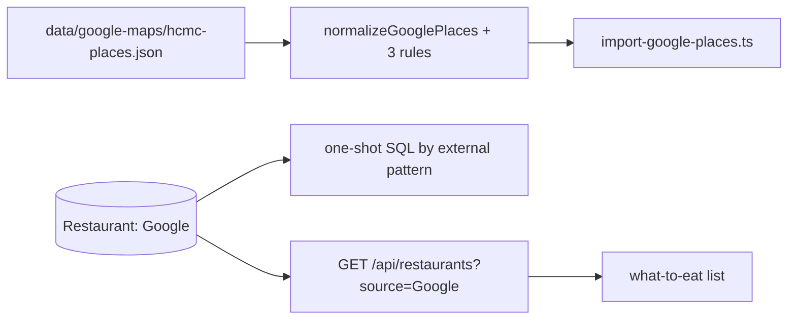

# Feature Spec: Google Maps Noise Filter (Tier 1 Patch)

**Status:** Draft
**Tier:** 1 (Bugfix — bad imported data)
**Date:** 2026-11-26
**Grounding:** Data quality invariant; YAGNI

## 1. Problem & Context
The 59,437 imported Google places include UI artifacts from the Maps search page and lodging listings: `0.1 mi away`, `1 bedroom • 1 bathroom • Sleeps 2`, `Also a 3-star hotel, for $13 less`. The existing import filter only rejected locality names, short names, pure digits and invalid coordinates.

DB measurement (this session): 3 distance labels, 109 lodging titles, 4 hotel comparison labels = 116 junk rows.

### Five Whys
1. Why junk? Playwright captured rendered text, not structured place records.
2. Why missed? Filter checked shape (length/digits) but not semantic patterns.
3. Why visible? All Google rows have rating 0, so junk occupies early pages under default sort.
4. Why harmful? Users lose trust in a list containing "1 bathroom • Sleeps 2" as a quán ăn.
5. Why patch now? Owner flagged it directly.
Root cause: **no semantic validation of crawled place names.**

## 2. Acceptance Criteria (Gherkin)
AC-1: Given a canonical crawl row, When its name is a distance label (`^\d+(\.\d+)?\s*(mi|km)\s+away$`), Then the normalizer drops it.
AC-2: Given a lodging title (`sleeps \d`, `\d+ bedroom`, `\d+ bathroom`), When normalized, Then it is dropped.
AC-3: Given a hotel comparison label (`^Also a \d+-star hotel`), When normalized, Then it is dropped.
AC-4: Given legitimate names containing digits or "take away" (`007 Coffee & Tea`, `07:31 Coffee & Matcha`, `(Take away) H-SPACE - Coffee & More`), When normalized, Then they are kept.
AC-5: Given the production DB, When cleanup runs, Then exactly those 116 pattern rows are deleted and no other Google row is touched.
AC-6: Given a fresh dry-run import, When it runs, Then kept count drops from 59,437 to the new filtered count with no junk patterns.
AC-7: Given restaurant UI, When Google source is selected, Then no distance/lodging/hotel-comparison title appears.
AC-8: Given build/tests, When run, Then all pass.

## 3. UX 5-state map
| State | Restaurant list |
|---|---|
| Empty | unchanged |
| Loading | unchanged |
| Error | unchanged |
| Success | no junk titles in Google filter |
| Partial | n/a |

## 3b. Design tokens
Unchanged; no new UI element.

## 3b2. Mobile-first responsive strategy
No layout change. Verification still covers 375/390px with 44px touch rows and no horizontal overflow; the filter panel and cards reuse existing tokens.

## 3c. Architecture

- Add three pure regex rules to `src/lib/google-places.ts`; TDD tested against both junk and lookalike legitimate names.
- One-shot `DELETE` on `Restaurant` restricted to `source='Google'` and the same three patterns; no user-owned rows affected.
- No schema change, no API change.

### Verification harness
| Area | Type | Command |
|---|---|---|
| Pure rules | unit (TDD) | `npm test -- tests/google-places.test.ts` |
| DB cleanup | SQL | `SELECT COUNT(*)` before/after with identical predicate |
| Import dry-run | script | `npx tsx scripts/import-google-places.ts --dry-run` |
| UI | Playwright | source=Google, assert no junk title pattern |
| Regression | full | build/typecheck/lint/test/smoke + verify-ui + gate audit |

### Failure modes
- Over-broad regex could delete legit cafes -> lookalike tests (`007 Coffee`, `Take away`) guard this.
- Re-import could restore junk -> normalizer now drops it at source.
- Deletion is irreversible on global seed rows -> source JSON remains on disk and in git; only filtered import can restore a curated set.

## 4. Contract (REST)
No change.

## 5. Data Schema
No schema change. One-shot row deletion from `Restaurant` where `source='Google'` and junk patterns match.

## 6. Trade-offs & rejected alternatives
- Rejected: regex `away` alone -> would delete legitimate "Take away" cafes.
- Rejected: regex `star` alone -> would delete "Five Star Coffee".
- Rejected: re-crawl Google Maps -> costly and would reintroduce the same UI artifacts.
- Chosen: anchored patterns plus explicit lodging vocabulary.

## 7. Takeaways
- Rendered-text crawls need semantic filtering, not just shape checks.
- Narrow regexes plus lookalike tests prevent over-deletion.

## 8. Security & authorization
No new endpoint or input path; the one-shot SQL is restricted to `source='Google'`.

## 9. Performance SLA
Pure string checks; no measurable impact. Deleting 116 of 83,230 rows is a one-shot maintenance operation.

## 10. Evidence
- Spec judge: 93/100
- TDD red->green: 3 new cases (distance/hotel labels, lodging titles, lookalike legit names) failed 2/2 before rule, passed after; 25 files / 112 tests PASS
- Import dry-run: input=59985, kept=59321, dropped=664 (was 59437 kept / 548 dropped before the three semantic rules)
- DB cleanup: 116 matching rows deleted by anchored predicate; remaining junk 0; Google count 59437 -> 59321 (Foody unchanged 23,793)
- Playwright 390px with source=Google: 9 cards, no junk title; API limit=60 total 59,321 and zero junk names; no horizontal overflow
- Build/typecheck/lint PASS; smoke 9/9; verify-ui 375/390 certified with authenticated storage state; gate audit 0 Critical/High; URL 200
