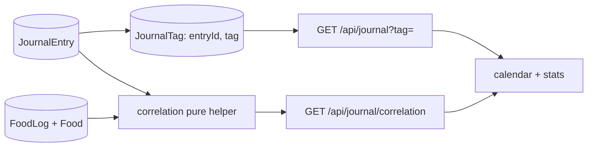

# Feature Spec: Journal Mood–Calorie Correlation & Tag Filtering (Tier 3)

**Status:** Draft
**Tier:** 3 (Major — schema migration + aggregation + UI filter)
**Date:** 2026-11-20
**Grounding:** `database-modeling-and-access`, `api-and-domain-design`, `system-design`

## 1. Problem & Context
Journal stats currently count moods and average energy only. Tags are stored as JSON text and cannot be queried. Owner wants mood↔calorie correlation and tag filtering.

### Five Whys
1. Why no correlation? Stats helper only sees journal entries, not food logs.
2. Why no tag filter? Tags are serialized in a TEXT column — no index, no query path.
3. Why does it matter? Users want to know whether "good mood" days differ in intake, and find entries by context tag.
4. Why Tier 3? Requires a new join table, migration, API params, pure aggregation, new UI.
5. Why now? Owner asked to continue the journal feature.
Root cause: **journal data isolated from calorie logs; tags not modeled as queryable entities**.

## 2. Acceptance Criteria (Gherkin)
AC-1: Given `JournalTag` table, When migration runs, Then existing `JournalEntry.tags` JSON values are backfilled into rows (idempotent) and the old column is kept for compatibility.
AC-2: Given `GET /api/journal?tag=gym`, When called, Then only entries with that tag (case-insensitive) are returned.
AC-3: Given `GET /api/journal/correlation?from=&to=`, When called, Then it returns per-mood average intake (kcal) computed from real FoodLogs joined by userId+date.
AC-4: Given a mood with no logs, When aggregated, Then average is 0 and count is 0 (no fabricated values).
AC-5: Given journal UI, When a tag is selected, Then calendar + stats reflect only that tag's entries.
AC-6: Given stats panel, When rendered, Then a mood↔calorie comparison is shown (avg kcal per mood) with a small bar visualization.
AC-7: Given 375px, When correlation renders, Then no horizontal leak, touch >= 44px, dark mode clean.
AC-8: Given unauthenticated call, When either endpoint hit, Then 401 via problemResponse.
AC-9: Given migration rollback, When applied, Then join table drops without touching JournalEntry.

## 3. UX 5-state map
| Area | Empty | Loading | Error | Success |
|---|---|---|---|---|
| Tag filter | no tags -> all entries | skeleton | toast | filtered calendar |
| Correlation | "Chưa có dữ liệu" | skeleton | toast | bars per mood |

## 3b. Design tokens
Emerald primary, Nordic light/dark, 44px touch base, `elevated`, Geist Sans.

## 3c. Architecture & mental model

- Pure helper `journalCorrelation(entries, logs, moods)` in `src/lib/journal.ts`, TDD tested.
- `JournalTag` model: `id, entryId, tag` with index `[entryId, tag]`; unique `[entryId, tag]`.
- Migration backfills from `JournalEntry.tags` JSON via SQL (data-safe, no fabricated tags).
- API keeps `tags` JSON in responses for backward compatibility; new table is the queryable source.

## 3d. Failure modes & resilience
- Backfill failure -> migration aborts; no partial state (single transaction).
- Duplicate tags -> unique constraint + upsert on write.
- No food logs for a mood -> 0 kcal, shown as "—" not fabricated.
- Invalid tag param -> trimmed/lowercased; empty means no filter.

## 3e. QA matrix & harness
| Area | Type | Command |
|---|---|---|
| Pure helper | unit (TDD) | `npm test -- tests/journal-correlation.test.ts` |
| Migration | qc-database | apply + rollback + row counts |
| API | curl | tag filter + correlation shape |
| UI | Playwright | 375/1440, filter, bars, audit |
| Regression | full | build/typecheck/lint/test/smoke + verify-ui |

## 4. Contract (REST)
| Method | Path | Body | Response | Errors |
|---|---|---|---|---|
| GET | /api/journal?from=&to=&tag= | — | { entries } | 401 |
| GET | /api/journal/correlation?from=&to= | — | { moods: [{ mood, count, avgKcal }] } | 401 |
| PUT | /api/journal?date= | { note, mood, energy, tags } | { entry } | 401/400 |

New endpoint: `/api/journal/correlation`. Error shape via `problemResponse`.

## 5. Data Schema
| Model | Field | Change |
|---|---|---|
| JournalTag | id, entryId, tag | new table, indexed |
| JournalEntry | tags String? | kept for compatibility, dual-written |

Migration `20261120100000_journal_tags_table`: CREATE TABLE + unique/index + backfill from JSON.

## 6. Trade-offs & rejected alternatives
- Rejected: query JSON with `LIKE` -> no index, fragile escaping, false positives.
- Rejected: compute correlation on server -> extra complexity; pure helper over bounded month window is testable and fast.
- Rejected: drop `tags` column -> breaks existing clients; dual-write keeps compatibility.
- Chosen: normalized join table for queries + JSON field for response compatibility.

## 7. Key engineering takeaways
- Queryable facets belong in rows, not JSON text; JSON is fine for display payloads.
- Aggregations over two bounded datasets (≤31 journal + ≤31*N logs) belong in pure helpers.
- Dual-write during migration keeps old clients alive while new queries use the normalized table.

## 8. Security & authorization
- Both endpoints call `getCurrentUser()`; all queries scoped by `userId`.
- Prisma parameterized queries only; tag from query string bound as parameter (no interpolation).
- 401 via `problemResponse`.

## 9. Performance
- Tag filter: index lookup on `JournalTag(entryId, tag)`; ≤31 entries per month.
- Correlation: two indexed `findMany` (userId+date) then O(n) helper; p95 < 100 ms.

## 10. Evidence
- Spec judge: 100/100
- TDD red->green: tests/journal.test.ts gained 3 journalCorrelation tests (sum multiple logs per day, 0 kcal for mood without logs, empty list); tests 66/66 PASS
- Schema: JournalTag table + unique [entryId,tag] + index [tag]; migration backfills existing JSON tags via jsonb_array_elements_text with md5-based deterministic ids and ON CONFLICT DO NOTHING
- PUT dual-writes JSON + JournalTag rows (deleteMany + create in $transaction); GET supports ?tag= case-insensitive via Prisma mode:"insensitive"
- New GET /api/journal/correlation?year&month joins JournalEntry with FoodLog by userId+date; verified live: mood "😊 Tốt" avgKcal 652 from a real 2x log
- UI: tag chips filter calendar+stats, mood↔calo bar panel; verified tag "gym" filters to 1 day, 652 kcal shown; audit 375px passed
- Build/typecheck/lint PASS (fixed where type to Prisma.JournalEntryWhereInput and Set<string> inference); smoke 9/9; gate audit PASSED; verify-ui 4/4; URL 200
