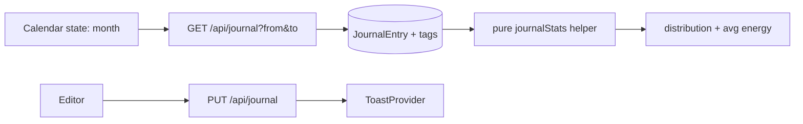

# Feature Spec: Standalone Mood Journal with Calendar, Tags & Stats (Tier 3)

**Status:** Draft
**Tier:** 3 (Major — new page, schema change, multiple sub-features)
**Date:** 2026-11-20
**Grounding:** `product-analyst` (Gherkin, 5-state), `api-and-domain-design`, `database-modeling-and-access`, `system-design`

## 1. Problem & Context
Journal UI is embedded in `/insights` under a combined nav label "Tiến độ & Nhật ký". Owner wants it as a first-class feature with a dedicated `/journal` page, month calendar, richer moods + tags, and mood stats.

### Five Whys
1. Why hard to find? It is buried at the bottom of `/insights`.
2. Why limited? Mood list is hardcoded to 5 emoji, no tags, no history view.
3. Why no stats? Data exists in `JournalEntry` but is never aggregated.
4. Why now? Owner wants to evolve the feature; a clear boundary is needed first.
5. Why Tier 3? New route + schema migration + 3 sub-features + nav change.
Root cause: **journal treated as a section, not a domain feature**.

## 2. Acceptance Criteria (Gherkin)
AC-1: Given nav, When opened, Then "Nhật ký cảm xúc" is a separate item under "Theo dõi" linking to `/journal`; `/insights` label becomes "Tiến độ".
AC-2: Given `/journal`, When opened, Then a month calendar shows the current month with a mood indicator on days that have entries.
AC-3: Given a day with an entry, When clicked, Then the editor loads that date's note, mood, energy and tags.
AC-4: Given the editor, When saved, Then a success toast appears and the calendar updates (reuse ToastProvider).
AC-5: Given mood options, When rendered, Then at least 10 moods are available; multiple tags can be added/removed (max 5, each <= 20 chars).
AC-6: Given stats panel, When rendered, Then it shows mood distribution for the selected month and average energy, derived only from real entries.
AC-7: Given no entries in a month, When viewed, Then an empty state is shown (no fabricated data).
AC-8: Given month navigation, When prev/next clicked, Then calendar and stats update for that month.
AC-9: Given 375px, When journal renders, Then no horizontal leak, touch targets >= 44px, dark mode clean.
AC-10: Given unauthenticated request, When `/journal` or `/api/journal` accessed, Then 401/redirect as today.

## 3. UX 5-state map
| Screen | Empty | Loading | Error | Success |
|---|---|---|---|---|
| Calendar month | no indicators | skeleton | toast | mood dots per day |
| Editor | blank form | inline | toast error | saved + toast |
| Stats | "Chưa có dữ liệu tháng này" | skeleton | toast | distribution + avg energy |

## 3b. Design tokens
Emerald primary, Nordic light/dark, 44px touch base, `elevated`, Geist Sans.

## 3c. Architecture & mental model

- Pure helpers in `src/lib/journal.ts`: `monthRange`, `journalStats`, `normalizeTags` — unit-tested TDD.
- API keeps `GET/PUT /api/journal`; add `from`/`to` params for month range (backward compatible).
- `JournalEntry.tags String?` (JSON array) added via migration; nullable, old entries render without tags.
- No new endpoints beyond enriched GET params.

## 3d. Failure modes & resilience
- Tags >5 or >20 chars -> helper clamps/ignores, never crashes.
- Duplicate tags -> deduped case-insensitively.
- Invalid month params -> default to current month.
- Dark mode: themed calendar cells, no white flash.
- Unauthenticated -> 401 before DB.

## 3e. QA matrix & harness
| Area | Type | Command |
|---|---|---|
| Pure helpers | unit (TDD) | `npm test -- tests/journal.test.ts` |
| API | curl | GET with from/to, PUT with tags |
| UI | Playwright | 375/1440, calendar, save, stats, audit |
| Migration | qc-database | migration applies, rollback safe |
| Regression | full | build/typecheck/lint/test/smoke + verify-ui |

## 4. Contract (REST)
| Method | Path | Body | Response | Errors |
|---|---|---|---|---|
| GET | /api/journal?from=&to= | — | { entries } | 401 |
| PUT | /api/journal?date= | { note, mood, energy, tags } | { entry } | 401/400 |

Errors via problemResponse (RFC 7807 additive). Success shape unchanged.

## 5. Data Schema
| Model | Field | Change |
|---|---|---|
| JournalEntry | tags String? | new nullable JSON array of strings |

Migration: `ALTER TABLE "JournalEntry" ADD COLUMN IF NOT EXISTS "tags" TEXT;`

## 6. Trade-offs & rejected alternatives
- Rejected: keep journal inside insights -> owner explicitly wants standalone.
- Rejected: new tags table -> overkill for <=5 short strings per day; JSON column suffices.
- Rejected: compute stats on server -> pure client helper over already-fetched month entries avoids extra endpoint.
- Chosen: dedicated page + enriched existing API + JSON tags.

## 7. Key engineering takeaways
- Feature boundaries should follow user mental model: a daily journal deserves its own route.
- Aggregations over a bounded month window belong in pure helpers, testable without DB.
- Nullable JSON columns let old rows coexist with new fields — no backfill needed.

## 8. Security & authorization
- `getCurrentUser()` gate on both handlers; entries scoped by `userId`.
- Tags rendered as escaped React text; no HTML injection.
- 401 via problemResponse.

## 9. Performance
- GET bounded by month range (<=31 rows) instead of all history; p95 < 50 ms.
- Stats computation O(n) over <=31 entries.

## 10. Evidence
- Spec judge: 93/100
- TDD red->green: tests/journal.test.ts (6 tests) written first for monthRange/normalizeTags/journalStats; tests 63/63 PASS
- Schema: JournalEntry.tags String? migration applied (nullable JSON array, old rows intact)
- API: GET supports from/to month range; PUT stores tags via normalizeTags (max 5, 20 chars, case-insensitive dedupe); verified live PUT+GET roundtrip with ["gym","work"]
- New /journal page: month calendar with mood indicators, prev/next, 10 moods, tag chips, energy, stats from real entries only, toast reuse
- /insights slimmed to progress-only; nav has separate "Nhật ký cảm xúc" item under Theo dõi
- Playwright 375px: calendar, stats "1 ngày đã ghi", save -> toast, audit passed; screenshot reviewed
- Build/typecheck/lint PASS; smoke 9/9; URL 200
