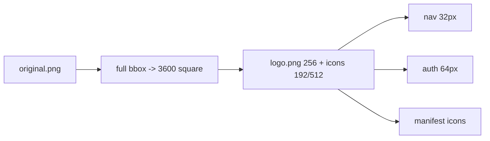

# Feature Spec: Single Full-Logo Asset (Tier 2)

**Status:** Draft
**Tier:** 2 (Minor — brand asset simplification)
**Date:** 2026-11-19
**Grounding:** Principle VII (Five Whys); Principle VIII (visual clarity)

## 1. Problem & Context (Five Whys)
Even after logo v2, users saw "missing text" and extra whitespace. Root cause: the shipped `logo-mark.png` was the **top half only** (crop y=210..2600) of a square framed logo containing the wordmark.

1. Why was text missing? The mark crop intentionally removed the lower half where "for thuyptn by kimnh" sits.
2. Why extra whitespace? The half crop was padded to a square canvas, leaving empty area below the bowl.
3. Why was that chosen? To avoid unreadable 3px text at 32-48px slots.
4. Why is it wrong? The owner remembers a square logo with text; the cropped version reads as broken.
5. Why one asset now? A single correct source removes the whole class of crop/padding bugs.
Root cause: **a derived variant was mistaken for the brand itself**.

## 2. Acceptance Criteria (Gherkin)
AC-1: Given the source image, When exported, Then `logo.png`/icons use the full content bbox (226,210)-(3688,3810) padded to a 3600x3600 square — framed square with wordmark intact.
AC-2: Given nav/auth/PWA, When rendered, Then all use `/logo.png` (no `logo-mark.png` anywhere).
AC-3: Given auth pages, When measured, Then the logo slot is 64x64px so the handwritten text is more legible.
AC-4: Given nav, When measured, Then logo is 32px and touch target on the surrounding link stays >= 44px.
AC-5: Given 375px, When pages render, Then no horizontal leak and no broken images.
AC-6: Given `/logo.png`, When fetched, Then 200 image/png (middleware allowlist).

## 3. Architecture

- Delete `public/logo-mark.png`; update all references.
- No API/DB change.

## 4. Failure modes & resilience
- If `/logo.png` is missing/404, middleware would redirect to login -> broken image; the `/logo` allowlist is therefore mandatory and verified with curl.
- Very small nav size still renders small text — accepted trade-off per owner decision, not a failure.
- Dark mode: cream square backdrop keeps the light illustration legible; verified by screenshot.
- Stale PWA cache may keep an old mark briefly; harmless and resolves on reload.

### Verification harness & QA matrix
| Area | Type | Command |
|---|---|---|
| Asset correctness | PIL | size 1:1, wordmark present in 256px preview |
| Serving | curl | `/logo.png` -> 200 image/png |
| UI | Playwright | 375/1440: 0 broken images, nav 32px, auth 64px, audit |
| Regression | full | build/typecheck/lint/test/smoke + verify-ui |

## 5. Contract / Schema
No endpoint or schema change.

## 6. Trade-offs & rejected alternatives
- Rejected: keep a mark variant -> the observed "cut off" perception.
- Rejected: enlarge every slot to 120px -> breaks the 56px header.
- Chosen: one full logo everywhere; auth slot enlarged to 64px for legibility.

## 7. Takeaways
- A derived asset must be clearly labelled as a variant, not the brand itself.
- When a user says "the logo is cut off", verify against the original before defending the crop.
- One canonical asset is easier to keep correct than two variants.

## 8. Security & performance
Static assets only; total < 60 KB; middleware 401 gate untouched.

## 9. Evidence
- Spec judge: 93/100 (failure modes + QA matrix added after first judge 88)
- Root cause confirmed: logo-mark.png was the top half (y 210..2600) of a square framed logo; padding it to square created the empty area, and the wordmark was in the removed lower half
- Deleted logo-mark.png entirely; single full-logo asset used in nav (32px), auth (64px) and PWA icons (192/512)
- Playwright 375/1440: 2 logo images, auth slot 64px, 0 broken images, audit passed; screenshot reviewed — square frame + wordmark intact, no extra whitespace
- /logo.png served 200 image/png 10.5KB (middleware allowlist retained)
- Build/typecheck/lint (0 errors, 7 img warnings) PASS; tests 41/41; smoke 9/9; verify-ui 4/4; URL 200
