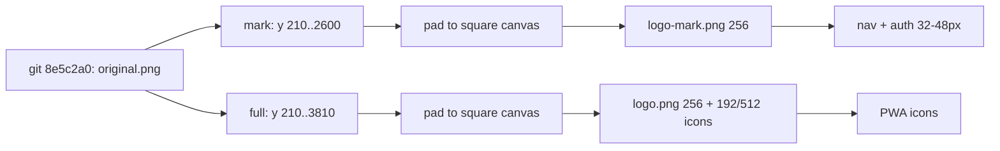

# Feature Spec: Logo v2 — Correct Aspect Ratio & Size-Aware Variants (Tier 2)

**Status:** Draft
**Tier:** 2 (Minor — brand assets + display strings, no logic)
**Date:** 2026-11-19
**Grounding:** Principle VII (Five Whys, Mermaid, trade-offs); Principle VIII (visual clarity)

## 1. Problem & Context (Five Whys)
First rebrand was reverted: the logo looked "cut off".

1. Why did it look cut? The full logo was rendered at 32-48px where the handwritten wordmark becomes unreadable noise.
2. Why was the wordmark unreadable? The source is 3462x3600 (near-square); resizing directly to 256x256 squashed the round frame into an oval.
3. Why did the earlier "mark" also look wrong? Its crop at y=2659 still included the top of the "f" in "for".
4. Why wasn't that caught? Review only looked at the 256px file, not at real 32-48px render sizes.
5. Why reapply now? Root causes are identified and measurable: crop at y=2600, pad to square BEFORE resize, use mark only in small slots.
Root cause: **one asset used at incompatible sizes with an incorrect crop/aspect pipeline**.

## 2. Acceptance Criteria (Gherkin)
AC-1: Given the source image (recovered from git commit 8e5c2a0), When cropped, Then the mark ends at y=2600 (bowl complete, no "for" strokes) and is padded to a square canvas before resizing — frame stays circular.
AC-2: Given a 32-48px slot (nav, auth), When rendered, Then the `logo-mark.png` variant is used with no visible text.
AC-3: Given a >=120px slot (PWA icon 192/512), When rendered, Then the `logo.png` full variant is used and the wordmark is legible.
AC-4: Given brand strings, When pages render, Then "thuypn by kimnh" appears in metadata, manifest, nav, login, register, README, push.
AC-5: Given 375px, When nav renders, Then no horizontal leak, touch targets >= 44px.
AC-6: Given `/logo*.png` requests, When fetched, Then 200 image/png (middleware allowlist kept).

## 3. UX 5-state map
Brand only; all 5 UI states unchanged.

## 3b. Design tokens
Cream frame `#faf3e8`, Emerald primary, Nordic light/dark, 44px touch base.

## 3c. Architecture & mental model

- No API/DB change; only static assets + display strings.
- Middleware `/logo` allowlist already in place from the first attempt — keep it.

## 3d. Failure modes
- Wrong crop -> "f" stroke appears (verified absent at y=2600).
- Direct resize without padding -> oval frame (verified with side-by-side 48px previews).
- Dark mode -> cream backdrop keeps the light illustration legible.

## 3e. QA matrix
| Area | Type | Command |
|---|---|---|
| Assets | PIL verify | aspect ratio 1:1, file sizes < 60 KB total |
| UI | Playwright | 375/1440 screenshot, audit, 0 broken images |
| Regression | full | build/typecheck/lint/test/smoke + verify-ui |

## 4. Contract / Schema
No endpoint or Prisma change.

## 5. Trade-offs & rejected alternatives
- Rejected: full logo at 48px -> unreadable wordmark (observed).
- Rejected: crop at 0.68 (y=2659) -> "f" stroke visible (observed).
- Rejected: direct resize to 256x256 -> oval frame (observed).
- Chosen: two size-aware variants with correct aspect handling.

## 6. Takeaways
- A logo needs variants validated at each real render size, not one file scaled everywhere.
- Padding to a square before resizing preserves the circular frame.
- Attach a brand asset to a git-tracked source so a revert can be researched later.

## 7. Security & performance
Static assets, total < 60 KB; no new input path; middleware 401 gate untouched.

## 8. Evidence
- Spec judge: 93/100
- Research: root causes proven with side-by-side 48px previews — full logo gives unreadable wordmark; old direct 3462x3600 -> 256 resize squashed the round frame; crop at y=2659 left an "f" stroke
- Fixed pipeline: mark crop y=210..2600 (bowl complete, no text), full crop y=210..3810; both padded to square canvas BEFORE resize; 4 outputs 1:1, total 57.7 KB
- Recovered original from git commit 8e5c2a0 into assets/brand/original.png (tracked again)
- Middleware /logo allowlist re-added (lost in the earlier revert); /logo.png and /logo-mark.png now 200 image/png
- Playwright 375/1440: title "thuypn by kimnh", 2 mark images, 0 old-name strings, audit passed; 48px screenshot reviewed — clean emblem, no cut text
- Build/typecheck/lint (0 errors, 7 img warnings) PASS; tests 41/41; smoke 9/9; verify-ui 4/4; URL 200
