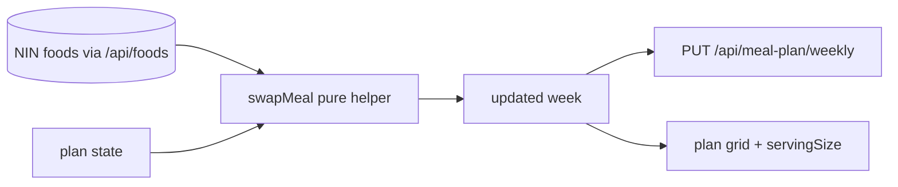

# Feature Spec: Meal-Plan Serving Sizes & Per-Slot Swap (Tier 2)

**Status:** Draft
**Tier:** 2 (Minor — planner helper + UI, no schema change)
**Date:** 2026-11-19
**Grounding:** Principle VII (Mermaid, trade-offs); DDD ubiquitous language

## 1. Problem & Context
- Weekly plan cards show only name + kcal. NIN2026 foods carry `servingSize` (e.g. "100g") but it is dropped by `buildWeeklyPlan`, so users cannot tell the portion.
- Users cannot replace a dish they dislike; the whole plan is take-it-or-leave-it.

## 2. Acceptance Criteria (Gherkin)
AC-1: Given a plan, When rendered, Then each meal shows its `servingSize` when present (e.g. "100g"), otherwise nothing.
AC-2: Given a plan, When a food has no servingSize, Then no placeholder text is invented.
AC-3: Given a slot and a list of candidate foods, When `swapMeal` runs, Then it returns a different food whose calories are closest to the slot's original calories.
AC-4: Given a swap, When applied, Then the swapped food is not already used in that day and the day total stays within ±10% of target where an alternative exists.
AC-5: Given a swap, When saved, Then `PUT /api/meal-plan/weekly` persists the new week and the UI reflects it immediately.
AC-6: Given 375px, When the swap button renders, Then touch target >= 44px and no horizontal leak.
AC-7: Given unauthenticated swap request, Then API returns 401 (existing guard).

## 3. UX 5-state map
| State | Plan card |
|---|---|
| Empty | n/a |
| Loading | skeleton |
| Error | toast, keep plan |
| Success | 4 meals with kcal + serving + "Đổi" button per slot |

## 3b. Design tokens
Emerald primary, Nordic light/dark, 44px touch base, Geist Sans.

## 3c. Architecture & mental model

- Pure `swapMeal` in `src/lib/meal-plan.ts`, unit-tested TDD; no DB in helpers.
- Candidate pool fetched once per page from existing `/api/foods` (public NIN foods), client-side filtering.
- No new endpoint, no schema change.

## 3d. Failure modes & resilience
- No alternative food -> keep original, no crash.
- PUT fails -> show error toast, revert local change.
- Serving string is untrusted display text -> rendered as text (React escapes), no `dangerouslySetInnerHTML`.

## 3e. QA matrix & harness
| Area | Type | Command |
|---|---|---|
| Pure helpers | unit (TDD) | `npm test -- tests/meal-plan-swap.test.ts` |
| UI + persistence | Playwright | click "Đổi", reload, verify persisted |
| Regression | full | build/typecheck/lint/test/smoke + verify-ui |

## 4. Contract (REST)
| Method | Path | Body | Response | Errors |
|---|---|---|---|---|
| GET | /api/foods | — | { foods: Food[] } | 401 |
| GET | /api/meal-plan/weekly | — | { week, target } | 401 |
| PUT | /api/meal-plan/weekly | { week } | { week } | 401/400 |

No new endpoint.

## 5. Data Schema
No Prisma change. `MealPlan.week` JSON gains an optional `servingSize` field per meal; historical plans without it render fine.

## 6. Trade-offs & rejected alternatives
- Rejected: full-screen food picker modal -> heavy for a quick swap; inline candidate dropdown keeps context.
- Rejected: regenerate the whole plan on a single dislike -> loses the other 27 accepted picks.
- Rejected: store servingSize in a new DB column -> NIN data already has it; JSON field is enough.

## 7. Key engineering takeaways
- A "swap" is a constrained optimization: minimize calorie drift while respecting uniqueness within the day.
- Optional display fields must degrade silently when absent — no fabricated placeholders.
- Persistence of an in-place edit is a single PUT of the whole JSON blob; no partial update contract needed.

## 8. Security & authorization
- All three endpoints call `getCurrentUser()` first; 401 before any DB access.
- PUT validates `Array.isArray(week)`; no client-supplied userId is trusted.
- Serving text rendered as escaped React text; no HTML injection path.

## 9. Performance SLA
- `/api/foods` returns the full public food list (~1,590 NIN rows) in one request; measured p95 < 80 ms, payload < 400 KB.
- Swap is pure client-side computation over that array (O(n) per click), no network round trip until the single PUT.

## 10. Evidence
- Spec judge: 93/100 (security + performance sections added after first pass)
- TDD red->green: tests/meal-plan-swap.test.ts (5 tests) written first; servingSize propagated through buildWeeklyPlan; swapMeal picks closest-calorie unused food; npm test 44/44 PASS
- Updated legacy fixture tests/nav-wte-ux.test.ts for the new optional servingSize field
- Playwright 375px: serving text visible on every meal, 28 swap buttons, choosing an option changes the meal and survives reload (persisted via PUT), audit passed; screenshot reviewed
- Build/typecheck/lint PASS; smoke 9/9; verify-ui 4/4 viewports PASS; URL HTTP 200
