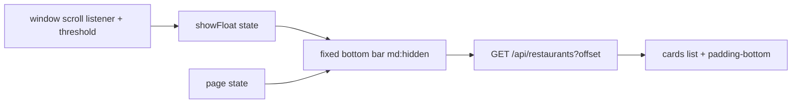

# Feature Spec: Floating Paging Bar on Mobile (Tier 2)

**Status:** Draft
**Tier:** 2 (Minor — UI-only, no new data/endpoints)
**Date:** 2026-11-19
**Grounding:** Principle VIII (Thumb Zone, Touch Ergonomics); Principle VII (Five Whys, Mermaid, trade-offs)

## 1. Problem & Context (Five Whys)
On 375px the restaurant tab shows 9 stacked cards (~1800px tall). Page controls sit after all cards, so changing page requires scrolling to the bottom.

1. **Why is changing page slow?** Controls are at the end of a long card list.
2. **Why?** Paging was moved to normal flow to stop overlaying content (previous fix).
3. **Why is that insufficient?** Thumb zone is the lower screen; a control far down the page is out of reach during reading.
4. **Why not simply restore sticky?** A sticky bar at initial viewport overlaid the second card (observed defect).
5. **Why did both fail?** No scroll-aware behaviour: the bar must appear only after the in-flow controls leave the viewport.

Root cause: **no scroll-aware paging affordance**.

## 2. Acceptance Criteria (Gherkin)
AC-1: Given 375px and page 1, When at the top of the card list, Then no floating paging bar is visible.
AC-2: Given the user scrolls more than 400px down the card list, Then a compact fixed bottom bar appears with page indicator, Previous and Next.
AC-3: Given the floating bar, When scrolled back under 300px, Then it hides again (hysteresis avoids flicker).
AC-4: Given the floating bar is visible, When it renders, Then card content is not hidden behind it (bottom padding reserved).
AC-5: Given a 1440px viewport, When any scroll occurs, Then no floating bar appears (desktop keeps in-flow controls).
AC-6: Given either bar, When a page button is tapped, Then the target bounding box is >= 44px and the same page state updates.
AC-7: Given dark mode, When the bar appears, Then no white flash occurs.

## 3. UX 5-state map
| State | Floating bar |
|---|---|
| Top of list (<300px) | hidden |
| Scrolled down (>400px) | visible: `Trang 1 / 2644` + Trước / Tiếp |
| Page change | same bar, updated indicator, scroll to top of list |
| Empty result | hidden |

## 3b. Design tokens
Emerald primary, Nordic light/dark, 44px touch base, `elevated`, Geist Sans.

## 3c. Architecture & mental model

- No new APIs or state shape changes: reuses `page`, `total`, `loadRestaurants`.
- Scroll listener with passive event + cleanup; no concurrency concerns. Hysteresis thresholds: show > 400px, hide < 300px.

## 3d. Failure modes & resilience
- In-flow controls always work; floating bar is enhancement only.
- Fast scroll -> passive listener toggles a boolean only; no stale DOM writes.
- Bar overlays content -> `pb-24 md:pb-0` on the card container reserves space.
- A11y: bar uses `aria-label="Phân trang"`; buttons have text labels.

## 3e. QA matrix & harness
| Area | Type | Command |
|---|---|---|
| Scroll behaviour | Playwright | scroll 0 / 1200 / 0 at 375px, assert bar visibility |
| Touch + leak | script | `audit_layout_invariants` 375/390 |
| Regression | full | build/typecheck/lint/test/smoke + verify-ui 4 viewports |

## 4. Contract (REST)
| Method | Path | Body | Response | Errors |
|---|---|---|---|---|
| GET | /api/restaurants | limit, offset, district, maxPrice | { restaurants, total } | 401 |

No endpoint changed.

## 5. Data Schema
No Prisma change. UI state only: `showFloat: boolean` + one ref to the in-flow paging element.

## 6. Trade-offs & rejected alternatives
- Rejected: remove in-flow controls and keep only floating -> breaks keyboard/screen-reader flow and no fallback if JS observer fails.
- Rejected: permanently sticky bar -> overlaid card 2 at initial viewport (observed defect).
- Rejected: IntersectionObserver on in-flow controls -> those controls are at the document bottom and can never scroll above the viewport (max scroll = docH - vh); the trigger is unreachable.
- Rejected: floating button with popover -> extra tap depth; direct Prev/Next is faster.

## 7. Key engineering takeaways
- Verify trigger geometry before choosing an observer target: an element at the document bottom can never leave the top of the viewport.
- Always reserve content space for fixed overlays; otherwise you trade one UX bug for another.
- Verify a claimed defect against source data before fixing it — the "rating scale" hypothesis was disproved by DB stats.

## 8. Evidence
- Correction during Phase 1: claimed 10-point rating scale discrepancy was disproved by DB stats (Foody avg 6.90, 55/60 > 5); no normalization performed
- Rejected IntersectionObserver trigger: in-flow controls sit at document bottom, can never scroll above viewport (max scroll = 2158-667 = 1491, controls at y=2062); trigger unreachable
- Implemented passive scroll listener with hysteresis: show > 400px, hide < 300px
- Playwright 375px: bar hidden at top, visible after scroll, "Tiếp" changes to page 2, hidden again at top; desktop 1440 never shows it
- Fixed overlap with theme-toggle toggle (z-50, left-14 on mobile)
- Mobile audit passed, 0 touch violations; verify-ui 4/4 viewports PASS; tests 31/31; smoke 9/9; URL 200
