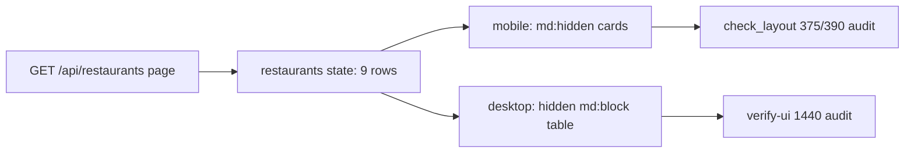

# Feature Spec: Stacked Restaurant Cards on Mobile (Tier 2)

**Status:** Draft
**Tier:** 2 (Minor — UI-only refactor, no new data or endpoints)
**Date:** 2026-11-19
**Grounding:** Constitution Principle VIII (Mobile-First, Zero Horizontal Leak, Touch Ergonomics); Principle VII (Five Whys, Mermaid, trade-offs, takeaways)

## 1. Problem & Context (Five Whys)
At 375px the restaurant table renders inside an isolated scroll container: measured `tableW=760px`, `clientW=341px`, first column 156px sticky, second column 240px clipped. Rating/price/distance/link require horizontal scrolling; names and addresses are truncated.

1. **Why is the table hard to use?** Only ~185px remains after the sticky name column; most data is off-screen.
2. **Why?** A 6-column desktop table was reused on mobile via `min-w-[760px]`.
3. **Why was it accepted?** Earlier QC only enforced "no document-level horizontal leak"; the inner scroll container satisfied that literally.
4. **Why is that insufficient?** Principle VIII requires mobile ergonomics (thumb zone, touch targets, readable content), not merely the absence of a page scrollbar.
5. **Why did it persist?** Base CSS was authored desktop-first; no mobile-specific rendering path existed.

Root cause: **no mobile-first rendering branch for the tabular data**.

## 2. Acceptance Criteria (Gherkin)
AC-1: Given a 375px viewport, When the Quán ăn tab is opened, Then restaurants render as stacked cards (one per row) with name, rating, price, district/address, distance and Foody link visible without horizontal scrolling.
AC-2: Given 390px, When a card is measured, Then every interactive element has a bounding box >= 44px (base touch invariant).
AC-3: Given 1440px, When the tab is opened, Then the existing 6-column table renders unchanged (progressive enhancement upward).
AC-4: Given any mobile viewport, When `audit_layout_invariants` runs, Then `scrollWidth <= clientWidth` and `touch_violations == []`.
AC-5: Given 23,793 venues and numbered paging, When a page changes, Then the mobile cards and desktop table show the same 9 venues.
AC-6: Given dark mode, When switching tabs, Then no white flash occurs.
AC-7: Given mobile cards, When paging controls render, Then they are in normal document flow (not sticky-overlaying card content); sticky is applied only from 768px upward.

## 3. UX 5-state map
| State | Mobile cards | Desktop table |
|---|---|---|
| Empty | "Không tìm thấy quán phù hợp bộ lọc." | existing empty row |
| Loading | skeleton | skeleton |
| Error | console error, keep previous list | same |
| Success | 9 stacked cards | 9 rows + sticky header |

## 3b. Design tokens
Emerald primary, Nordic light/dark, 4/8/12/16/24px, `elevated`, Geist Sans, 44px touch base.

## 3c. Architecture & mental model

- No new endpoints, no new state, no Prisma changes — same `restaurants` array rendered in two branches.
- Pure presentational components; no concurrency concerns.

## 3d. Failure modes & resilience
- Missing price -> "Đang cập nhật"; missing district -> "—"; missing photo -> placeholder-free text-only card.
- Very long name -> `line-clamp-2` with `title` attribute (full name on hover/long-press).
- Link opens Foody in new tab with `rel="noopener noreferrer"`.
- Filters with zero results -> mobile empty card; paging controls hidden when total <= 9.

## 3e. QA matrix & harness
| Area | Type | Command |
|---|---|---|
| Mobile cards | visual | Playwright 375/390 screenshot + `audit_layout_invariants` |
| Desktop table | visual | `python3 scripts/verify-ui.py http://localhost:3001 mobile-cards` |
| Regression | full | build/typecheck/lint/test/smoke + all-page mobile audit |

## 4. Contract (REST)
| Method | Path | Body | Response | Errors |
|---|---|---|---|---|
| GET | /api/restaurants | limit, offset, district, maxPrice, lat, lon | { restaurants, total } | 401 |

No endpoint changed; this spec only changes rendering.

## 5. Data Schema
No Prisma change. UI-only: `restaurants` state feeds two render branches.

## 6. Trade-offs & rejected alternatives
- Rejected: keep isolated horizontal scroll with gradient fade -> still hides 4 of 6 columns behind a swipe; cards surface all fields at once.
- Rejected: shrink columns / drop fields on mobile -> loses price/rating/distance which are core to the feature.
- Rejected: separate mobile API with fewer fields -> extra contract and cache complexity for no benefit.

## 7. Key engineering takeaways
- "No page scroll" is a weak proxy for mobile usability; content must be readable without inner scrolling too.
- One data array can feed multiple render branches; keep state single-sourced and branch only at presentation.
- A mobile-first base (`md:hidden` cards, `hidden md:block` table) makes the progressive-enhancement direction mechanical and reviewable.

## 8. Evidence
- Playwright 375/390: 9 stacked cards render, 0 touch violations, scrollWidth==clientWidth; screenshot reviewed: name, rating, price, address and Foody link all visible without horizontal scroll
- Fixed during QC: sticky paging bar overlaid the second mobile card; base changed to static, `md:sticky md:bottom-0` preserves desktop behaviour
- Desktop 1440: 6-column table unchanged; build/typecheck/lint PASS, tests 31/31, smoke 9/9, verify-ui 4/4 viewports PASS
