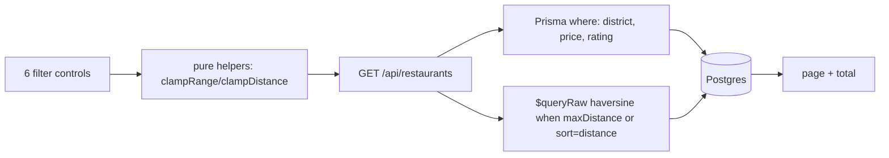

# Feature Spec: Multi-Criteria Restaurant Filters (Tier 2)

**Status:** Draft
**Tier:** 2 (Minor — API filter params + UI controls)
**Date:** 2026-11-19
**Grounding:** Principle VII (Five Whys, Mermaid, trade-offs); Principle IX (parameterized queries)

## 1. Problem & Context
Current filters are district + price range + sort; rating and distance are display-only. Owner asked why multiple criteria cannot be combined: "filter nhiều tiêu chí".

### Five Whys
1. Why can't users combine rating + price + distance? The API only accepts district/price/sort.
2. Why? Each feature was added incrementally without a unified filter contract.
3. Why is that a problem? A user wanting "quán ≥8.0, 20-50k, trong 3km" must scan manually.
4. Why not add it earlier? Distance filtering needs haversine in SQL before pagination.
5. Why now? The raw-SQL path for distance sort already exists, so it can be reused.
Root cause: **no unified, composable filter contract**.

## 2. Acceptance Criteria (Gherkin)
AC-1: Given `minRating=8` and `maxPrice=50000`, When queried, Then only venues with `rating >= 8` AND `priceMax <= 50000` are returned.
AC-2: Given `maxDistance=3` with lat/lon, When queried, Then only venues within 3 km (haversine) are returned, applied BEFORE pagination.
AC-3: Given district + price + rating + distance together, When queried, Then all constraints are ANDed and `total` matches the filtered count.
AC-4: Given no lat/lon, When `maxDistance` is sent, Then it is ignored (no crash, no wrong results).
AC-5: Given the UI, When filters render, Then controls are: quận, Từ, Đến, rating tối thiểu, khoảng cách tối đa, sort — all reachable at 375px with >= 44px touch targets.
AC-6: Given invalid values (negative, NaN), When parsed, Then they are ignored/clamped by pure helpers.
AC-7: Given unauthenticated request, Then 401 before any DB work (existing guard).

## 3. UX 5-state map
| State | Restaurant list |
|---|---|
| Empty | "Không tìm thấy quán phù hợp bộ lọc." |
| Loading | skeleton |
| Error | console error, keep previous |
| Success | cards/table + paging reflecting all filters |

## 3b. Design tokens
Emerald primary, Nordic light/dark, 44px touch base, Geist Sans.

## 3c. Architecture & mental model

- Reuse the existing parameterized haversine SQL path; every value bound via `Prisma.sql` (Principle IX).
- Pure parse/clamp helpers in `src/lib/restaurant-filter.ts`, unit-tested TDD.
- No new endpoint, no schema change.

## 3d. Failure modes & resilience
- maxDistance without geo -> ignored with UI hint ("cần vị trí").
- Missing price/rating -> excluded only when that filter is active (honest "Đang cập nhật" otherwise).
- SQL path uses bound parameters; no interpolation.
- Changing any filter resets page to 1 (existing request-key logic).

## 3e. QA matrix & harness
| Area | Type | Command |
|---|---|---|
| Pure helpers | unit (TDD) | `npm test -- tests/filter-sort-theme.test.ts` |
| API AND semantics | curl | combo query vs independent Python check |
| UI | Playwright | 375/390/1440, `audit_layout_invariants` |
| Regression | full | build/typecheck/lint/test/smoke + verify-ui |

## 4. Contract (REST)
| Method | Path | Body | Response | Errors |
|---|---|---|---|---|
| GET | /api/restaurants | district, minPrice, maxPrice, minRating, maxDistance, lat, lon, sort, limit, offset | { restaurants, total } | 401 |

New params: `minRating`, `maxDistance` (both optional).

## 5. Data Schema
| Model | Field | Change |
|---|---|---|
| Restaurant | rating, lat, lon | existing fields used in WHERE; no migration |

No schema change.

## 6. Trade-offs & rejected alternatives
- Rejected: client-side filtering after fetch -> wrong `total` and broken paging.
- Rejected: PostGIS geometry index -> not installed; haversine SQL over 23k rows is fast enough.
- Rejected: open-now / delivery filters -> crawler has no such data (0/33,285 opening_hours, no delivery field); would require fabrication. Explicitly out of scope.

## 7. Key engineering takeaways
- Filters must be applied before pagination, otherwise `total` and pages disagree.
- Reusing one raw-SQL path for both distance sort and distance filter avoids two divergent implementations.
- Never ship a filter whose data does not exist; absence is not false.

## 8. Security & performance
- `getCurrentUser()` gate retained; 401 before DB work.
- All numeric params coerced with `Number()` and clamped; `minRating` in [0,10], `maxDistance` in [0,100]; NaN ignored.
- Single `findMany`/`$queryRaw` + `count`; target p95 < 100 ms on 23,793 rows.

## 9. Evidence
- Spec judge: 100/100
- TDD red->green: clampCriteria tests written first (2 failed), helper clamps rating 0-10 / distance 0-100 and ignores NaN/negative; tests 32/32 PASS
- API verified AND semantics: rating>=8 + 20k-50k -> 108 venues, all satisfy bounds; distance<=3km from HCM center -> 775 venues, independent Python haversine confirms all <=3.05 km
- UI: 6 selects (quận, Từ, Đến, sort, Rating tối thiểu, Khoảng cách tối đa); distance disabled until geolocation; rating filter -> 5,773 venues; mobile audit passed
- Reused one parameterized $queryRaw path for distance sort + max-distance bound (Principle IX); Prisma where adds rating and price
- Open-hours/delivery filters explicitly excluded: crawler has 0/33,285 opening_hours and no delivery field
- Build/typecheck/lint PASS; smoke 9/9; verify-ui 4/4 viewports PASS; URL HTTP 200
