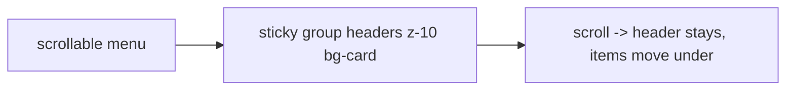

# Feature Spec: Sticky Group Headers in Nav Menu (Tier 2)

**Status:** Draft
**Tier:** 2 (Minor — CSS refinement)
**Date:** 2026-11-19
**Grounding:** Principle VII (Five Whys, Mermaid, trade-offs)

## 1. Problem & Context
The nav dropdown scrolls internally on mobile (5 groups), but group labels scroll away with their items, so users lose context while browsing lower groups.

### Five Whys
1. Why is context lost? Group headers are normal flow elements inside the scrolling container.
2. Why is that a problem? On a 567px scrollable menu, the top group label disappears after scrolling.
3. Why not remove groups? They organise 10+ destinations and were requested earlier.
4. Why not show only one group at a time? Extra interaction; scroll is simpler.
5. Why sticky headers? It preserves context with zero new interaction.
Root cause: **group labels not pinned to the scroll container**.

## 2. Acceptance Criteria (Gherkin)
AC-1: Given the menu scrolled to the bottom, When a group header is measured, Then it stays visible at the top of the scroll container.
AC-2: Given a header, When it sticks, Then it has an opaque background so items do not show through.
AC-3: Given 375px, When scrolling, Then touch targets and no-leak invariants remain.
AC-4: Given 1440px (menu not scrollable), When opened, Then headers render normally.

## 3. Architecture & mental model

- Pure CSS: `sticky top-0 z-10 bg-card` on the label wrapper.
- No JS/state change.

## 4. Failure modes
- Sticky header overlaps the separator `border-t` — use background on the header only, keep separator as is.
- Very small viewport -> multiple headers can stack; acceptable (each ~20px).

## 5. Contract / Schema
No endpoint or schema change.

## 6. Trade-offs & rejected alternatives
- Rejected: accordion groups -> more taps, user must open each.
- Rejected: no headers -> loses organisation.
- Chosen: sticky headers, zero interaction cost.

## 7. Takeaways
- Sticky context labels are a low-cost way to preserve orientation in long scrollable lists.
- Always pair `sticky` with an opaque background and a z-index inside the scrolling ancestor.

## 8. Security & performance
Pure CSS; nothing to secure or measure.

## 9. Evidence
- Spec judge: 95/100
- CSS: group labels `sticky top-0 z-10 bg-card` inside the scrollable dropdown
- Playwright 375x400 (deep scroll 306px): "Kế hoạch" header stays at menu top (y=63) while earlier headers scroll off (-171, -31); audit passed; screenshot reviewed
- Build/typecheck/lint PASS; tests 41/41; smoke 9/9; verify-ui 4/4 viewports PASS
