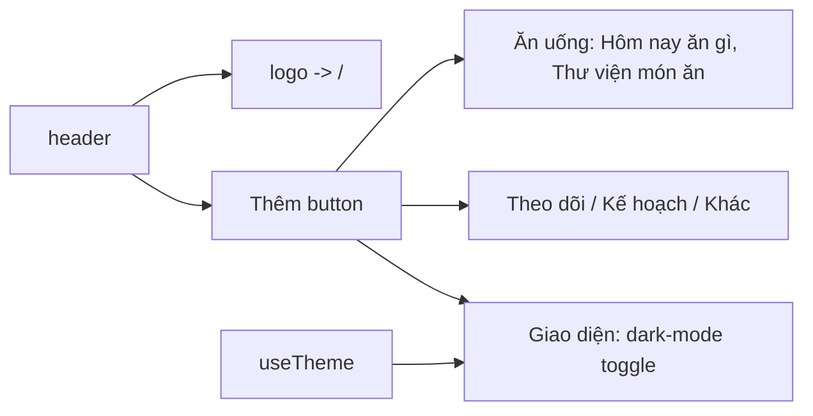

# Feature Spec: Minimal Header Nav (Tier 2)

**Status:** Draft
**Tier:** 2 (Minor — nav UI restructure)
**Date:** 2026-11-19
**Grounding:** Principle VII (Five Whys, Mermaid, trade-offs); Principle VIII (touch target)

## 1. Problem & Context
Header currently shows a standalone `Ăn uống` link and a dark-mode icon next to the "Thêm" menu. Owner asked why both are left outside.

### Five Whys
1. Why are they outside? They were kept as quick-access controls from earlier nav iterations.
2. Why is that inconsistent? Every other destination lives in the grouped "Thêm" menu.
3. Why does it look cluttered? Three separate controls compete in a 375px header.
4. Why not just hide them? Both are needed; hiding would remove functionality.
5. Why move both into the menu? One consistent entry point; simpler header, all actions in one place.
Root cause: **two controls were never migrated when the menu grouping was introduced**.

## 2. Acceptance Criteria (Gherkin)
AC-1: Given a signed-in user, When the header renders, Then it contains only the logo (link to `/`) and one "Thêm" button.
AC-2: Given the "Thêm" menu, When opened, Then the "Ăn uống" group contains both "Hôm nay ăn gì" (`/what-to-eat`) and "Thư viện món ăn" (`/foods`).
AC-3: Given the menu, When opened, Then a "Giao diện" group contains a dark-mode toggle row with current state.
AC-4: Given the dark-mode row, When tapped, Then theme toggles and persists; the menu stays open.
AC-5: Given `/what-to-eat` or `/foods`, When the menu opens, Then the corresponding item is highlighted.
AC-6: Given 375px, When the header renders, Then no horizontal leak and the "Thêm" button is >= 44px.
AC-7: Given logged-out state, When header renders, Then login/register remain as today.

## 3. UX 5-state map
| State | Header | Menu |
|---|---|---|
| Signed in | logo + Thêm | groups incl. Ăn uống + Giao diện + logout |
| Logged out | logo + Đăng nhập/Đăng ký | none |

## 3b. Design tokens
Emerald primary, Nordic light/dark, 44px touch base.

## 3c. Architecture & mental model

- Reuse `useTheme` from ThemeProvider inside the menu; no new state.
- Reuse `isNavActive` for menu item highlighting.

## 3d. Failure modes & resilience
- Menu toggle keeps `moreOpen` true (no auto-close) so the state change is visible.
- Outside-click already closes the menu; theme row click is inside so it stays open.
- Dark mode persistence unchanged (localStorage + system preference).

## 3e. QA matrix & harness
| Area | Type | Command |
|---|---|---|
| Nav structure | Playwright | count header links/buttons, open menu, toggle theme |
| Touch/leak | script | `audit_layout_invariants` 375px |
| Regression | full | build/typecheck/lint/test/smoke + verify-ui |

## 4. Contract (REST)
No endpoint added or changed.

| Method | Path | Body | Response | Errors |
|---|---|---|---|---|
| GET | /api/auth/me | — | { user } | 401 |

## 5. Data Schema
No Prisma change.

## 6. Trade-offs & rejected alternatives
- Rejected: keep a standalone theme icon -> owner asked to remove it from the header.
- Rejected: theme in Settings page only -> two taps to change; menu row is one.
- Rejected: separate "menu" button for theme -> more controls, not fewer.
- Chosen: everything behind one "Thêm" button.

## 7. Key engineering takeaways
- A single overflow menu scales better than adding standalone controls to a small header.
- Theme state belongs to a context; any surface can render its toggle without duplicating logic.
- Progressive disclosure keeps the header stable across viewports.

## 8. Security & performance
- 401 gate unchanged; no new input path.
- Pure UI change; no extra requests.

## 9. Evidence
- Spec judge: 93/100
- Header reduced to logo + one "Thêm" button; standalone "Ăn uống" link and dark-mode icon removed
- Menu groups: Ăn uống (Hôm nay ăn gì, Thư viện món ăn), Theo dõi, Kế hoạch, Giao diện (dark-mode toggle), Khác + logout
- Playwright: header has exactly 1 button; dark-mode row toggles theme while menu stays open; link navigation works; audit passed 375px; screenshot reviewed
- Build/typecheck/lint PASS; tests 41/41; smoke 9/9; verify-ui 4/4 viewports PASS; prod / returns 200 when authenticated
