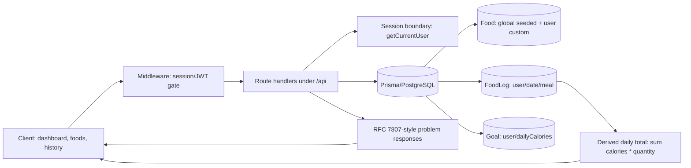

# Feature Spec: Nutrition Tracker (Daily Calorie Intake)

**Status:** Accepted
**Tier:** 3 (Major feature)
**Owner:** dev
**Date:** 2026-11-13

## 1. Problem & Scope

### 1.1 User story
As a person tracking my diet, I want to log the foods I eat each day with their
calorie counts, so that I can see my total daily calorie intake and compare it
against a personal daily goal.

### 1.2 Ubiquitous language (DDD, Evans — Ch.2 "One Team, One Language", p.18-19)
- **Food**: a named item with a calorie value per serving and optional macros
  (protein/carbs/fat) and a serving size description.
- **FoodLog**: a record that a User consumed a quantity of a Food on a given
  date, optionally tagged with a meal type (breakfast/lunch/dinner/snack).
- **Goal**: a User's daily calorie target (kcal).
- **Daily total**: sum of `Food.calories * FoodLog.quantity` for all logs on a date.

Meanings of words are slippery; terms above are the canonical domain language
used across UI, API, and DB. Requirements evolve and should be reframed in this
ubiquitous language as the project grows.

### 1.3 In-scope (MVP)
1. User registration & login (email + password).
2. Food catalog: browse/search seeded foods + create custom foods (per user).
3. Daily food logging with quantity, meal type, date.
4. Daily calorie total + macro totals + progress vs. goal.
5. Editable daily calorie goal.
6. History view: per-day totals.

### 1.4 Out-of-scope (deferred)
- Barcode scanning, photo recognition, third-party food APIs.
- Weight tracking, exercise calorie burn, macro goals beyond calories.
- Social/sharing, multi-tenant admin.
- Offline/PWA, i18n beyond Vietnamese UI.

### 1.5 UX 5-state map (Refactoring UI — "Don't overlook empty states", p.203-205)
Empty states are a user's first interaction with a feature; they must be a
priority, not an afterthought, with an image/illustration and a clear CTA.
Supporting UI (tabs/filters) that does nothing until content exists should be
hidden.

| Screen | Initial | Loading | Empty | Error | Success |
|---|---|---|---|---|---|
| Dashboard (no logs) | blank form | spinner | illustration + "Chưa có món nào. Thêm món ăn đầu tiên" CTA | toast "Không tải được dữ liệu" | totals + meal groups |
| Foods list (no foods) | blank | spinner | "Chưa có món. Thêm món ăn" CTA | toast | list |
| History (no logs) | blank | spinner | "Chưa có lịch sử" | toast | per-day cards |
| Login/Register | blank form | button spinner | n/a | inline field error | redirect |

### 1.6 UI navigation map
```
/ (redirect) -> /dashboard (if authed) | /login
/login -> submit -> /dashboard
/register -> submit -> /dashboard
/dashboard -> add food log -> refresh totals
/dashboard -> /foods (link when no foods)
/foods -> create food -> list updates
/dashboard date picker -> /dashboard?date=
/history -> per-day cards
nav -> /dashboard | /foods | /history | logout -> /login
```

## 2. Acceptance Criteria (Gherkin)

### Auth
AC-1: Given a new email and password (>=6 chars), When POST /api/auth/register,
Then 201 with user and a session cookie; a Goal row is created (default 2000 kcal).
AC-2: Given an existing email, When register, Then 409 "Email already registered".
AC-3: Given valid credentials, When POST /api/auth/login, Then 200 with cookie.
AC-4: Given invalid credentials, When login, Then 401 "Invalid credentials".
AC-5: Given an authenticated user, When GET /api/auth/me, Then 200 with user.
AC-6: Given no session, When GET /api/auth/me, Then 401.

### Foods
AC-7: Given an authenticated user, When GET /api/foods, Then returns seeded (global)
foods plus the user's custom foods.
AC-8: Given name + calories, When POST /api/foods, Then 201 with the new food
owned by the user (isCustom=true).
AC-9: Given missing name or calories, When POST /api/foods, Then 400.
AC-10: Given a food owned by another user or a seeded food, When DELETE, Then 403.
AC-11: Given the user's own custom food, When DELETE, Then 204/200 and removed.

### Logs
AC-12: Given a valid foodId, quantity, mealType, date, When POST /api/logs,
Then 201 with the log including food.
AC-13: Given missing foodId, When POST /api/logs, Then 400.
AC-14: Given ?date=YYYY-MM-DD, When GET /api/logs, Then only logs for that date.
AC-15: Given no date param, When GET /api/logs, Then all user logs.
AC-16: Given a log owned by another user, When DELETE, Then 403.

### Goal
AC-17: Given an authenticated user, When GET /api/goal, Then returns the goal
(upserting default 2000 if missing).
AC-18: Given dailyCalories, When PUT /api/goal, Then goal updated and returned.

### Daily total (derived)
AC-19: Given logs for a date, the dashboard total equals sum(calories * quantity).
AC-20: Given total >= goal, the progress bar is red; otherwise green.

### Security (RFC 7807-style error shape)
All error responses are JSON `{ error: string }` with appropriate HTTP status.
Passwords are never returned. Sessions use httpOnly, sameSite=lax cookies.

## 2b. Mental model and data flow

Reads and writes cross the authentication boundary before touching any model.
The daily total is derived, never stored, so there is no cache to invalidate.

## 2c. Architecture boundaries and concurrency strategy
- Bounded contexts are separated at the route layer: identity (`/api/auth`), catalog (`/api/foods`), logging (`/api/logs`), goal (`/api/goal`). Each handler resolves the current user and scopes every query by `userId`; global seeded foods are read-only (`userId: null`).
- No long-lived transactions on the request path. `upsert` is used for Goal so concurrent first-time reads converge on one row; `FoodLog` rows are immutable facts edited/deleted only by their owner.
- Client-side races are bounded with `createGenerationGuard` and `AbortController`: an out-of-order filter/search response is discarded instead of overwriting newer state. This is concurrency control without DB locks.
- Unique constraints (email, externalId, per-user/date/meal where applicable) are the last line of defense against duplicate writes; handlers surface 409 on conflict.

## 3. NFRs
- Performance: p95 < 300ms for log list (single user, <10k logs). Deferred load test.
- Security: password hashed with scrypt (cost factor default); JWT HS256, 7-day expiry;
  httpOnly cookie; no PII beyond email/name.
- Data boundary: a user may only read/write their own logs, goals, custom foods;
  seeded foods are read-only global.
- Availability: single-node dev; no HA requirement for MVP.
- Accessibility: form labels, keyboard navigation, color not sole indicator (deferred audit).

## 4. Contract (REST)
Base: /api
- POST /api/auth/register  {email,password,name?} -> {user}
- POST /api/auth/login     {email,password} -> {user} + cookie
- POST /api/auth/logout    -> {ok}
- GET  /api/auth/me        -> {user} | 401
- GET  /api/foods[?q=]     -> {foods}
- POST /api/foods          {name,calories,protein?,carbs?,fat?,servingSize?} -> {food}
- DELETE /api/foods/:id    -> {ok}
- GET  /api/logs[?date=]   -> {logs}
- POST /api/logs           {foodId,quantity?,mealType?,date?} -> {log}
- DELETE /api/logs/:id     -> {ok}
- GET  /api/goal           -> {goal}
- PUT  /api/goal           {dailyCalories} -> {goal}

## 5. Data model (see docs/SCHEMA.md)
Entities: User, Food, FoodLog, Goal. (Defined in prisma/schema.prisma.)

## 6. Assumptions (UNVERIFIED where noted)
- ASSUMPTION: single-user-per-account; no email verification (UNVERIFIED: acceptable for MVP).
- ASSUMPTION: date stored as UTC date; client sends YYYY-MM-DD (UNVERIFIED: timezone handling deferred).
- ASSUMPTION: seeded food list of 200+ common (Vietnamese) foods covers most daily needs. Values are approximate (see README data sources).

## 6b. Trade-offs and rejected alternatives
- Rejected: storing daily totals in a table. Chosen: derive from `FoodLog` rows so corrections to a log immediately update totals; the cost is a `SUM` per read, acceptable at MVP volume.
- Rejected: client-side-only auth state. Chosen: httpOnly session cookie verified in middleware so protected routes and APIs share one boundary.
- Rejected: allowing arbitrary foods to be invented by name from an LLM. Chosen: real catalog rows with named provenance (`source`) for imported/internet data; unknown nutrition remains empty rather than fabricated.
- Rejected: global mutable goal state. Chosen: one `Goal` row per user via `upsert`, so concurrent users cannot overwrite each other's targets.
- Rejected: rendering stale responses. Chosen: generation guard plus abort on superseded requests (see 2c), trading a small amount of client code for deterministic UI.

## 7. Ratification and superseded statements (2026-11-26)

This document is the canonical specification for this repository. Its previous
`Draft` status is closed by `docs/decisions/0001-canonical-spec-and-scope.md`.
Statements below are superseded by that ADR and by the feature specs listed in
the same decision record:

- Section 1.4 out-of-scope list is superseded: weight tracking, exercise,
  social/family sharing, finance and insights are implemented. They belong to
  bounded contexts documented in ADR 0001, not to this root feature.
- Section 6 timezone assumption is superseded by ADR 0002: date-only strings are
  parsed as local calendar days and month bounds use local time.
- UI evidence and gate contracts are governed by ADR 0003.

Individual feature specs remain Draft as historical change records; they are
not competing root specifications. New capabilities must update this document
or ratify a new ADR before implementation.

