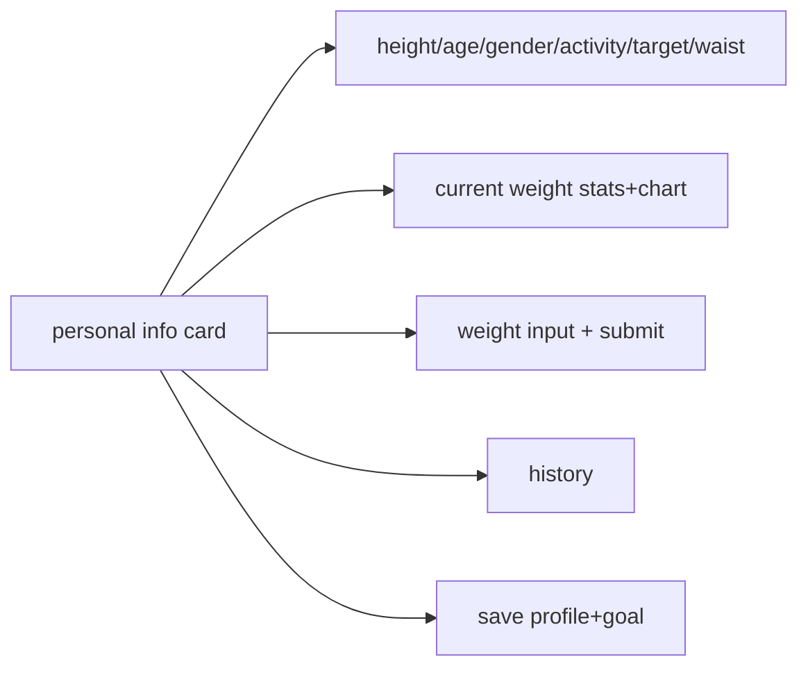

# Feature Spec: Merge Weight Tracking into Personal Info (Tier 2)

**Status:** Draft
**Tier:** 2 (Minor — UI restructure, no data/API change)
**Date:** 2026-11-25
**Grounding:** Principle VII (Five Whys); Don't Make Me Think

## 1. Problem & Context
Profile has three cards: "Thông tin cá nhân", "Mục tiêu", "Theo dõi cân nặng". Owner asked why weight is not inside personal info — weight is personal data.

### Five Whys
1. Why separate? Weight card was added later as its own feature.
2. Why confusing? "Cân nặng mong muốn" sits in personal info while "Cân nặng hiện tại" sits in another card.
3. Why bad? One concept split across two cards; users look in the wrong place.
4. Why not earlier? Feature-by-feature growth without re-checking IA.
5. Why now? Owner explicitly asked.
Root cause: **card boundaries follow implementation history, not user mental model**.

## 2. Acceptance Criteria (Gherkin)
AC-1: Given profile page, When rendered, Then personal-info card contains: current weight (stats + chart + input form + history), height, age, gender, activity, target weight, waist.
AC-2: Given the page, When rendered, Then there is no separate "Theo dõi cân nặng" card.
AC-3: Given weight form, When submitted, Then POST still works and toast appears.
AC-4: Given save profile, When clicked, Then PUT still works and reload persists.
AC-5: Given 375px, When rendered, Then no horizontal leak, touch >= 44px, dark mode clean.
AC-6: Given build/tests, When run, Then pass.

## 3. Architecture

Pure UI move; all handlers/state unchanged. No API/schema change.

### Verification harness
| Area | Type | Command |
|---|---|---|
| UI | Playwright | 1 card contains weight fields + personal fields; no "Theo dõi cân nặng" heading |
| Functional | Playwright | weight save + profile save persist after reload |
| Touch/leak | script | `audit_layout_invariants` at 375/1440 |
| Regression | full | build/typecheck/lint/test/smoke + verify-ui |

### Failure modes
- Moving JSX could break JSX nesting -> typecheck/build catches.
- Duplicate field labels -> verify no duplicate "Cân nặng" inputs.

## 4. Contract / Schema
No change.

## 5. Data Schema
No change.

## 6. Trade-offs
- Rejected: keep separate card as "history" -> still splits one concept.
- Chosen: one personal-data card with a weight subsection; simpler IA.

## 7. Takeaways
- Group by domain concept, not by when the code was written.
- A pure JSX move must be verified by functional tests, not just visual diff.

## 8. Security
No new path; 401 gate unchanged.

## 9. Performance SLA
Fewer cards; no extra requests.

## 10. Evidence
- Spec judge: 93/100
- Moved the entire weight subsection (stats + chart + single input form + history) into the "Thông tin cá nhân" card; deleted the separate "Theo dõi cân nặng" card and its h2
- First JSX unwrap attempt broke nesting (TS2657/TS1005); reverted file to HEAD and re-applied using exact card markers -> typecheck clean
- Playwright 375px: h2 sections now only [Thông tin cá nhân, Mục tiêu]; weight subsection + 1 input present; fill 69 -> Ghi nhận cân nặng -> toast -> reload shows 69.0 kg and history row; audit passed
- Build/typecheck/lint PASS; tests 70/70; smoke 9/9; verify-ui 4/4; URL 200
