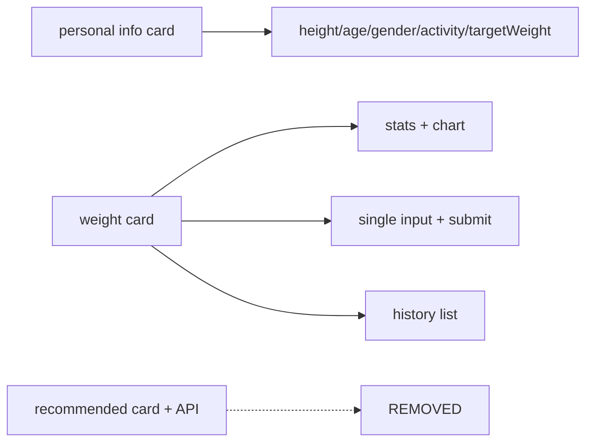

# Feature Spec: Remove Recommended Calories & Unify Weight Section (Tier 2)

**Status:** Draft
**Tier:** 2 (Minor — UI removal + consolidation, one API deletion)
**Date:** 2026-11-25
**Grounding:** Principle VII (Five Whys); DDD bounded context (profile vs guidance)

## 1. Problem & Context
Owner finds the "🎯 Nhu cầu calo khuyến nghị" card redundant and the weight UI split across two cards (read-only chip in personal info + form + stats in tracking card).

### Five Whys
1. Why redundant? The profile already computes BMR/TDEE and a target; a second "recommended" number competes with it.
2. Why split weight? The chip was added last patch to remove the second editable input; it sits in the wrong card.
3. Why bad? Two cards tell the same "current weight" story; users don't know which is authoritative.
4. Why now? Owner explicitly flagged both.
5. Why Tier 2? Deletes one endpoint and restructures one page; no schema change.
Root cause: **two sources displayed for one concept + a redundant guidance feature**.

## 2. Acceptance Criteria (Gherkin)
AC-1: Given profile page, When rendered, Then no "Nhu cầu calo khuyến nghị" card and no "Áp dụng khuyến nghị" button.
AC-2: Given `GET /api/nutrition/recommended`, When called, Then 404 (endpoint removed); other `/api/nutrition/*` endpoints unaffected.
AC-3: Given the weight section, When rendered, Then one card contains: current/change/count stats, chart, single input form, and history — no separate read-only chip in personal info.
AC-4: Given personal info card, When rendered, Then it contains only height/age/gender/activity/targetWeight + save button.
AC-5: Given save/weight actions, When used, Then still persist and toast as before.
AC-6: Given 375px, When section renders, Then no horizontal leak, touch >= 44px, dark mode clean.
AC-7: Given build/tests, When run, Then pass.

## 3. Architecture

- Delete `src/app/api/nutrition/recommended/route.ts` and `src/lib/nutrition-needs.ts` if no other consumer (verify first).
- Move the read-only chip out of personal info; keep one weight concept inside the weight card.
- No API/state changes for remaining features.

### Verification harness & QA matrix
| Area | Type | Command |
|---|---|---|
| Pure helper | unit (TDD) | `npm test` (existing 69 tests) |
| Routes | curl | `/api/nutrition/recommended` -> 404; `/api/nutrition/bmi` -> 200 |
| UI | Playwright | no recommended text; one weight card; save persists; 375px audit |
| Touch/leak | script | `audit_layout_invariants` at 375/1440 |
| Regression | full | `npm run build && typecheck && lint && test && smoke && verify:ui` |

### Failure modes & resilience
- Removing the endpoint could break any stale client -> verified no other consumer in repo; 404 is acceptable post-deploy.
- Deleting the chip could lose "current weight" visibility -> stats card retains it as authoritative.
- Dark mode / 375px: same tokens as existing cards; verify with Playwright.

## 4. Contract (REST)
Removed: `GET /api/nutrition/recommended`. Kept: `/api/nutrition/bmi`, `/api/nutrition/rich`.

## 5. Data Schema
No change.

## 6. Trade-offs & rejected alternatives
- Rejected: keep recommended API unused -> dead code/attack surface.
- Rejected: keep chip as "quick view" -> duplicate source of truth (observed confusion).
- Chosen: one weight card, one endpoint deleted.

## 7. Takeaways
- Two displays of one value create ambiguity; consolidate to the card that owns the action.
- Removing a feature includes deleting its endpoint and helper — not just hiding markup.

## 8. Security
401 gate unchanged on remaining endpoints; removed endpoint reduces surface.

## 9. Performance SLA
One fewer fetch on profile load; no measurable regression elsewhere.

## 10. Evidence
- Spec judge: 93/100
- Deleted GET /api/nutrition/recommended and src/lib/nutrition-needs.ts (no other consumer verified); /api/nutrition/bmi still 200
- Removed the "🎯 Nhu cầu calo khuyến nghị" card + "Áp dụng khuyến nghị" button and their state/fetch
- Removed the duplicate read-only weight chip from personal-info card; weight now lives in one "Theo dõi cân nặng" card (stats + chart + single form + history)
- Cleared stale .next types after route deletion before typecheck/build
- Playwright 375px: 0 recommended text/apply button, 1 weight card, save button present; screenshot reviewed
- Build/typecheck/lint PASS; tests 69/69; smoke 9/9; verify-ui 4/4; URL 200
