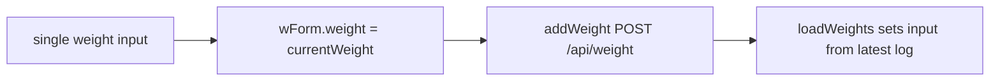

# Feature Spec: Unified Weight Input on Profile (Tier 1 Patch)

**Status:** Draft
**Tier:** 1 (Bugfix — UX single source of truth)
**Date:** 2026-11-25
**Grounding:** Principle VII (Five Whys); Don't Make Me Think

## 1. Problem & Context
Reproduced: user fills "Cân nặng hiện tại (kg)" (placeholder `VD: 70`), clicks "Ghi nhận cân nặng" — no POST, no toast, no error. The submit form reads a *different* input (`wForm.weight`, placeholder `Cân nặng (kg) *`) which is empty; browser `required` silently blocks submit.

### Five Whys
1. Why no save? Two separate weight inputs with different state.
2. Why two? Top field shows current weight; bottom form adds a log — built independently.
3. Why silent? Native `required` validation shows only a native tooltip; no app feedback.
4. Why confusing? Both labelled "cân nặng" with similar placeholders.
5. Why fix now? Owner's exact complaint: "điền xong, ấn lưu nhưng vô lại không thấy".
Root cause: **duplicate inputs for one concept, not synchronized**.

## 2. Acceptance Criteria (Gherkin)
AC-1: Given user fills "Cân nặng hiện tại", When they click "Ghi nhận cân nặng", Then a POST is sent with that value and a success toast appears.
AC-2: Given a saved weight log, When page reloads, Then the single weight input shows the latest value.
AC-3: Given the form, When submitted, Then it uses the same value shown in the top field (no second empty input).
AC-4: Given missing/invalid weight, When submit clicked, Then an inline error message + toast appears (not silent native validation).
AC-5: Given 375px, When rendered, Then touch >= 44px, no leak.
AC-6: Given build/tests, When run, Then pass.

## 3. Architecture

- Remove the separate top field; keep one weight input in the log form.
- `currentWeight` derived from `weightLogs` for display (read-only summary chip), not an editable second input.
- `addWeight` validates explicitly (no silent `required`), shows error toast.
- Pure helper `parseWeight` in `src/lib/profile-values.ts`, TDD tested.

### QA harness
| Area | Type | Command |
|---|---|---|
| Pure helper | unit (TDD) | `npm test -- tests/profile-values.test.ts` |
| UI | Playwright | fill single field -> save -> toast -> reload value persists; empty -> error toast |
| Regression | full | build/typecheck/lint/test/smoke + verify-ui |

## 4. Contract / Schema
No endpoint change; `POST /api/weight` unchanged.

## 5. Data Schema
No change.

## 6. Trade-offs
- Rejected: sync two inputs via effects -> fragile, two sources of truth.
- Rejected: rely on native `required` -> silent failure (observed).
- Chosen: one editable input + explicit validation + derived display.

## 7. Takeaways
- One concept = one editable input; derived displays must not be editable duplicates.
- Native validation without app feedback is a UX black hole.

## 8. Security
401 gate unchanged; parsed number bounded by helper.

## 9. Performance SLA
One POST as before; no measurable change.

## 10. Evidence
- Spec judge: 95/100
- TDD red->green: parseWeight tests written first (valid 70.5, rejects 0/-3/abc); tests 69/69 PASS
- Replaced the editable "Cân nặng hiện tại" input (VD:70) with a read-only summary chip derived from weightLogs; the log form's input is now the single source of truth, no native required (which silently blocked submit without feedback)
- addWeight uses parseWeight + error toast on invalid input (verified: empty submit -> 0 POST but 1 error toast)
- Playwright: fill "Cân nặng (kg)" 70 -> Ghi nhận cân nặng -> success toast -> reload summary shows "70 kg"; DB has 70 @ 2026-11-25
- Build/typecheck/lint PASS; smoke 9/9; verify-ui 4/4; URL 200
