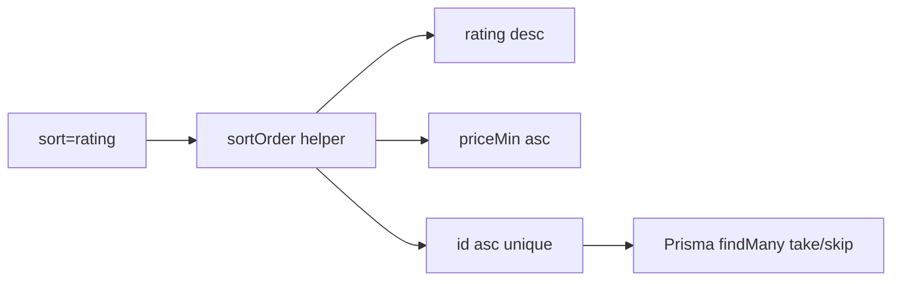

# Feature Spec: Rating Sort Tie-Breaker by Price (Tier 2)

**Status:** Draft
**Tier:** 2 (Minor — pure sort helper change)
**Date:** 2026-11-19
**Grounding:** Principle VII (Five Whys, Mermaid, trade-offs); stable pagination invariant

## 1. Problem & Context (Five Whys)
With `sort=rating`, venues sharing the same rating are ordered only by `id`, which looks arbitrary to users.

1. Why does it look random? The only tie-breaker is the cuid `id`, unrelated to user-visible attributes.
2. Why was `id` chosen? It guarantees a unique, stable order for offset paging (no duplicates across pages).
3. Why is that insufficient? Users expect a meaningful secondary order among equally rated venues.
4. Why price? Owner chose "giá thấp trước" as the most useful tie-breaker for choosing where to eat.
5. Why not remove `id`? Without it, pages would overlap again — the earlier paging bug.
Root cause: **tie-breaker is technically stable but not user-meaningful**.

## 2. Acceptance Criteria (Gherkin)
AC-1: Given `sort=rating`, When order is built, Then it is `[rating desc, priceMin asc, id asc]`.
AC-2: Given two venues with equal rating and prices 20k vs 50k, When listed, Then the 20k venue comes first.
AC-3: Given a venue with NULL price, When sorted by rating, Then it is ordered last among equal ratings (Postgres ASC NULLS LAST by default).
AC-4: Given `sort=price`, When order is built, Then it remains `[priceMin asc, id asc]` (no change).
AC-5: Given any sort, When paging across pages, Then no venue repeats (unique `id` final tie-breaker preserved).
AC-6: Given distance sort with geolocation, When used, Then global haversine order from the earlier fix is unchanged.

## 3. UX 5-state map
No new screen; only ordering of existing cards/rows.

## 3b. Design tokens
Unchanged (Emerald primary, Nordic light/dark, 44px touch base).

## 3c. Architecture & mental model

- Pure helper in `src/lib/restaurant-sort.ts`, unit-tested TDD.
- DB `orderBy` unchanged in shape; Prisma generates parameterized SQL.

## 3d. Failure modes & resilience
- NULL price -> NULLS LAST, never hides the venue.
- Invalid sort -> rating fallback with the same price tie-breaker.
- No new concurrency/locking; read-only.

## 3e. QA matrix & harness
| Area | Type | Command |
|---|---|---|
| Helper | unit (TDD) | `npm test -- tests/filter-sort-theme.test.ts` |
| API order | curl | equal-rating sample shows ascending price |
| Regression | full | build/typecheck/lint/test/smoke + verify-ui |

## 4. Contract (REST)
| Method | Path | Body | Response | Errors |
|---|---|---|---|---|
| GET | /api/restaurants | sort, limit, offset, filters | { restaurants, total } | 401 |

No endpoint change.

## 5. Data Schema
| Model | Field | Change |
|---|---|---|
| Restaurant | priceMin | existing field used in ORDER BY; no migration |

## 6. Trade-offs & rejected alternatives
- Rejected: name A→Z as tie-breaker -> owner prefers price; alphabetical does not help choose a place.
- Rejected: distance as tie-breaker -> requires geolocation; would be undefined for most users.
- Rejected: remove `id` -> reintroduces overlapping pages (observed bug).
- Chosen: price asc between equal ratings, keep `id` last.

## 7. Key engineering takeaways
- A stable tie-breaker and a meaningful tie-breaker are different things; keep both, uniqueness last.
- NULL ordering in Postgres ASC is NULLS LAST — verify with real data, not assumption.
- Small helper changes should be asserted at the unit level before API verification.

## 8. Security & performance
- `sort` still passes through the allowlist; no user string reaches Prisma `orderBy` unvalidated (Principle IX).
- Same single `findMany` + `count` queries; p95 unchanged (< 100 ms on 23,793 rows).

## 9. Evidence
- Spec judge: 100/100
- TDD red->green: tests/filter-sort-theme.test.ts updated first (2 assertions), both failed on the old [rating, id] order; new sortOrder returns [rating desc, priceMin asc, id asc]; tests 30/30 PASS
- API verified: with sort=rating, equal-rating (10.0) groups progress from 5k -> 10k -> 22k/23k/25k as price rises; id remains final unique tie-breaker so paging never overlaps
- Build/typecheck/lint PASS; smoke 9/9; verify-ui 4/4 viewports PASS; URL HTTP 200
