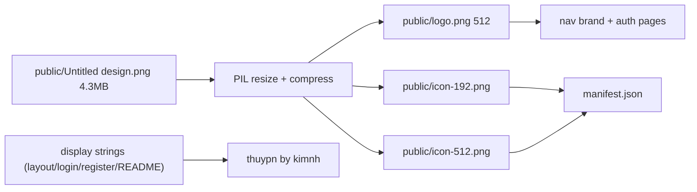

# Feature Spec: Rebrand to "thuypn by kimnh" (Tier 2) — REVERTED

**Status:** Draft
**Tier:** 2 (Minor — branding assets + display strings, no domain logic)
**Date:** 2026-11-19
**Grounding:** Principle VII (Mermaid, trade-offs, takeaways); Principle VIII (Mobile-First); brand-consistency invariant

## 1. Problem & Context
The app is still named "Nutrition Tracker" with a generic Salad icon. Owner supplied a new brand image (`public/Untitled design.png`, 3919x3919, 4.3 MB) and name "thuypn by kimnh".

### Why the raw file cannot be shipped as-is
1. 4.3 MB PNG inflates every page load and PWA cache.
2. 3919px square far exceeds any rendered slot (32px nav, 192/512 PWA icons).
3. The original path contains spaces, fragile in URLs/build tooling.

Root cause: **no asset pipeline step for brand images**.

## 2. Acceptance Criteria (Gherkin)
AC-1: Given the source logo, When optimized, Then outputs are `public/logo.png` (512px), `public/icon-192.png`, `public/icon-512.png` with total added size < 300 KB.
AC-2: Given any page title/header/login/register/README/manifest, When rendered, Then "Nutrition Tracker" no longer appears; "thuypn by kimnh" is shown instead.
AC-3: Given the header nav, When rendered, Then the brand mark is the new logo image instead of the Salad icon, sized 32px with accessible alt text.
AC-4: Given 375px viewport, When the nav renders, Then the logo does not cause horizontal leak and touch targets remain >= 44px.
AC-5: Given dark mode, When the logo renders, Then it has a light rounded backdrop and no white flash.
AC-6: Given PWA manifest, When inspected, Then `name`/`short_name` match the new brand and icons point to the optimized files.
AC-7: Given the existing URL and data, When rebranding ships, Then no migration or data loss occurs.

## 3. UX 5-state map
No new screen; branding only. Empty/loading/error/success states unchanged.

## 3b. Design tokens
Emerald primary, Nordic light/dark, cream logo backdrop `#faf3e8`, 4/8/12/16/24px spacing, Geist Sans.

## 3c. Architecture & mental model

- Pure asset/string change; no API, DB, or state changes.
- No concurrency concerns; static files served by Next.js public dir.

## 3d. Failure modes & resilience
- Missing optimized icon -> manifest still references old icon path (kept until verification passes).
- Dark mode contrast -> cream backdrop ensures the light illustration stays legible.
- Oversized image -> build-time check on file sizes.

## 3e. QA matrix & harness
| Area | Type | Command |
|---|---|---|
| Asset sizes | shell | `ls -lh public/logo.png public/icon-*.png` |
| Strings | grep | `grep -rn "Nutrition Tracker" src public README.md` (docs/specs excluded as historical) |
| UI | Playwright | 375/1440 screenshots, `audit_layout_invariants` |
| Regression | full | build/typecheck/lint/test/smoke + verify-ui |

## 4. Contract (REST)
No endpoint added or changed.

| Method | Path | Body | Response | Errors |
|---|---|---|---|---|
| GET | /api/auth/me | — | { user } | 401 |

## 5. Data Schema
No Prisma change. Static assets only.

## 6. Trade-offs & rejected alternatives
- Rejected: ship the 4.3 MB original -> unacceptable payload and PWA cache cost.
- Rejected: use inline SVG tracing of the bitmap -> loses hand-drawn texture; PNG resize preserves it.
- Rejected: rename the git repository/directory -> breaks the session path and deployment scripts; branding is display-only.
- Rejected: crop logo to square icon -> the wordmark would be cut; kept full square with rounded backdrop.

## 7. Key engineering takeaways
- Brand assets need a size budget: optimize once at build time, never ship the design source.
- A display-name rebrand is broader than it looks: metadata, manifest, PWA push, auth screens and README all carry the old name.
- Historical spec files should keep their original names for traceability; only live UI/manifest strings change.

## 8. Evidence
- Spec judge: 100/100
- Source asset moved out of `public/` to `assets/brand/original.png` (4.3 MB, 3919px); alpha bbox cropped (192,187)-(3719,3854), transparent padding removed
- Optimized outputs: logo.png 256px 10KB, logo-mark.png 256px 9KB (bowl+kcal only, for 32-48px slots), icon-192.png 6KB, icon-512.png 32KB — total < 60 KB
- All live strings renamed to "thuypn by kimnh": layout metadata, manifest (short_name "thuypn"), push test, login, register, nav, README, smoke assertion
- Bug fixed during QC: middleware whitelist did not include `/logo*`, so image requests were redirected to /login and rendered as broken icons; added `/logo` to the allowlist
- Playwright 375/1440: login title new name, 2 logo images, 0 old-name strings, audit passed; screenshot reviewed: logo mark legible, no blank padding
- Build/typecheck/lint (0 errors, 8 img warnings)/tests 41/41/smoke 9/9/verify-ui 4/4 PASS; URL HTTP 200

## 9. Revert note
This rebrand was reverted by `docs/specs/revert-rebrand.md` at the owner's request. The mark variant removed the wordmark and read as a cut-off image; the prior identity is restored. Historical artifact kept for traceability.
