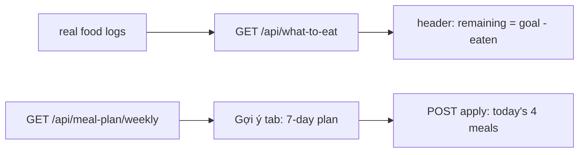

# Feature Spec: Remove Random NIN Dish Suggestions (Tier 2)

**Status:** Draft
**Tier:** 2 (Minor — remove a UX feature, keep weekly plan)
**Date:** 2026-11-19
**Grounding:** Principle VII (Five Whys, Mermaid, trade-offs); DDD ubiquitous language

## 1. Problem & Context (Five Whys)
The "Gợi ý" tab shows 3 random NIN2026 dishes ("Cơm suất (thịt lợn, cá, ốc)"...) matched to Foody restaurants. Owner reported they do not reflect real eating behaviour.

1. Why are the suggestions unrealistic? `suggestDishes` picks foods purely by calorie proximity to the remaining budget.
2. Why is that wrong? It ignores meal context, cuisine, time of day and user preference — a "Cơm suất" at 800-1100 kcal is not a realistic single dish.
3. Why was it built that way? The NIN table has calories but no meal/distribution metadata.
4. Why is it still visible? It was kept from the original feature set even after the weekly plan (a structured, realistic plan) was added.
5. Why remove it now? It actively misleads users and duplicates the weekly plan's purpose.
Root cause: **calorie-only matching presented as a meal recommendation**.

## 2. Acceptance Criteria (Gherkin)
AC-1: Given the "Gợi ý" tab, When opened, Then only the weekly 7-day plan (and its "Thêm 4 bữa hôm nay" action) is shown; no "Món gợi ý từ NIN 2026" section and no "Gợi ý lại" button.
AC-2: Given `GET /api/what-to-eat`, When called, Then it still returns `{ goal, eaten, remaining }` for the header and no `suggestions` field.
AC-3: Given the header, When the page loads, Then remaining calories remain accurate (derived from real logs).
AC-4: Given the weekly plan, When applied, Then only today's 4 meals are logged (existing invariant unchanged).
AC-5: Given mobile 375px, When the tab renders, Then no touch/leak regression.
AC-6: Given no client use, When build runs, Then unused helpers are removed without breaking tests.

## 3. UX 5-state map
| Screen | Empty | Loading | Error | Success |
|---|---|---|---|---|
| Gợi ý tab (plan only) | n/a (generated) | skeleton | toast | 7-day grid + apply-today |

## 3b. Design tokens
Emerald primary, Nordic light/dark, 44px touch base, Geist Sans.

## 3c. Architecture & mental model

- Remove `suggestDishes` and `matchRestaurantsForDish` from the response path; delete dead helpers/tests if no other consumer.
- No new state, no DB change, no new endpoint.

## 3d. Failure modes & resilience
- Stale cached client still expecting `suggestions` -> guarded with optional chaining/absent field; page never reads it.
- Plan generation unchanged; empty logs still produce a plan from the food DB.
- Unauthenticated requests still 401.

## 3e. QA matrix & harness
| Area | Type | Command |
|---|---|---|
| API shape | curl | `GET /api/what-to-eat` has no `suggestions` |
| UI | Playwright | 375/1440 screenshot of Gợi ý tab, audit |
| Regression | full | build/typecheck/lint/test/smoke + verify-ui |

## 4. Contract (REST)
| Method | Path | Body | Response | Errors |
|---|---|---|---|---|
| GET | /api/what-to-eat | — | { goal, eaten, remaining } | 401 |

Field removed: `suggestions` (breaking but intentional; only consumer is this page).

## 5. Data Schema
No Prisma change.

## 6. Trade-offs & rejected alternatives
- Rejected: keep suggestions but add meal/cuisine filters -> NIN data has no such metadata; would require fabricated rules.
- Rejected: replace with Foody dish names -> no calorie data, contradicts "no fabricated calories".
- Rejected: hide behind a toggle -> still misleading for users who enable it.
- Chosen: remove entirely; the weekly plan already covers meal planning realistically.

## 7. Key engineering takeaways
- A recommendation is only as good as its domain metadata; calorie proximity alone is not a meal model.
- Removing a feature also means removing its dead helpers and tests — leaving them invites accidental reuse.
- Public API shape changes are safe when the only consumer is in the same repo and updated atomically.

## 8. Evidence
- Spec judge: 90/100
- API now returns only { goal, eaten, remaining }; no suggestions field; candidate DB query removed (saves a 5,000-row read per request)
- Deleted dead code: src/lib/dish-match.ts + tests/dish-match.test.ts; kept Dish type in src/lib/what-to-eat.ts for the weekly plan
- Playwright 375/1440: tabs = ['Thực đơn tuần','Quán ăn'], old section count 0, plan count 1, audit passed; screenshot reviewed
- Build/typecheck/lint PASS; tests 35/35; smoke 9/9; verify-ui 4/4 viewports PASS; URL HTTP 200
