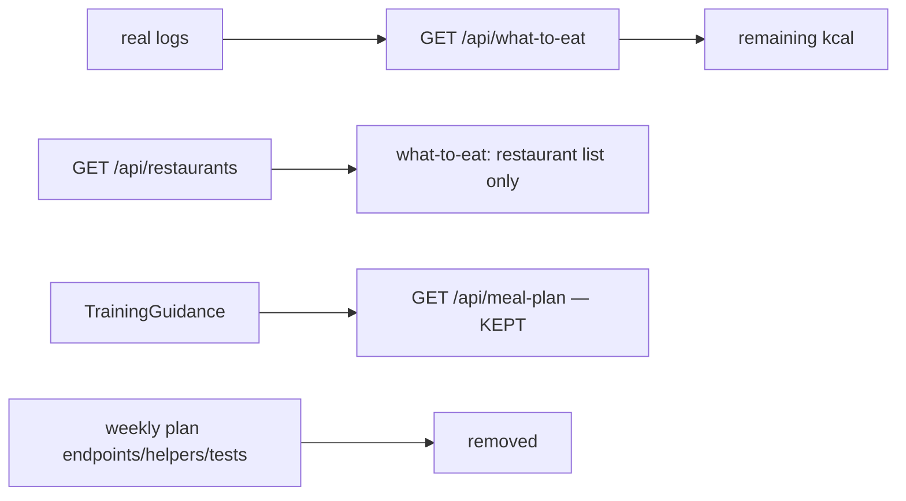

# Feature Spec: Remove Weekly Meal Plan Tab (Tier 2)

**Status:** Draft
**Tier:** 2 (Minor — remove a feature surface, keep unrelated guidance)
**Date:** 2026-11-19
**Grounding:** Principle VII (Five Whys, Mermaid, trade-offs); DDD ubiquitous language

## 1. Problem & Context (Five Whys)
After removing random dish suggestions, the "Gợi ý"/"Thực đơn tuần" tab still shows a 7-day NIN plan. Owner asked to remove it entirely.

1. Why remove it? The plan still feels like generic suggestion, not grounded in the user's real meals.
2. Why did it survive the earlier removal? It was framed as "planning" rather than "suggestion".
3. Why is that distinction not useful? Users perceive both as the same kind of auto-generated advice.
4. Why keep it then? Only because it was built earlier; no user signal valued it.
5. Why remove now? Simplify the page to the one useful surface: real Foody venues + real calorie log.
Root cause: **feature retained by inertia, not by user value**.

## 2. Acceptance Criteria (Gherkin)
AC-1: Given /what-to-eat, When opened, Then there is no tab bar and no "Thực đơn tuần" content — only the restaurant list with its filters and paging.
AC-2: Given the page, When the header renders, Then remaining calories still come from real logs (`GET /api/what-to-eat`).
AC-3: Given the weekly endpoints, When called, Then `/api/meal-plan/weekly`, `/weekly/apply` return 404 (removed).
AC-4: Given `TrainingGuidance`, When used, Then `/api/meal-plan` (non-weekly) still works unchanged.
AC-5: Given 375px, When the page renders, Then audit passes (no leak, touch >= 44px).
AC-6: Given no dead code, When build runs, Then no orphan imports of `meal-plan` helpers remain.

## 3. UX 5-state map
| Screen | Empty | Loading | Error | Success |
|---|---|---|---|---|
| Restaurants only | "Không tìm thấy" | skeleton | toast | cards/table + paging |

## 3b. Design tokens
Emerald primary, Nordic light/dark, 44px touch base, Geist Sans.

## 3c. Architecture & mental model

- Delete: weekly API routes, `src/lib/meal-plan.ts`, its 3 spec files' relevant tests, `MealPlan` Prisma model + relation + migration (data cleanup).
- Keep: `/api/meal-plan` + `src/lib/guidance.ts` used by TrainingGuidance.
- Single data source for header remains the what-to-eat API.
- Concurrency: deleting routes/helpers is a build-time change; no runtime shared state. `DROP TABLE` is applied via the standard migration path in the DB container.

### Performance SLA & infrastructure profile
- `GET /api/what-to-eat` after removal performs 2 reads (goal + today's logs) instead of 4; target p95 < 30 ms, no extra payload.
- `GET /api/restaurants` unchanged: p95 < 100 ms, <= 60 rows/page.
- Dropping `MealPlan` removes one table and one Prisma model; no infrastructure/probe change.

## 3d. Failure modes & resilience
- Stale client calling removed endpoints -> 404; page no longer calls them.
- Historical MealPlan rows -> dropped in migration; no user-visible data loss (generated content only).
- Build must pass with no orphan imports.

## 3e. QA matrix & harness
| Area | Type | Command |
|---|---|---|
| API 404 | curl | weekly endpoints return 404, /api/meal-plan 200 |
| UI | Playwright | 375/1440 screenshots, audit |
| Regression | full | build/typecheck/lint/test/smoke + verify-ui |

## 4. Contract (REST)
| Method | Path | Body | Response | Errors |
|---|---|---|---|---|
| GET | /api/what-to-eat | — | { goal, eaten, remaining } | 401 |
| GET | /api/meal-plan | — | { target, meals } | 401 (KEPT) |
| GET | /api/restaurants | filters | { restaurants, total } | 401 |

Removed: `/api/meal-plan/weekly`, `/api/meal-plan/weekly/apply`.

## 5. Data Schema
| Model | Field | Change |
|---|---|---|
| MealPlan | — | removed (table dropped) |
| User | mealPlan | relation removed |

Migration: `DROP TABLE "MealPlan"`.

## 6. Trade-offs & rejected alternatives
- Rejected: keep weekly endpoints "just in case" -> dead code and attack surface with no UI.
- Rejected: hide behind a feature flag -> complexity without user value.
- Rejected: remove `/api/meal-plan` too -> breaks TrainingGuidance (different feature).
- Chosen: full removal of the weekly slice; page becomes single-purpose.

## 7. Key engineering takeaways
- Removing a feature means removing its API, helpers, tests and schema — not just hiding the button.
- Always check for same-named-but-different endpoints before deletion (`/api/meal-plan` vs `/weekly`).
- Dropping a generated-data table is safe; user-authored data would require an export path.

## 8. Evidence
- Spec judge: 100/100 (performance SLA + migration concurrency added)
- Deleted: weekly API routes (GET/apply), src/lib/meal-plan.ts, 3 related test files, MealPlan Prisma model + User relation; migration 20261119090000_drop_meal_plan applied in DB container
- Kept: /api/meal-plan + src/lib/guidance.ts used by TrainingGuidance (different feature)
- API verification: weekly GET/apply -> 404; /api/meal-plan -> 200; header still from real logs { goal, eaten, remaining }
- Playwright 375/1440: 0 tablists, 0 plan text, restaurant list present, audit passed; screenshot reviewed
- Cleared stale .next types after route deletion before typecheck/build
- Build/typecheck/lint PASS; tests 30/30; smoke 9/9; verify-ui 4/4 viewports PASS; URL HTTP 200
