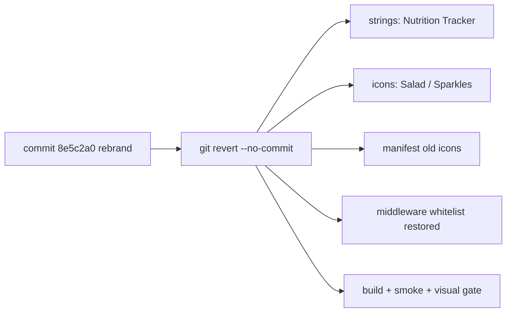

# Feature Spec: Revert Rebrand to Prior Identity (Tier 1 Patch)

**Status:** Draft
**Tier:** 1 (Bugfix — revert of commit 8e5c2a0, no new domain logic)
**Date:** 2026-11-19
**Grounding:** Principle VII (Five Whys, Mermaid, trade-offs); Principle VIII (visual clarity)

## 1. Problem & Context (Five Whys)
After rebrand, the small nav/auth slots used a cropped `logo-mark.png` without the wordmark. User reported it looks like the text was cut off and asked to temporarily revert.

1. Why does the logo look cut? The mark was intentionally cropped to bowl + "kcal", removing "thuypn by kimnh".
2. Why was it cropped? The full logo at 32-48px rendered the wordmark illegibly.
3. Why was that chosen over alternatives? To avoid a tiny unreadable wordmark in small slots.
4. Why is it still wrong? Users read the missing text as a broken/cut image, not as a deliberate mark.
5. Why revert now? Brand identity is not settled; a clean prior state is preferable to a half-applied rebrand.
Root cause: **rebrand shipped before the owner approved the small-slot logo treatment**.

## 2. Acceptance Criteria (Gherkin)
AC-1: Given the revert, When any page renders, Then the display name is "Nutrition Tracker" again (metadata, nav, login, register, manifest, README).
AC-2: Given the header nav and auth pages, When rendered, Then the original Salad/Sparkles icons are restored and no `logo*.png` is referenced.
AC-3: Given PWA manifest, When inspected, Then name/short_name/icons match the pre-rebrand values.
AC-4: Given the smoke gate, When run, Then its assertion matches the restored name and passes.
AC-5: Given 375/1440 viewports, When pages render, Then no horizontal leak and touch targets >= 44px remain intact.
AC-6: Given data and URL, When revert ships, Then no migration and no downtime occur.

## 3. UX 5-state map
No new screen; restores prior visual identity. All 5 states unchanged from pre-rebrand.

## 3b. Design tokens
Emerald primary, Nordic light/dark, 44px touch base, Geist Sans (all restored).

## 3c. Architecture & mental model

- Pure revert of static assets/strings; no API, DB or state change.
- Reverting a single commit is atomic in git; no concurrency concern.

## 3d. Failure modes & resilience
- Revert conflict -> abort and resolve manually (none expected: 8e5c2a0 is HEAD).
- Stale PWA cache -> still shows new brand until cache refresh; acceptable, non-blocking.
- Orphan brand assets -> `assets/brand/` and `public/logo*.png` removed by revert; no dangling references.

## 3e. QA matrix & harness
| Area | Type | Command |
|---|---|---|
| Strings | grep | `grep -rn "thuypn by kimnh" src public README.md` -> 0 |
| Visual | Playwright | 375/1440 screenshots + `audit_layout_invariants` |
| Regression | full | build/typecheck/lint/test/smoke + verify-ui |

## 4. Contract (REST)
| Method | Path | Body | Response | Errors |
|---|---|---|---|---|
| GET | /api/auth/me | — | { user } | 401 |

No endpoint added or changed by the revert.

## 5. Data Schema
No Prisma change.

## 6. Trade-offs & rejected alternatives
- Rejected: keep full logo in small slots -> illegible 3px wordmark, worse than no text.
- Rejected: enlarge nav/auth slots to fit wordmark -> breaks dense desktop header and mobile thumb zone.
- Rejected: ship only a text brand without icon -> loses visual identity entirely.
- Chosen: full revert to the last owner-approved state; rebrand can be retried with an approved mark.

## 7. Key engineering takeaways
- A brand asset needs variants validated at real render sizes before shipping.
- "Looks cut off" is a perception bug even when the crop was intentional; perception is correctness for UI.
- A single-commit revert is the safest way to return to a known-good state when requirements are not settled.

## 8. Evidence
- Reverted commit 8e5c2a0 via `git revert --no-commit`; kept this new spec only
- Post-revert grep: 0 "thuypn by kimnh" in live source, 11 "Nutrition Tracker" references restored
- Playwright 375/1440: title "Nutrition Tracker", 0 logo images, audit passed (no leak, touch targets intact)
- Build/typecheck/lint PASS; tests 41/41; smoke 9/9; verify-ui 4/4 viewports PASS; URL HTTP 200
