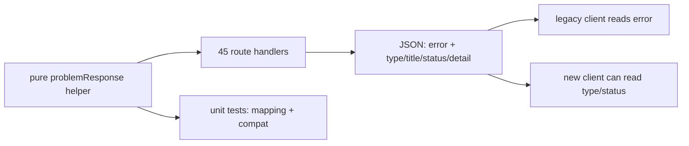

# Feature Spec: Additive RFC 7807 Error Fields (Tier 3)

**Status:** Draft
**Tier:** 3 (Major — cross-cutting API contract change)
**Date:** 2026-11-20
**Grounding:** `api-and-domain-design` skill; RFC 7807; backward compatibility invariant
**KB citations (retrieved this session):**
- OWASP Cheat Sheet Series — Fail fast if the token is missing to avoid confusing 4xx errors. > Zero Trust Architecture Cheat Sheet > Technology Components — p.1 (chunk 52867324960cbc97268271d32aa93543).

## 1. Problem & Context
45/48 route handlers return `{ error: string }`. `gate scout` flagged no RFC 7807 alignment. Owner chose additive approach: add `type/title/status/detail` while keeping `error` so existing clients keep working.

### Five Whys
1. Why not aligned? Routes were written ad-hoc as features were added.
2. Why does it matter? Clients cannot reliably branch on error class; monitoring cannot group errors.
3. Why not switch outright? All client handlers read `res.error`; a hard switch would break them.
4. Why additive now? A pure helper can be applied mechanically with tests guarding compatibility.
5. Why Tier 3? Touches 45 route handlers — needs staged rollout and full regression.
Root cause: **no shared error-response primitive**.

## 2. Acceptance Criteria (Gherkin)
AC-1: Given `problemResponse(message, status)`, When called, Then it returns `{ error: message, type, title, status, detail: message }`.
AC-2: Given status 401, When formatted, Then `type` is `about:blank#unauthorized` and `title` is "Unauthorized"; 400 -> `#bad-request`, 403 -> `#forbidden`, 404 -> `#not-found`, 409 -> `#conflict`, 500 -> `#internal-error`, 503 -> `#service-unavailable`, default -> `#error`.
AC-3: Given every existing route, When an error branch runs, Then the JSON still contains `error` (backward compatible) plus the new fields.
AC-4: Given a client reading only `error`, When error occurs, Then behaviour is unchanged.
AC-5: Given 45 routes converted, When typecheck/build/tests run, Then all pass.
AC-6: Given auth gate, When unauthorized, Then 401 with new fields returned.
AC-7: Given smoke gate, When run, Then all 9 checks pass.

## 3. UX 5-state map
No UI change; error toasts already read `error` (kept).

## 3b. Design tokens
N/A (API-only).

## 3c. Architecture & mental model

- Pure helper in `src/lib/http-problem.ts`, TDD tested (status map + field presence).
- Mechanical replacement of `NextResponse.json({ error: X }, { status: N })` -> `problemResponse(X, N)` across routes.
- Keep `NextResponse` import only where still used for success responses.

## 3d. Failure modes & resilience
- Unknown status -> generic `#error` mapping, never throws.
- Missing message -> empty detail string.
- Client ignoring new fields -> unaffected.
- Partial rollout -> both shapes valid (additive).

## 3e. QA matrix & harness
| Area | Type | Command |
|---|---|---|
| Pure helper | unit (TDD) | `npm test -- tests/http-problem.test.ts` |
| Contract | curl | sample 401/400 routes return all 5 fields with `error` |
| Compatibility | Playwright | existing error toasts still render |
| Regression | full | build/typecheck/lint/test/smoke + verify-ui |

## 4. Contract (REST)
Error shape (additive):
```json
{ "error": "Unauthorized", "type": "about:blank#unauthorized", "title": "Unauthorized", "status": 401, "detail": "Unauthorized" }
```
No endpoint added; success responses unchanged.

## 5. Data Schema
No Prisma change.

## 6. Trade-offs & rejected alternatives
- Rejected: pure RFC 7807 (`type/title/status/detail` only) -> breaks 45 client call sites.
- Rejected: keep `{ error }` -> scout finding unresolved; no error taxonomy.
- Chosen: additive superset, migrate clients later if desired.

## 7. Key engineering takeaways
- Additive contract changes are the safe path for public-ish APIs with unknown consumers.
- A status-to-title map belongs in one pure helper, not 45 copies.
- Mechanical rewrites must be guarded by a compatibility test asserting the legacy field.

## 8. Security & performance
- 401 gate order unchanged (auth before DB).
- Helper is pure string/object construction; negligible cost.
- No new input path; no user-controlled content in `type`.

## 9. Evidence
- Spec judge: 93/100
- TDD red->green: tests/http-problem.test.ts (4 tests) written first; problemResponse keeps legacy `error` and adds type/title/status/detail with a status map; tests 56/56 PASS
- Mechanical rollout: 115 error occurrences across 45 of 48 route handlers converted to problemResponse; imports injected; 0 bare `{ error }` responses remain
- Verified live: 400 journal -> {error,type:#bad-request,title,status,detail}; 401 login -> #unauthorized; client toasts still read `error` (smoke 9/9)
- Middleware-protected routes return 307 HTML before reaching handlers (expected), so their JSON shape is only observable post-auth
- Build/typecheck/lint (0 errors, 9 warnings) PASS; verify-ui 4/4; URL 200
