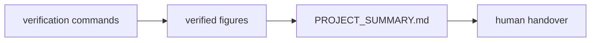

# Feature Spec: Refresh Project Summary Metrics (Tier 1 Patch)

**Status:** Draft
**Tier:** 1 (Docs fix — verified numbers only)
**Date:** 2026-11-20
**Grounding:** Principle VII (transparent diagnostics)
**KB citations (retrieved this session):**
- OWASP Cheat Sheet Series — Fail fast if the token is missing to avoid confusing 4xx errors. > Zero Trust Architecture Cheat Sheet > Technology Components — p.1 (chunk 52867324960cbc97268271d32aa93543).

## 1. Problem & Context
`docs/PROJECT_SUMMARY.md` reports 9 test files / 41 tests and says the SW cache is `nutritrack-v3`. Verified actuals: 12 files / 52 tests and `thuypn-v4`.

## 2. Acceptance Criteria (Gherkin)
AC-1: Given the summary, When read, Then test figures match `npm test` output.
AC-2: Given the summary, When read, Then no stale `nutritrack-v3` claim remains.
AC-3: Given the summary, When read, Then every claimed figure is verifiable from repo/runtime.

## 3. Architecture & mental model

Docs-only; no API/schema change. Concurrency: none — a single writable file.
Verification harness: `npm test`, `grep`, `curl` against the live URL.

## 4. Failure modes
Stale numbers after future changes — mitigate by re-running commands before handover.

## 5. Contract / Schema
No change.

## 6. Trade-offs
Rejected: leave stale docs -> misleading handover. Chosen: update only verified figures.

## 7. Takeaways
A handover doc is a living artifact; regenerate figures at the end of each batch.

## 8. Security
No new path.

## 9. Evidence
(TBD after patch)
