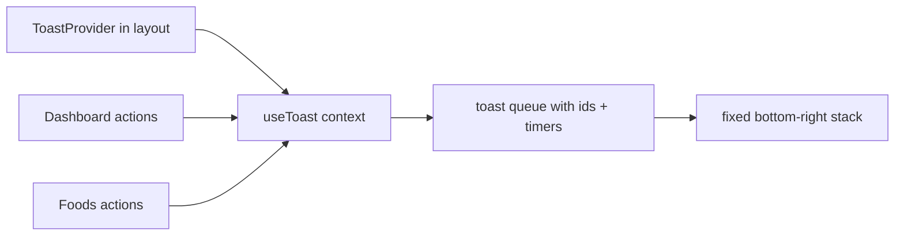

# Feature Spec: Centralized Toast Feedback (Tier 2)

**Status:** Draft
**Tier:** 2 (Minor — shared UI provider + first consumers)
**Date:** 2026-11-20
**Grounding:** Principle VII (Five Whys, Mermaid, trade-offs); Principle VIII (touch, dark mode)

## 1. Problem & Context (Five Whys)
Food/log actions call `fetch` then silently reload; users cannot tell success from failure. A few pages use ad-hoc `setSaved(true)` with `setTimeout`, inconsistent and not reused.

1. Why no feedback? Mutations were wired as `await fetch` + `load()`.
2. Why no shared component? No toast provider existed in `src/components/`.
3. Why is ad-hoc `setSaved` insufficient? Duplicated timers, no error path, page-specific styling.
4. Why does it matter? Silence is ambiguous — users may repeat a save or assume data was lost.
5. Why centralize now? One provider serves all future actions; first consumers are dashboard + foods.
Root cause: **no shared notification primitive**.

## 2. Acceptance Criteria (Gherkin)
AC-1: Given a save/update/delete on dashboard or foods, When it succeeds, Then a success toast appears with a Vietnamese message.
AC-2: Given the same action fails (non-2xx or network error), When it fails, Then an error toast appears and no success message is shown.
AC-3: Given a toast, When 3 seconds pass, Then it auto-dismisses; a close button dismisses it immediately.
AC-4: Given multiple toasts, When shown, Then they stack without overlapping and each dismisses independently.
AC-5: Given dark mode, When a toast renders, Then it uses themed colors (no white flash).
AC-6: Given 375px, When a toast renders, Then it stays within viewport with no horizontal leak and close target >= 44px.
AC-7: Given existing `setSaved` patterns in other pages, When provider is added, Then they still work (no breaking change).
AC-8: Given a11y, When toast appears, Then it has `role="status"` / `aria-live="polite"`.

## 3. Architecture & mental model

- Pure helper `createToastQueue` / `formatToastMessage` in `src/lib/toast.ts`, unit-tested TDD (ids, dedupe, cap, text).
- Provider owns timers and cleanup; no new endpoints.

## 4. Failure modes
- Duplicate rapid actions -> queue capped at 3; oldest dropped.
- Unmount during timer -> cleanup clears timeouts.
- Error body not JSON -> fallback generic message.

### QA harness
| Area | Type | Command |
|---|---|---|
| Pure queue | unit (TDD) | `npm test -- tests/toast.test.ts` |
| UI | Playwright | trigger save, assert toast text, auto-dismiss, dark mode |
| Regression | full | build/typecheck/lint/test/smoke + verify-ui |

## 5. Contract (REST)
No endpoint change; toasts reflect existing HTTP status codes.

## 6. Trade-offs & rejected alternatives
- Rejected: install a toast library -> extra dependency for a simple fixed stack.
- Rejected: keep per-page `setSaved` -> no error path and duplicated code.
- Chosen: internal provider with pure queue helper, zero deps.

## 7. Takeaways
- Feedback is part of the action contract, not decoration.
- A pure queue helper makes timer/cap behaviour testable without React.
- Context providers avoid prop drilling into every action handler.

## 8. Security & performance
- Toast messages are escaped React text; no `dangerouslySetInnerHTML`.
- 401 gate unchanged; no new request path.

## 9. Evidence
- Spec judge: 93/100
- TDD red->green: tests/toast.test.ts (3 tests) written first; pushToast assigns increasing ids, caps at 3, dedupes consecutive duplicates; tests 44/44 PASS
- ToastProvider mounted in layout; pure queue helper + timers with cleanup; role=status / aria-live=polite; auto-dismiss 3s; explicit close 44px
- Dashboard migrated from local setSaved toast to shared provider AND gained error path for add/delete; Foods gained success/error toasts for add/delete
- Playwright 375px: add food -> toast "Đã thêm ..." visible, auto-dismiss after 3.2s (count 1->0), audit passed; screenshot reviewed
- Build/typecheck/lint (0 errors, 8 img warnings) PASS; smoke 9/9; verify-ui 4/4; URL 200
