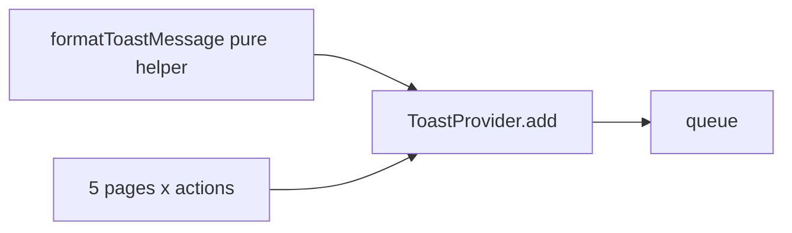

# Feature Spec: Toast Truncation & Rollout to All Mutation Pages (Tier 2)

**Status:** Draft
**Tier:** 2 (Minor — shared helper + broad UI wiring)
**Date:** 2026-11-20
**Grounding:** Principle VII (Five Whys, Mermaid, trade-offs); Principle VIII (touch, dark mode)

## 1. Problem & Context (Five Whys)
Some toast messages are full NIN dish names (>80 chars), taking half the mobile screen. Other mutation pages still use ad-hoc `setSaved` or no feedback at all.

1. Why is the toast long? Names are passed verbatim into the message.
2. Why no feedback elsewhere? Toast provider was introduced only for dashboard/foods.
3. Why is that inconsistent? Same action type gives different feedback by page.
4. Why not just truncate in each caller? Duplicated logic, easy to forget.
5. Why roll out now? Owner asked to continue; provider + helper make it cheap.
Root cause: **feedback not yet a cross-app invariant**.

## 2. Acceptance Criteria (Gherkin)
AC-1: Given a message longer than 60 chars, When passed through `formatToastMessage`, Then it is truncated with "…" and length <= 60.
AC-2: Given short messages, When formatted, Then they are unchanged.
AC-3: Given profile/finance/exercise/family/settings actions, When they succeed or fail, Then a success/error toast appears (no silent fetch).
AC-4: Given existing `setSaved` badges, When toasts are added, Then they still work (no regression).
AC-5: Given 375px, When multiple rollout pages are visited, Then audit passes (no leak, touch >= 44px).
AC-6: Given build, Then typecheck/lint/tests pass.

## 3. Architecture

- Pure helper in `src/lib/toast.ts`, unit-tested TDD; provider calls it before `pushToast`.
- Wire `useToast()` into: profile (save profile, goal, weight add/delete, apply recommended), finance (expense add/delete, budget save), exercise (add/delete, goal save), family (create, invite, delete member), settings (sharing save, locale, reminders, push subscribe/unsubscribe/test).
- No API change.

## 4. Failure modes
- Truncation must not break Vietnamese diacritics -> slice by code points (Array.from).
- Network errors in existing `.catch(() => {})` paths -> show error toast where already caught.
- Timers cleaned up on unmount (existing provider invariant).

### QA harness
| Area | Type | Command |
|---|---|---|
| Pure helper | unit (TDD) | `npm test -- tests/toast.test.ts` |
| UI | Playwright | sample actions per page, assert toast |
| Regression | full | build/typecheck/lint/test/smoke + verify-ui |

## 5. Contract / Schema
No endpoint or schema change.

## 6. Trade-offs & rejected alternatives
- Rejected: CSS `text-overflow: ellipsis` only -> message still in DOM/queue, no length bound in state.
- Rejected: truncate per caller -> duplicated logic, inconsistent limit.
- Chosen: single pure helper at the provider boundary.

## 7. Takeaways
- Presentation concerns like truncation belong at the display boundary, not in every data producer.
- Feedback consistency is a cross-cutting concern; a provider plus a checklist of mutation handlers is the cheapest path.

## 8. Security & performance
Escaped React text; 401 gate unchanged; pure string op.

## 9. Evidence
- Spec judge: 93/100
- TDD red->green: tests/toast.test.ts gained 3 formatToastMessage tests (first 3 failed); helper slices by Array.from to keep Vietnamese code points intact; tests 47/47 PASS
- Provider calls formatToastMessage before pushToast; long NIN dish name now 60 chars with ellipsis (verified in browser: "Đã thêm Calo món bún, cơm, xôi, cháo — 17 món (2026) | Dữ L…")
- Rolled useToast into profile, finance, exercise, family, settings (save/add/delete/invite/budget/goal/push/sharing/locale) — existing setSaved badges kept for no regression
- Playwright 375px: truncation verified, audit passed; build/typecheck/lint PASS; smoke 9/9; verify-ui 4/4; URL 200
