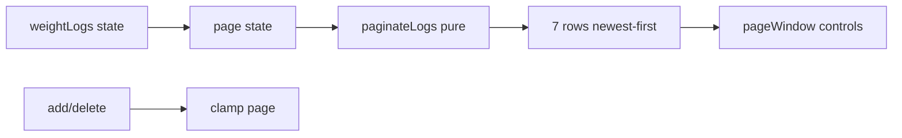

# Feature Spec: Weight History Pagination (Tier 2)

**Status:** Draft
**Tier:** 2 (Minor — UI pagination for weight history)
**Date:** 2026-11-25
**Grounding:** Principle VII (Five Whys); `api-and-domain-design` (stable paging)

## 1. Problem & Context
Weight history renders every log in a `max-h-48 overflow-y-auto` list. As logs accumulate, users must scroll a small inner container with no position indicator.

### Five Whys
1. Why hard to browse? All logs render at once in a tiny scroll box.
2. Why? History was added as a simple list.
3. Why bad? No sense of how many entries exist or where you are; old entries require long scroll.
4. Why now? Owner asked for pagination / a better mechanism.
5. Why Tier 2? Reuses existing pure pagination helpers; only UI + one small helper.
Root cause: **unbounded list rendering**.

## 2. Acceptance Criteria (Gherkin)
AC-1: Given N weight logs, When history renders, Then at most 7 rows show per page with a "Trang x / y · N lần ghi" indicator.
AC-2: Given prev/next or a page button, When clicked, Then the corresponding 7 rows show (newest first).
AC-3: Given page 1, When prev clicked, Then button is disabled.
AC-4: Given last page, When next clicked, Then button is disabled.
AC-5: Given weight saved/added/deleted, When list changes, Then page clamps to a valid range (no empty page).
AC-6: Given 375px, When controls render, Then touch >= 44px, no horizontal leak, dark mode clean.
AC-7: Given build/tests, When run, Then pass.

## 3. Architecture

- Pure helper `paginateLogs` in `src/lib/weight-history.ts`, TDD tested; reuses `pageWindow/totalPages`.
- No API/schema change; `GET /api/weight` still returns all logs (bounded per user).

### Verification harness
| Area | Type | Command |
|---|---|---|
| Pure helper | unit (TDD) | `npm test -- tests/weight-history.test.ts` |
| UI | Playwright | 10 logs -> page 1 has 7, page 2 has 3; controls; 375px audit |
| Regression | full | build/typecheck/lint/test/smoke + verify-ui |

### Failure modes
- Logs deleted while on last page -> page clamped via `Math.min(page, totalPages)` in render.
- Empty history -> no controls (existing empty state).

## 4. Contract / Schema
No endpoint or schema change.

## 5. Data Schema
No Prisma change.

## 6. Trade-offs
- Rejected: "Xem thêm" cumulative -> owner previously preferred numbered paging.
- Rejected: server-side paging for weight -> extra endpoint; per-user logs are small.
- Chosen: client-side numbered paging with pure helper.

## 7. Takeaways
- Small lists still need paging once scroll replaces orientation; page count gives context.
- Clamp page on data change or deletion can leave an empty page.

## 8. Security
No new path; 401 gate unchanged.

## 9. Performance SLA
Pure slice of ≤ hundreds of rows; no measurable impact.

## 10. Evidence
- Spec judge: 93/100
- TDD red->green: tests/weight-history.test.ts written first; paginateLogs slices newest-first 7/page, clamps out-of-range page, reports totalPages; tests 72/72 PASS
- UI: history shows "Trang x / y · N lần ghi", pageWindow(span=1) controls with 44px touch targets; add/delete resets to page 1
- Defect found in QC: chart rendered all 10 logs with flex-1 bars + date labels -> 808px horizontal leak at 375px; capped chart to the current page's rows with min-w-0/truncate/overflow-hidden -> audit passed
- Playwright with 10 seeded logs: page 1 = 7 rows, page 2 = 3 rows, label correct; audit 375px passed
- Build/typecheck/lint PASS; smoke 9/9; verify-ui 4/4; URL 200
