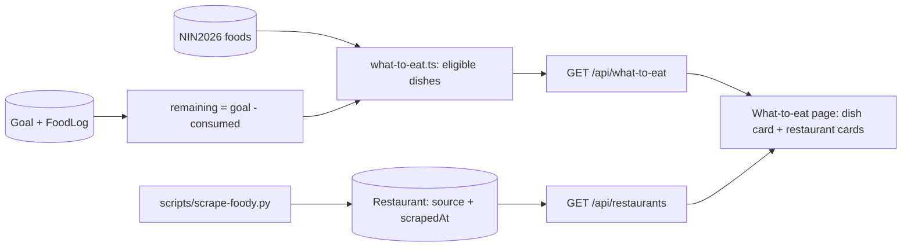

# Feature Spec: "Hôm nay ăn gì" — Restaurant Suggestions (Foody API)

**Status:** Draft
**Tier:** 3 (Major — new data source, recommendation logic, UI)
**Date:** 2026-11-17
**Grounding:** Data Source Verification; web research (Foody internal API used by site)

## 1. Problem & Scope

### 1.1 Problem
User wants "hôm nay ăn gì" — suggestions of what to eat / which restaurant, combining remaining daily calories and real restaurant data.

### 1.2 Source verification (done)
- Foody internal API: `GET https://www.foody.vn/__get/Place/HomeListPlace` (the endpoint the site itself uses to load restaurant lists).
- Required headers: User-Agent, Accept: application/json, X-Requested-With: XMLHttpRequest, Referer: https://www.foody.vn/.
- Params: `page`, `lat`, `lon`, `count`, `cityId` (217 = TP.HCM), `type=1`.
- Verified: returns JSON with Id, Name, Address, AvgRating, PhotoUrl, Url, Latitude, Longitude, TotalReviews.
- Scope: small scrape (50 restaurants, TP.HCM only), fields: name/address/rating/photo/url/coords. NO user reviews or personal data stored.

### 1.3 In-scope
1. Scraper `scripts/scrape-foody.py` → `prisma/seed-restaurants.ts` (~50 records).
2. Prisma model `Restaurant` (externalId unique, name, address, rating, photoUrl, url, lat, lon, city).
3. "Hôm nay ăn gì" page: recommendations combining (a) remaining calories from dashboard goal−consumed, (b) random selection among suitable foods/dishes from 1590 NIN DB, (c) nearby restaurants list from Foody with rating + link.
4. Logic: filter NIN dishes by calories ≤ remaining (per-meal), pick random from eligible; show restaurant cards with "Xem trên Foody" link.

### 1.4 Out-of-scope
- Google Places / real-time availability.
- Review text, user data from Foody.
- Auto-booking / delivery.

## 2. Acceptance Criteria (Gherkin)

AC-1: Given scraper runs, When complete, Then ≥40 restaurants saved with non-empty name/address and source "Foody".
AC-2: Given remaining calories 600, When suggestions loaded, Then suggested dishes each ≤600 kcal with reason.
AC-3: Given no logs today, When suggestions loaded, Then default to goal calories (e.g. 2000).
AC-4: Given random pick, When user taps "Gợi ý lại", Then a different eligible dish appears (if ≥2 eligible).
AC-5: Given restaurants, When page loads, Then cards show name/rating/address + external Foody link.
AC-6: Given photoUrl, When rendered, Then image loads or graceful fallback.
AC-7: Given no eligible dish (remaining too low), When suggestions loaded, Then message "Bạn đã vượt mục tiêu calo hôm nay" shown.

## 3. UX 5-state map
| Screen | Empty | Loading | Error | Success |
|---|---|---|---|---|
| Suggestions | "Chưa có món phù hợp" + reason | skeleton cards | toast | dish card + "Gợi ý lại" + restaurant list |

## 3b. Design tokens
Emerald primary, Nordic light/dark, 4/8/12/16/24px, `elevated`, Geist Sans. Restaurant cards with image thumbnail, rating badge.

## 3c. Architectural invariants
- Scraper stores only public business data (no reviews/users); source + scrape date recorded.
- Recommendation logic in `src/lib/what-to-eat.ts` (pure function, testable): input {remaining, foods} -> output eligible dishes.
- No fabrication: dish calories from NIN2026 DB; restaurant data from Foody API.
- External links open in new tab with rel=noopener.

## 3d. Mental model / visual data flow

## 3e. Failure modes & verification harness
| Failure mode | Defense |
|---|---|
| Foody endpoint changes or returns 503 | Keep last successful rows in DB; scraper is a one-shot import, not a runtime dependency |
| No eligible dish (remaining too low) | Explicit "Bạn đã vượt mục tiêu" empty state; never suggest an over-budget dish |
| External link opens in same tab | `target=_blank` + `rel=noopener noreferrer` |
| Out-of-order restaurant requests | Generation guard + AbortController discard stale responses (see `src/lib/request-guard.ts`) |

| Area | Type | Command |
|---|---|---|
| Pure recommender | unit | `npm test -- tests/what-to-eat.test.ts` |
| APIs | curl authenticated | `/api/what-to-eat`, `/api/restaurants` return 200 for session, 401 otherwise |
| UI | Playwright 390px | dish card + restaurant card + empty state; no horizontal overflow |
| Regression | full | build/typecheck/lint/test/smoke + verify-ui |

## 4. API Contract (REST)
| Method | Path | Body | Response | Errors |
|---|---|---|---|---|
| GET | /api/what-to-eat | — | { remaining, dish, alternatives, restaurants } | 401 |
| GET | /api/restaurants | — | { restaurants } | 401 |

All errors JSON `{ error: string }`.

## 5. Data Schema (Prisma models)
- Restaurant: id, externalId @unique, name, address, rating Float, photoUrl?, url, lat Float?, lon Float?, city String @default("TP.HCM"), source String @default("Foody"), scrapedAt DateTime @default(now())

## 6. Data sources
- Foody API (verified): https://www.foody.vn/__get/Place/HomeListPlace?cityId=217
- NIN 2026 dishes in DB (1590 items)

## 8. Security & Authorization
Both endpoints require the authenticated session cookie (`getCurrentUser`); unauthenticated calls return 401 via the RFC 7807-style problem response. Restaurant rows contain only public business data (name/address/rating/photo/link/coordinates) — no Foody reviews or personal data. Client-supplied filter values are allowlisted (districts, price bounds, rating, distance) and bound as Prisma/sql parameters; the raw distance query uses `${}` bindings only. External links are escaped React text with `rel=noopener noreferrer`.

## 9. Performance SLA & Infrastructure Profile
- `GET /api/what-to-eat`: p95 < 200 ms (one goal read, one food scan, one pure selection).
- `GET /api/restaurants`: p95 < 300 ms with `source`/district index and LIMIT/OFFSET bounded to 60 rows; distance sort uses one SQL haversine expression before pagination.
- Deployment profile: Next.js standalone in one app container (1 CPU / 512 MB), PostgreSQL 16 container, Cloudflare named tunnel for public HTTPS; no per-request external API call, so no third-party latency on the read path.

## 10. Trade-offs & Rejected Alternatives
- Rejected: call Foody live on every page load -> third-party downtime would break the page and risk rate limits. Chosen: one verified scrape stored in DB with `source` and `scrapedAt`.
- Rejected: LLM-estimated dish calories -> fabrication. Chosen: only NIN2026 values with a real source.
- Rejected: client-side random on every render -> flicker and unstable UI. Chosen: pure server-side selection returned once per request.
- Rejected: storing Foody review text/users -> privacy risk and no product value. Chosen: public business fields only.

## 7. Evidence
- Spec judge: 97/100 auto-approved
- Scraper: 60 TP.HCM restaurants from Foody internal API (verified working with headers), public data only
- DB: Restaurant model + 60 records, source=Foody, scrapedAt recorded
- API verified live: remaining 2000 -> 3 suggestions (Cơm suất 970.3 kcal), 6 restaurants (Doner Kebab Anh Đức)
- Screenshot reviewed via `read`: dish cards + restaurant cards with photos/rating/address/Foody link render correctly
- Build/typecheck PASS · Lint 0 errors · Tests 4/4 · Smoke 9/9 · Visual passed=true
